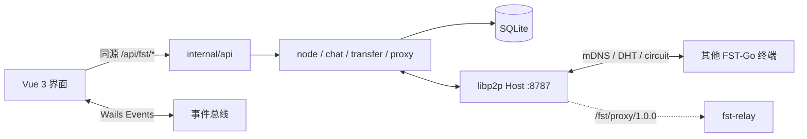

<div align="center">
# FST-Go

**File Safe Transfer** — 文件安全传输。

用 Go 实现的局域网 / 跨网络 P2P 桌面程序：点对点传文件、聊天，以及可选的自建出网代理。无账号、无中心业务服务器。每台电脑既是客户端也是完整节点；局域网自动发现，跨网段只需要你自己的一台中继。

</div>

## 本程序仅供学习参考之用，请勿用于非法用途，希望对你有帮助，但作者本人不提供任何担保。

| 名称 | 含义 |
|---|---|
| **FST** | **F**ile **S**afe **T**ransfer，文件安全传输 |
| **Go** | 后端与节点用 Go 编写，也表示把文件「送出去」 |

仓库与命令行里仍使用短名 `fst`（例如 `fst.exe`、`fst-relay`、协议 ID `/fst/...`），与产品名 FST-Go 是同一项目。

[](LICENSE)
[](https://go.dev/)
[](https://vuejs.org/)
[](https://libp2p.io/)

当前发布形态：**Windows 桌面端**（`fst.exe`）+ **Linux 无头中继**（`fst-relay`）。本仓库以 [GNU Affero General Public License v3.0](LICENSE) 发布。

---

## 目录

- [它解决什么问题](#它解决什么问题)
- [功能](#功能)
- [特点](#特点)
- [架构](#架构)
- [模块](#模块)
- [协议](#协议)
- [开源组件](#开源组件)
- [运行环境](#运行环境)
- [编译桌面端](#编译桌面端)
- [打包与分发](#打包与分发)
- [中继：编译、部署与设置](#中继编译部署与设置)
- [终端如何连上中继](#终端如何连上中继)
- [网络代理（可选）](#网络代理可选)
- [配置与数据目录](#配置与数据目录)
- [开发与测试](#开发与测试)
- [现状与限制](#现状与限制)
- [许可证](#许可证)

---

## 它解决什么问题

常见网盘、即时通讯和商业 VPN 都把流量、文件和通讯录放在别人的服务器上。办公室、家庭局域网、或两台都在 NAT 后面的电脑，往往只想：

1. **同一网段互相看见、发消息、传文件**，不要注册、不要公网账号。
2. **不在同一网段时**，用自己的一台 VPS 当“介绍人 / 转发人”，而不是把文件存到云盘。
3. 需要时，让本机部分或全部上网流量 **经自己的中继出网**（类似自建出口），而不是再装一套无关的代理栈。

FST-Go 把这三件事放进同一个进程、同一个端口：设备身份是 libp2p PeerID，发现、聊天、文件和代理都在加密连接上多路复用。文件走端到端加密信道、整文件 SHA-256 校验、断点续传，不经过第三方网盘。

---

## 功能

| 能力 | 说明 |
|---|---|
| 设备发现 | 局域网 mDNS 自动上线；跨网靠中继目录 + 私有 DHT，可用完整 multiaddr、PeerID+中继或仅 PeerID 添加 |
| 点对点聊天 | 加密信道、本地存档、送达 ACK、未读、富文本；图片按文件通道发送 |
| 文件传输 | 多选 / 拖到设备卡片、确认弹窗、信任或自动接收、并发 1–8、`.fstpart` 断点续传、整文件 SHA-256 |
| 跨网络 | AutoNAT、DCUtR 打洞、Circuit Relay；打洞成功后丢掉中继冗余连接，升级直连 |
| 自建中继 | `fst-relay`：电路中继 + 在线目录 + DHT Server；可选 TCP/UDP 出网出口（PeerID 白名单） |
| 出网代理 | TUN 分流（CIDR / 域名）或全局；IPv4 TCP+UDP；本机 SOCKS5 入站（无需管理员也可给浏览器用） |
| 桌面集成 | 托盘、关闭行为（询问 / 托盘 / 退出）、系统通知、开机自启、单实例或多实例 |

---

## 特点

- **身份是 PeerID，不是 IP / MAC。** 私钥在 `%APPDATA%\FST\identity.key`，昵称和地址可变，设备主键不变。
- **单端口 8787**（TCP + QUIC/UDP 同号）。聊天、文件、代理都走 libp2p stream，不为业务再开公网端口。
- **文件字节不进前端。** Vue 只拿到本地路径；读写、哈希、进度都在 Go 里，进度事件节流推送。
- **无中心业务库。** 聊天和传输历史只存在本机 SQLite，节点之间不同步消息。
- **加密不自研。** 应用层消息走 libp2p 安全通道（TCP 上 Noise/TLS，QUIC 自带）。
- **出口 fail-closed。** 中继开 `-exit` 但白名单为空时，谁也不能拿这台机器当代理。
- **中继可完全自建。** 项目不内置公共中继；你填谁的地址，流量才经过谁。

---

## 架构



桌面端启动后：打开数据目录 → 加载或生成身份 → 建 libp2p Host → 挂聊天与传输 → 按配置可选启动 TUN/SOCKS5 → Wails 窗口把 `front/dist` 嵌进去，`/api/*` 由 Go 处理。

---

## 模块

| 路径 | 职责 |
|---|---|
| `main.go` / `instance.go` / `config.go` | 窗口、托盘、实例目录、`config.yaml` |
| `internal/api` | `/api/fst/*`，`{code,message,data}` 信封 |
| `internal/node` | Host、mDNS、DHT、中继预约、HELLO、在线状态 |
| `internal/chat` | 聊天收发、落库、ACK |
| `internal/transfer` | 文件 offer、流式拷贝、续传、校验、进度 |
| `internal/store` | SQLite（WAL，纯 Go 驱动） |
| `internal/proto` | 协议 ID、JSON 分帧 |
| `internal/proxy` | 出口 Client、TUN、路由绕行、fake-IP DNS、SOCKS5 |
| `internal/e2e` | 进程内多节点集成测试 |
| `cmd/fst-relay` | 无头中继入口 |
| `front/src/views/fst` | 设备 / 聊天 / 传输 / 设置 |
| `front/src/store/modules/fst.ts` | 唯一的 Wails 事件订阅点 |

---

## 协议

应用层协议定义在 `internal/proto`。底层连接由 libp2p 负责（多地址、加密、多路复用）。

| 协议 ID | 用途 | 帧格式 |
|---|---|---|
| `/fst/msg/1.0.0` | 控制与聊天：HELLO、CHAT、CHAT_ACK、FILE_OFFER/ACCEPT/REJECT/CANCEL、ERROR | uvarint 长度 + JSON，单帧 ≤ 1 MiB |
| `/fst/file/1.0.0` | 单文件内容 | JSON `FileHeader` → 裸字节 `[offset,size)` → 32 字节 SHA-256 → JSON `FileResult` |
| `/fst/proxy/1.0.0` | 经中继出网 | JSON `ProxyReq/Resp`；TCP 之后双向拷贝；UDP 之后为 2 字节大端长度前缀数据报 |
| mDNS 服务名 `fst` | 局域网发现 | UDP 5353 多播 |
| 私有 Kademlia `/fst` | 按 PeerID 查地址 | 仅 peer routing，不上公共 DHT |

HELLO 里：普通节点带已连对端的局域网 multiaddr（peer exchange）；**只有中继**填写 `Directory`（在线终端 PeerID），终端只采信自己配置的中继发来的目录。

UI 与 Go 之间 **不是** libp2p：同源 HTTP `/api/fst/*`（业务错误 HTTP 200 + `code: 400`）+ Wails 事件（`peer:*`、`chat:*`、`transfer:*`、`proxy:status` 等）。

---

## 开源组件

直接依赖（版本以 `go.mod` / `front/package.json` 为准）：

| 组件 | 用途 |
|---|---|
| [go-libp2p](https://github.com/libp2p/go-libp2p) v0.50 | PeerID、mDNS、Noise/TLS、yamux、TCP+QUIC、AutoNATv2、DCUtR、Circuit Relay |
| [go-libp2p-kad-dht](https://github.com/libp2p/go-libp2p-kad-dht) | 私有 DHT |
| [Wails v3](https://wails.io/) `v3.0.0-beta.29` | 桌面壳、托盘、原生对话框、拖放、嵌入前端 |
| [tun2socks](https://github.com/xjasonlyu/tun2socks) v2.6 + [gVisor](https://gvisor.dev/) | TUN 用户态协议栈 |
| [golang.zx2c4.com/wireguard](https://git.zx2c4.com/wireguard-go) / [Wintun](https://www.wintun.net/) | Windows TUN 网卡（需官方签名 `wintun.dll`） |
| [modernc.org/sqlite](https://gitlab.com/cznic/sqlite) | 纯 Go SQLite，运行时无 CGO |
| [yaml.v3](https://github.com/go.yaml/yaml) | `config.yaml` |
| Vue 3.5、Vite 8、Element Plus、Tailwind CSS v4、Pinia、vue-router、axios、wangEditor、DOMPurify | 界面与构建 |

第三方库保留各自许可证。本仓库源码以 AGPLv3 覆盖。

---

## 运行环境

**桌面端**

- Windows 10/11 x64
- [WebView2](https://developer.microsoft.com/microsoft-edge/webview2/)（Win11 通常已带）
- 局域网：防火墙放行 **TCP/UDP 8787**、**UDP 5353**（mDNS）；关闭路由器 AP/客户端隔离
- 跨网络：再放行到中继的 8787，并在设置里打开「允许跨网络」
- TUN 代理：管理员权限 + exe 旁的 `wintun.dll`

**中继**

- 公网 IPv4 的 Linux（当前 deb 为 amd64）
- 安全组 / `ufw` 放行 **TCP 8787 与 UDP 8787**

---

## 编译桌面端

需要：Go 1.26+、Node 22+、[pnpm](https://pnpm.io/)、[Wails v3 CLI](https://v3.wails.io/)（与 `go.mod` 中 Wails 版本一致）。

```powershell
go install github.com/wailsapp/wails/v3/cmd/wails3@v3.0.0-beta.29
$env:Path += ";$(go env GOPATH)\bin"

cd front
pnpm install
cd ..

# 覆盖 bin\fst.exe 前先结束正在运行的进程
Stop-Process -Name fst -ErrorAction SilentlyContinue
wails3 build
```

产物：`bin/fst.exe`，以及从 `build/windows/wintun/` 复制过去的 `bin/wintun.dll`。前端已经嵌进 exe，分发不必带 `front/`。

开发热重载（不写 `bin/`）：

```powershell
wails3 dev
```

同机开第二个实例（独立身份与端口）：

```powershell
$env:FST_DATA_DIR = "D:\fst-dev-2"
$env:FST_PORT = "8788"
```

---

## 打包与分发

把 FST-Go 拷到另一台 Windows，**只需要 `bin/fst.exe`**（若要用 TUN 代理，再带上同目录的 `wintun.dll`）。不要拷 `%APPDATA%\FST\`：那里的 `identity.key` 是设备身份，两台机器共用会 PeerID 冲突。

可选安装包（需本机安装 [NSIS](https://nsis.sourceforge.io/)）：

```powershell
wails3 package
```

会把 WebView2 引导程序打进安装包。没有 NSIS 时，直接分发 exe 即可。

---

## 中继：编译、部署与设置

中继 **没有界面、不做 mDNS**。它做三件事：Circuit Relay（NAT 后的两台终端互相转发）、私有 DHT、把连上它的 FST-Go 终端 PeerID 写进 HELLO 目录。加上 `-exit` 后，还可以当出网出口。

### 在 Windows 上交叉编译并打 deb

```powershell
$env:GOOS = "linux"
$env:GOARCH = "amd64"
$env:CGO_ENABLED = "0"
go build -trimpath -ldflags "-s -w" -o bin/fst-relay-linux-amd64 ./cmd/fst-relay
Remove-Item Env:GOOS, Env:GOARCH, Env:CGO_ENABLED

$env:Path += ";$(go env GOPATH)\bin"
wails3 tool package -name fst-relay -format deb -config ./build/relay/nfpm.yaml -out ./bin
```

得到例如 `bin/fst-relay_0.1.3_amd64.deb`。

### 在 Linux 上安装

```bash
sudo ufw allow 8787/tcp
sudo ufw allow 8787/udp
sudo dpkg -i fst-relay_0.1.3_amd64.deb
sudo systemctl status fst-relay
journalctl -u fst-relay -e
```

deb 会把二进制装到 `/usr/bin/fst-relay`，单元文件到 `/lib/systemd/system/fst-relay.service`，postinstall 会 `enable --now`。数据目录默认 `/var/lib/fst-relay`（`identity.key` 决定 PeerID，换目录等于换身份）。

启动日志会打印应填进客户端的地址：

```text
/ip4/<服务器公网IP>/tcp/8787/p2p/<PeerID>
```

### 命令行参数

| 参数 | 默认 | 含义 |
|---|---|---|
| `-data` | `/var/lib/fst-relay` | 数据目录（身份与库） |
| `-port` | `8787` | TCP + UDP(QUIC) 监听端口 |
| `-name` | `fst-relay` | 终端设备列表里显示的名字 |
| `-exit` | 关 | 开启出网出口（必须配白名单才有人能用） |
| `-exit-allow` | 空 | 文件：每行一个终端 PeerID；空文件或省略 = 拒绝所有人 |

改端口等参数用 systemd drop-in（重装 deb 不会冲掉）：

```bash
sudo systemctl edit fst-relay
```

只在编辑区写入：

```ini
[Service]
ExecStart=
ExecStart=/usr/bin/fst-relay -data /var/lib/fst-relay -port 8787 -exit -exit-allow /etc/fst-relay/allow.txt
```

```bash
sudo mkdir -p /etc/fst-relay
sudo chmod 700 /etc/fst-relay
# allow.txt：每行一个终端 PeerID（设置页可复制）
sudo systemctl restart fst-relay
```

没有出口需求时，保持默认 `ExecStart=/usr/bin/fst-relay -data /var/lib/fst-relay -port 8787` 即可，聊天和传文件仍然走电路中继。

---

## 终端如何连上中继

1. 设置 → **允许跨网络**，中继地址填一行 `/ip4/<公网IP>/tcp/8787/p2p/<PeerID>`，保存后 **重启 FST-Go**。
2. 两台终端都连上同一中继后，设备页会出现中继卡片；目录下发成功则对方也会出现在「在线设备」。
3. 若列表里暂时只有中继：用「添加设备」→ 仅 PeerID（DHT）或 PeerID+中继。
4. 聊天点卡片「聊天」；文件点「发送文件」或把文件拖到卡片上。卡片显示「中继」表示正在走服务器转发，「直连」表示已经打洞或本来就能直连。

`config.yaml` 与 exe 放在同一目录（开发时也可放在项目根）。设置页保存会改写该文件，**跨网络与代理相关项重启后生效**。

```yaml
enable_relay: true
relays:
  - /ip4/<PUBLIC_IP>/tcp/8787/p2p/<RELAY_PEER_ID>
proxy:
  enable: false
  mode: split          # split | global
  exit: /ip4/<PUBLIC_IP>/tcp/8787/p2p/<RELAY_PEER_ID>
  routes:
    - 93.184.216.0/24
  domains:
    - example.com
```

---

## 网络代理（可选）

经 **同一条** `/fst/proxy/1.0.0` 流到 `fst-relay` 出网，不另开公网端口。

- **分流 `split`**：只把列出的 IPv4 CIDR 和/或域名（fake-IP `198.18.0.0/15`，DNS `198.18.0.2`）送进隧道。
- **全局 `global`**：默认路由进 TUN；局域网、系统 DNS、常用公共 DNS、中继 `/32` 走原网关，避免把内网和解析一起送进隧道。
- 协议：IPv4 TCP 与 UDP。AAAA 回 NODATA，逼流量走 IPv4。
- 出口拒绝环回、私网、链路本地；仅白名单里的终端 PeerID 可拨出口。
- TUN 需要管理员 + `wintun.dll`。代理开启时还会在 `127.0.0.1` 随机端口起 SOCKS5（CONNECT + UDP ASSOCIATE），供浏览器 `socks5h://` 使用，不强制走 TUN。

Windows 上以管理员启动 `fst.exe`。中继必须 `-exit` 且 `allow.txt` 含本机 PeerID，否则拨不出去。失败原因见设置页代理状态，以及 `%APPDATA%\FST\fst.log` / `journalctl -u fst-relay`。

---

## 配置与数据目录

| 位置 | 内容 |
|---|---|
| `%APPDATA%\FST\identity.key` | 设备身份，不要在同时在线的两台机器间共用 |
| `%APPDATA%\FST\fst.db` | 设备、聊天、传输、部分设置（WAL） |
| `%APPDATA%\FST\fst.log` | 日志 |
| `config.yaml`（exe 旁或项目根） | 跨网络开关、中继列表、代理 |
| 默认下载目录 | `%USERPROFILE%\Downloads\FST` |

整体搬家：退出 FST-Go 后拷贝整个 `%APPDATA%\FST\`。只是多装一台：只拷 exe，让它自己生成新身份。

环境变量：`FST_DATA_DIR`、`FST_PORT`、`FST_WAN=1`（强制开跨网络）。

---

## 开发与测试

```powershell
go test ./internal/...
cd front
npx vue-tsc --noEmit
```

协作约定见根目录 [AGENTS.md](AGENTS.md)。模块与缺口的详细说明见 [docs/开发文档.md](docs/开发文档.md)，架构见 [docs/项目架构分析报告.md](docs/项目架构分析报告.md)，中继排障见 [部署.md](部署.md)。

---

## 现状与限制

- 桌面端目前按 Windows 构建；macOS / Linux 桌面未作为发布目标（Linux 走无头中继）。
- 代理仅 IPv4；无 IPv6 目标、无代理链、无出口鉴权（只有 PeerID 白名单）。
- 同一中继上的终端默认互相可见，没有分组/令牌。
- 无群聊、无离线消息、不传文件夹。
- 对端离线时聊天不会暂存重投。

---

## 许可证

Copyright (C) 2026 FST-Go contributors.

本程序是自由软件：你可以在 [GNU Affero General Public License v3.0](LICENSE) 的条款下再分发和/或修改它。本程序仅供学习参考之用，请勿用于非法用途，希望对你有帮助，但不提供任何担保。

若你修改后通过网络提供服务（例如公网运行改过的 `fst-relay`），AGPLv3 要求你向使用该服务的用户提供对应完整源码。依赖库仍按其原许可证使用。
