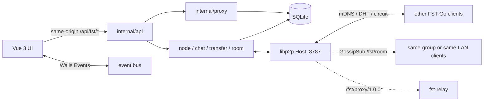

[**English**](README.md) | [简体中文](README_zh.md) | [日本語](README_ja.md)

# FST-Go

**File Safe Transfer** — secure file transfer.

A P2P desktop application for LAN and cross-network use, written in Go: peer-to-peer file transfer, chat, and an optional self-hosted egress proxy. No accounts, no central business server. Every machine is both a client and a full node: peers on the same LAN are discovered automatically, and crossing network boundaries only requires one relay of your own.


### This program is provided for learning and reference only. Do not use it for illegal purposes. It is meant to be helpful, but the author provides no warranty of any kind.

| Name | Meaning |
|---|---|
| **FST** | **F**ile **S**afe **T**ransfer |
| **Go** | Backend and node are written in Go; it also suggests "sending files out" |

The repository and CLI still use the short name `fst` (for example `fst.exe`, `fst-relay`, protocol IDs under `/fst/...`); it is the same project as the product name FST-Go.

[](LICENSE)
[](https://go.dev/)
[](https://vuejs.org/)
[](https://libp2p.io/)

Current release form: **Windows desktop** (`fst.exe`) + **headless Linux relay** (`fst-relay`). This repository is released under the [MIT License](LICENSE).

---

## Contents

- [The problem it solves](#the-problem-it-solves)
- [Features](#features)
- [Design highlights](#design-highlights)
- [Architecture](#architecture)
- [Modules](#modules)
- [Protocols](#protocols)
- [Open-source components](#open-source-components)
- [Requirements](#requirements)
- [Building the desktop app](#building-the-desktop-app)
- [Packaging and distribution](#packaging-and-distribution)
- [Relay: build, deploy and configure](#relay-build-deploy-and-configure)
- [Relay groups and exit authorization](#relay-groups-and-exit-authorization)
- [How a client connects to a relay](#how-a-client-connects-to-a-relay)
- [Network proxy (optional)](#network-proxy-optional)
- [Headless service mode (fst serve)](#headless-service-mode-fst-serve)
- [Configuration and data directory](#configuration-and-data-directory)
- [Development and testing](#development-and-testing)
- [Status and limitations](#status-and-limitations)
- [License](#license)

---

## The problem it solves

Common cloud drives, instant messengers, and commercial VPNs keep your traffic, files, and contacts on someone else's servers. Offices, home LANs, and two machines that are both behind NAT often just want to:

1. **See each other, exchange messages, and transfer files on the same subnet** — no registration, no public accounts.
2. **When not on the same subnet**, use one of your own VPSes as the introducer/forwarder instead of uploading files to a cloud drive.
3. **When needed, route some or all of this machine's traffic through your own relay** (a self-hosted egress) instead of installing an unrelated proxy stack.

FST-Go puts these three things into one process and one service port: device identity is a libp2p PeerID, and discovery, chat, files, and proxying are all multiplexed over encrypted connections. Files travel over end-to-end encrypted channels with whole-file SHA-256 verification and resumable transfers, never through a third-party cloud drive.

---

## Features

| Capability | Description |
|---|---|
| Device discovery | Automatic LAN peering via mDNS; across networks via relay directory + private DHT; add peers by full multiaddr, PeerID + relay, or PeerID alone |
| Peer-to-peer chat | Encrypted channel, local archive, delivery ACK, unread counts, rich text (≤32,000 characters per message); text / image / file-card bubbles; recall within 2 minutes; avatars synced via HELLO |
| Offline messages | When the peer is offline or times out, messages become "queued"; scanned every 15 seconds and retried with exponential backoff (capped at 10 minutes / 20 attempts), flushed immediately when the peer comes online; manual retry from the bubble |
| Group chat | Automatic GossipSub rooms: one room per LAN, plus a same-group room once a relay group key is configured; text only, local history, de-duplicated by message ID; reuses 8787, no extra port |
| File transfer | Multi-select / drag onto a device card, confirmation dialog, trusted or auto-accept, concurrency 1–8, `.fstpart` resume, whole-file SHA-256, global rate limit, pre-hash skip, continue the batch after failures |
| Folder transfer | Recursive directory send with relative structure and empty directories preserved; ≤1000 files per batch, larger sets split automatically; symlinks/special files reported before sending |
| Cross-network | AutoNAT, DCUtR hole punching, Circuit Relay; after a successful punch the redundant relay connection is dropped and upgraded to direct |
| Self-hosted relay | `fst-relay`: circuit relay + online directory + DHT server; group isolation, group expiry, per-group soft limits |
| Exit authorization | `-exit-allow` PeerID allowlist, `-exit-token` multiple tokens with expiry, `-exit-group` group restriction, intersected; all unconfigured keeps the previous behavior |
| Egress proxy | TUN split (CIDR / domain) or global; IPv4 TCP+UDP, optional experimental IPv6; local SOCKS5 inbound (default `127.0.0.1:20300`) |
| SOCKS5 hardening | Optional RFC1929 credentials, source CIDR allowlist, per-IP/global concurrency caps; without credentials it stays loopback-only and unauthenticated |
| Desktop integration | Tray, close behavior (ask / tray / quit), system notifications, autostart, single or multiple instances |
| Engineering foundation | `user_version` schema migrations, offline icons, zh/en strings for the four feature pages |

---

## Design highlights

- **Identity is a PeerID, not an IP / MAC.** The private key lives in `%APPDATA%\FST\identity.key`; nicknames and addresses may change, the device key does not.
- **Single service port 8787** (TCP + QUIC/UDP on the same number). Chat, files, and proxying all use libp2p streams; no extra public port for features. The only exception is the local SOCKS5 inbound (default `127.0.0.1:20300`, loopback only).
- **File bytes never enter the frontend.** Vue only receives local paths; I/O, hashing, and progress stay in Go, with throttled progress events; chat image/file cards carry only a transfer ID.
- **No central business database.** Chat and transfer history live only in local SQLite; nodes do not sync messages; schema upgrades go through `user_version` migrations.
- **No home-grown crypto.** Application messages use libp2p secure channels (Noise/TLS over TCP, built into QUIC).
- **Exit is fail-closed.** If a relay enables `-exit` with an empty allowlist, nobody can use that machine as a proxy; tokens are compared by digest and never logged in plaintext.
- **Fully self-hosted relay.** No public relay is bundled; traffic only goes through the relay whose address you configure.
- **High-risk features are off by default.** Proxy IPv6, LAN-origin SOCKS5, and unconfigured exit tokens behave exactly like older versions.

---

## Architecture



After the desktop app starts: open the data directory → migrate SQLite → load or create identity → build the libp2p Host → attach chat, transfer, and group chat → optionally start SOCKS5/TUN from config → the Wails window embeds `front/dist`, and `/api/*` is served by Go.

---

## Modules

| Path | Responsibility |
|---|---|
| `main.go` / `instance.go` / `config.go` | Window, tray, instance directory, `config.yaml`, proxy assembly |
| `internal/api` | `/api/fst/*`, the `{code,message,data}` envelope, read-only media endpoint |
| `internal/node` | Host, mDNS, DHT, relay reservations, HELLO/directory, presence, group table, avatars |
| `internal/chat` | Chat send/receive, kind/attach, recall, offline queue with exponential backoff, persistence, ACK |
| `internal/room` | GossipSub group chat: automatic rooms, topic derivation, LAN direct-connection checks, local history |
| `internal/transfer` | File/folder offers, automatic batching, streaming copy, resume, verification, rate limit, pre-hash, progress |
| `internal/store` | SQLite (WAL, pure-Go driver), `user_version` migrations |
| `internal/proto` | Protocol IDs, JSON framing, message structs |
| `internal/proxy` | Exit client, TUN, route bypass, fake-IP DNS, SOCKS5, exit tokens, IPv6 |
| `internal/e2e` | In-process multi-node integration tests |
| `cmd/fst-relay` | Headless relay/exit entry point |
| `front/src/views/fst` | Devices / Chat / Transfers / Settings |
| `front/src/api/fst` + `types/api/fst.d.ts` | The single business HTTP wrapper and type contract |
| `front/src/store/modules/fst.ts` | The single Wails event subscription point |

---

## Protocols

Application protocols are defined in `internal/proto`. The underlying transport is handled by libp2p (multiaddrs, encryption, multiplexing).

| Protocol ID | Purpose | Frame format |
|---|---|---|
| `/fst/msg/1.0.0` | Control and chat: HELLO, CHAT, CHAT_ACK, CHAT_RECALL, FILE_OFFER/ACCEPT/REJECT/CANCEL, ERROR | uvarint length + JSON, single frame ≤ 1 MiB |
| `/fst/file/1.0.0` | Single file content | JSON `FileHeader` → raw bytes `[offset,size)` → 32-byte SHA-256 → JSON `FileResult` |
| `/fst/proxy/1.0.0` | Egress through a relay | JSON `ProxyReq/Resp`; bidirectional copy after TCP; 2-byte big-endian length-prefixed datagrams after UDP |
| GossipSub `fst/room/1.0.0/<room>` | Group chat broadcast | Signed JSON `RoomMsg`; `lan` is the LAN room, `g-<hash>` is a group room (the hash does not reveal the key) |
| mDNS service name `fst` | LAN discovery | UDP 5353 multicast |
| Private Kademlia `/fst` | Address lookup by PeerID | Peer routing only, never joins the public DHT |

In HELLO: regular nodes carry LAN multiaddrs of already-connected peers (peer exchange); **only relays** fill in `Directory` (online client PeerIDs), and clients only trust directories from relays they configured; `group` is sent only to the configured relay, whose reply carries `group_name` / `group_expires` / `group_error`. Avatars carry only a small base64 image (≤16KB base64), never file bytes.

Private chat adds the `queued` state (pending send): when the peer is offline or times out, the message enters the local queue and is retried with backoff; `chat:ack` pushes state changes, and `POST /messages/{id}/retry` retries manually. Group messages are sent only over GossipSub and never enter `/fst/msg`; the LAN room only accepts messages whose original sender is a directly connected, non-circuit neighbor.

`FileInfo` is `{id,name,size,rel_path?,sha256?}`; `rel_path` is used for folder transfers and must be sanitized by the receiver as untrusted input. `ProxyReq` is `{net,addr,port,family?,token?}`; `family` explicitly declares `ip4`/`ip6`, and the exit never guesses dual-stack.

UI ↔ Go is **not** libp2p: same-origin HTTP `/api/fst/*` (business errors: HTTP 200 + `code: 400`) plus Wails events (`peer:*`, `chat:*`, `transfer:*`, `proxy:status`, etc.).

---

## Open-source components

Direct dependencies (versions per `go.mod` / `front/package.json`):

| Component | Purpose |
|---|---|
| [go-libp2p](https://github.com/libp2p/go-libp2p) v0.50 | PeerID, mDNS, Noise/TLS, yamux, TCP+QUIC, AutoNATv2, DCUtR, Circuit Relay |
| [go-libp2p-kad-dht](https://github.com/libp2p/go-libp2p-kad-dht) v0.42 | Private DHT |
| [go-libp2p-pubsub](https://github.com/libp2p/go-libp2p-pubsub) v0.18 | GossipSub group chat broadcast |
| [Wails v3](https://wails.io/) `v3.0.0-beta.29` | Desktop shell, tray, native dialogs, drag and drop, embedded frontend |
| [tun2socks](https://github.com/xjasonlyu/tun2socks) v2.6 + [gVisor](https://gvisor.dev/) | User-space TUN stack |
| [golang.zx2c4.com/wireguard](https://git.zx2c4.com/wireguard-go) / [Wintun](https://www.wintun.net/) | Windows TUN adapter (requires the officially signed `wintun.dll`) |
| [modernc.org/sqlite](https://gitlab.com/cznic/sqlite) v1.60 | Pure-Go SQLite, no CGO at runtime |
| [yaml.v3](https://github.com/go.yaml/yaml) v3.0.5 | `config.yaml` |
| Vue 3.5, Vite 8, Element Plus 2.13, Tailwind CSS v4, Pinia, vue-router, axios, wangEditor, DOMPurify, Iconify | UI, build, and offline icons |

Third-party libraries keep their own licenses. This repository's source is covered by MIT.

---

## Requirements

**Desktop**

- Windows 10/11 x64
- [WebView2](https://developer.microsoft.com/microsoft-edge/webview2/) (usually preinstalled on Windows 11)
- LAN: allow **TCP/UDP 8787** and **UDP 5353** (mDNS) through the firewall; disable AP/client isolation on the router
- Cross-network: also allow 8787 to the relay, and enable "Allow cross-network" in settings
- TUN proxy: administrator rights + `wintun.dll` next to the exe
- SOCKS5 inbound: no administrator rights, no `wintun.dll`; listens on loopback by default
- Linux desktop (verified on Ubuntu 24.04): GTK4 + WebKitGTK 6.0 runtime libraries; the TUN proxy needs root / `CAP_NET_ADMIN` and `/dev/net/tun`

**Service mode (fst serve)**

- Any modern browser (desktop / Android / iOS); the backend can share a machine with the desktop app
- Binds `127.0.0.1:9797` by default; when exposed to the LAN, allow **TCP** on the chosen port

**Relay**

- Linux with a public IPv4 (the current deb is amd64)
- Security group / `ufw`: allow **TCP 8787 and UDP 8787**
- Exit mode also needs outbound TCP/UDP from the relay to the target

---

## Building the desktop app

Requirements: Go 1.26+, Node 22+, [pnpm](https://pnpm.io/), [Wails v3 CLI](https://v3.wails.io/) (matching the Wails version in `go.mod`).

```powershell
go install github.com/wailsapp/wails/v3/cmd/wails3@v3.0.0-beta.29
$env:Path += ";$(go env GOPATH)\bin"

cd front
pnpm install
cd ..

# stop the running process before overwriting bin\fst.exe
Stop-Process -Name fst -ErrorAction SilentlyContinue
wails3 build
```

Artifacts: `bin/fst.exe` plus `bin/wintun.dll` copied from `build/windows/wintun/`. The frontend is embedded in the exe, so you do not need to ship `front/`.

For the service mode, also build a **console-subsystem** binary (logs print straight to the terminal — recommended for command-line use):

```powershell
go build -o bin\fst-serve.exe .
```

### Running

**Desktop `fst.exe`** (GUI subsystem):

1. Double-click `bin\fst.exe`, or run `.\fst.exe` in a terminal (no arguments starts the GUI).
2. Quit via the tray icon or the window close button.

**Service mode `fst-serve.exe`** (console subsystem):

```powershell
cd bin
.\fst-serve.exe serve                      # default http://127.0.0.1:9797, local only
.\fst-serve.exe serve -addr 0.0.0.0:9797   # expose to the LAN (allow TCP)
```

1. On startup the terminal prints a banner: **access URL / access token (64 hex chars) / data directory**, followed by live logs.
2. Open the URL in a browser and enter the token once to get the full desktop-equivalent UI (session cookie lasts 30 days).
3. Stop: press **Ctrl+C** in the terminal (graceful shutdown); for background processes use `Stop-Process -Name fst-serve`.
4. Forgot the token: search `token=` in the data directory's `fst.log`, or delete the `web_token` row in the SQLite `settings` table and restart to regenerate.
5. Note: serve and the desktop app share the same data directory and port 8787 — **only one can run at a time**; to run both, isolate with `FST_DATA_DIR` / `FST_PORT` (see below).

> `fst.exe serve` also starts the service (GUI subsystem, output via console attachment), but for terminal use `fst-serve.exe` is the most predictable.

Development with hot reload (does not write `bin/`):

```powershell
wails3 dev
```

Run a second instance on the same machine (separate identity and port):

```powershell
$env:FST_DATA_DIR = "D:\fst-dev-2"
$env:FST_PORT = "8788"
```

### Linux desktop (verified on Ubuntu 24.04 LTS)

The desktop app depends on GTK4 + WebKitGTK (C libraries, CGO required), so it **cannot** be cross-compiled with `GOOS=linux`; build it on Linux:

```bash
# system dependencies
sudo apt update
sudo apt install -y build-essential pkg-config curl git
sudo apt install -y build-essential pkg-config libgtk-4-dev libwebkitgtk-6.0-dev

# toolchain: Go 1.26+, Node 22+, pnpm (install per their official docs)
go install github.com/wailsapp/wails/v3/cmd/wails3@latest
export PATH=$PATH:$(go env GOPATH)/bin

# frontend (alternatively build it on Windows and copy front/dist over; embed requires it to exist)
cd front
pnpm install
pnpm build
cd ..

# build
wails3 build
```

Artifact: `bin/fst`.

The service mode (headless, browser access) can additionally be built as a console binary, or run directly via `./bin/fst serve` on a machine with the dependencies installed:

```bash
go build -o bin/fst-serve .
./bin/fst-serve serve          # default 127.0.0.1:9797, full UI in the browser
```

> Like the desktop build this requires the GTK development libraries; on a bare server, build elsewhere and copy the binary over (see the systemd example in the service-mode section below).

- Ubuntu 22.04 lacks WebKitGTK 6.0; use the GTK3 stack instead: `sudo apt install -y libgtk-3-dev libwebkit2gtk-4.1-dev`, and build with `-tags gtk3`. Ubuntu 20.04 and older are not supported.
- glibc compatibility: a binary built on one release only runs on that release or newer; if your targets include 22.04, build on 22.04.
- The TUN proxy requires root / `CAP_NET_ADMIN` and `/dev/net/tun`; the SOCKS5 inbound (`127.0.0.1:20300`) needs no privileges.
- Verify in an X11 session first; WebKitGTK has known compatibility issues under Wayland.

---

## Packaging and distribution

To run FST-Go on another Windows machine you only need `bin/fst.exe` (add `wintun.dll` from the same directory if you want the TUN proxy). Do not copy `%APPDATA%\FST\`: the `identity.key` there is the device identity, and sharing it between two machines that are online at the same time causes a PeerID conflict.

Optional installer (requires [NSIS](https://nsis.sourceforge.io/) on the build machine):

```powershell
wails3 package
```

This bundles the WebView2 bootstrapper. Without NSIS, just distribute the exe.

---

## Relay: build, deploy and configure

The relay has **no UI and no mDNS**. It does three things: Circuit Relay (forwarding between two NATed clients), private DHT, and writing the PeerIDs of connected FST-Go clients into the HELLO directory. With `-exit` it can also act as an egress.

### Cross-compiling and building a deb on Windows

```powershell
$env:GOOS = "linux"
$env:GOARCH = "amd64"
$env:CGO_ENABLED = "0"
go build -trimpath -ldflags "-s -w" -o bin/fst-relay-linux-amd64 ./cmd/fst-relay
Remove-Item Env:GOOS, Env:GOARCH, Env:CGO_ENABLED

$env:Path += ";$(go env GOPATH)\bin"
wails3 tool package -name fst-relay -format deb -config ./build/relay/nfpm.yaml -out ./bin
```

This produces something like `bin/fst-relay_0.1.3_amd64.deb`.

### Installing on Linux

```bash
sudo ufw allow 8787/tcp
sudo ufw allow 8787/udp
sudo dpkg -i fst-relay_0.1.3_amd64.deb
sudo systemctl status fst-relay
journalctl -u fst-relay -e
```

The deb installs the binary to `/usr/bin/fst-relay` and the unit file to `/lib/systemd/system/fst-relay.service`; postinstall runs `enable --now`. The data directory defaults to `/var/lib/fst-relay` (`identity.key` determines the PeerID; a different directory means a different identity).

The startup log prints the address to enter in clients:

```text
/ip4/<SERVER_PUBLIC_IP>/tcp/8787/p2p/<PeerID>
```

### Command-line flags

| Flag | Default | Meaning |
|---|---|---|
| `-data` | `/var/lib/fst-relay` | Data directory (identity and database) |
| `-port` | `8787` | TCP + UDP (QUIC) listen port |
| `-name` | `fst-relay` | Name shown in client device lists |
| `-group` | empty | Single group key: only clients presenting the same key are introduced to each other |
| `-group-file` | empty | Group table file, one `name:key[:expiry]` per line; mutually exclusive with `-group`; hot-reloaded within 10 seconds, no relay restart needed |
| `-group-max-terminals` | `0` | Soft cap on online clients per group; over the cap only directory/arrival notifications stop, connections are not dropped |
| `-exit` | off | Enable the egress (also requires `-exit-allow` listing clients, otherwise nobody can use it) |
| `-exit-allow` | empty | File: one client PeerID per line; an empty file or omission = deny everyone (fail-closed) |
| `-exit-token` | empty | Exit token file, one `token[:expiry]` per line; expiry accepts RFC3339 or Unix seconds |
| `-exit-group` | empty | Only clients in this group may use the exit; same group is exempt from tokens |
| `-exit-group-slots` | `0` | Per-group concurrent exit session cap; 0 means only the global 1024 limit applies |

Logs only print the effective group/token counts and PeerIDs, never keys or tokens in plaintext.

Change ports and other flags with a systemd drop-in (reinstalling the deb will not overwrite it):

```bash
sudo systemctl edit fst-relay
```

Write only in the editor section:

```ini
[Service]
ExecStart=
ExecStart=/usr/bin/fst-relay -data /var/lib/fst-relay -port 8787 -group-file /etc/fst-relay/groups.txt -exit -exit-allow /etc/fst-relay/allow.txt -exit-token /etc/fst-relay/tokens.txt
```

```bash
sudo mkdir -p /etc/fst-relay
sudo chmod 700 /etc/fst-relay
# allow.txt: one client PeerID per line (copy it from the settings page)
# groups.txt: one name:key[:expiry] per line, e.g. office:change-me:2027-01-01T00:00:00Z
# tokens.txt: one token[:expiry] per line; clients enter the same value as the "exit token" in settings
sudo systemctl restart fst-relay
```

Without egress needs, keep the default `ExecStart=/usr/bin/fst-relay -data /var/lib/fst-relay -port 8787`; chat and file transfer still use the circuit relay.

---

## Relay groups and exit authorization

**Group isolation** is for multiple batches of clients behind one relay:

- Clients enter a string key in settings or `config.yaml: group`; it is only sent to the configured relay.
- The relay validates with `-group` (single group) or `-group-file` (multi-group table); only same-group clients introduce each other, different groups are invisible to each other.
- Group table lines are `name:key[:expiry]`; after expiry the relay stops publishing the directory and arrival notifications, and returns `group_error` in the HELLO reply; the settings page shows "group expired / invalid key".
- **Hot reload**: after editing `-group-file` the relay swaps the table within 10 seconds without a restart; deleting a group, rotating a key, or expiry immediately revokes that group's directory/exit rights and re-sends HELLO. Saving a new `group` on the client also reconnects to the relay immediately.
- `-group-max-terminals` is a soft limit: over the limit the relay only stops sending directories and arrival notifications, it does not drop connections.
- Without groups configured, behavior is identical to older versions.

**Exit authorization** intersects three layers (check order: allowlist → group → token):

1. `-exit-allow`: PeerID allowlist; `fst-relay` always enables it, and an empty allowlist means fail-closed.
2. `-exit-group`: only the specified group may use the exit; the same group is exempt from tokens.
3. `-exit-token`: clients send it in `proxy.token`; the relay compares in constant time and supports multiple tokens with expiry.

`-exit-group-slots` limits per-group concurrency; global concurrency is 1024. `-exit` requires a non-empty `-exit-allow`, otherwise nobody can use the exit.

Boundaries: grouping is a shared-key model with no online rotation/revocation API; after changing the table the relay must be restarted, and clients must be restarted after config changes. The relay can still see encrypted streams; end-to-end security is provided by libp2p.

---

## How a client connects to a relay

1. Settings → **Allow cross-network**, enter one relay address per line `/ip4/<PUBLIC_IP>/tcp/8787/p2p/<PeerID>`, save, then **restart FST-Go**.
2. Once both clients are connected to the same relay, the device page shows the relay card; if the directory is published successfully, the peer also appears under "Online".
3. If only the relay is listed for now: use "Add device" → PeerID only (DHT) or PeerID + relay.
4. Click "Chat" on the card to chat; click "Send file" or drag files onto the card to transfer. The card shows "Relay" while traffic is forwarded by the server, and "Direct" after hole punching or when a direct connection already exists.

`config.yaml` lives next to the exe (during development it may also be in the project root). Saving in the settings page rewrites this file: **the group key takes effect immediately by reconnecting to the relay**; other cross-network and proxy items still require a restart.

```yaml
enable_relay: true
relays:
  - /ip4/<PUBLIC_IP>/tcp/8787/p2p/<RELAY_PEER_ID>
group: ""                # relay group key; empty = no grouping
proxy:
  enable: false
  mode: split            # split | global
  exit: /ip4/<PUBLIC_IP>/tcp/8787/p2p/<RELAY_PEER_ID>
  routes:
    - 93.184.216.0/24
  domains:
    - example.com
  token: ""              # exit token for relay -exit-token
  ipv6: false            # experimental: TUN IPv6 stack + fake AAAA
  socks_enable: true     # local SOCKS5 inbound (on by default)
  socks_user: ""
  socks_pass: ""
  socks_allow: []        # source CIDRs; non-empty requires credentials
  socks_max_conn: 0
  socks_max_per_ip: 0
```

---

## Network proxy (optional)

Traffic goes out through `fst-relay` over the **same** `/fst/proxy/1.0.0` stream; no extra public port is opened. The proxy requires cross-network to be enabled and a relay configured as the exit.

- **Split `split`**: only the listed CIDRs and/or domains (fake-IP `198.18.0.0/15`, DNS `198.18.0.2`) enter the tunnel; with domain rules the `/32` routes of system/public DNS also enter the TUN, and unmatched domains are resolved at the exit.
- **Global `global`**: the default route enters the TUN; the LAN, system DNS, common public DNS, and the exit relay IP use the original gateway, so the intranet and resolution do not go through the tunnel.
- **Transport**: IPv4 TCP + UDP; with `proxy.ipv6=true` an IPv6 exit (AAAA, IPv6 literals, `tcp6`/`udp6`) and a TUN v6 stack are added, falling back to IPv4 on failure.
- **Exit security**: loopback, private, link-local, ULA, and multicast targets are rejected; the allowlist, token, and group take part in authorization whenever configured.
- **SOCKS5 inbound**: `127.0.0.1:20300` (falls back to a random port when occupied), CONNECT + UDP ASSOCIATE, usable as `socks5h://` in browsers without forcing TUN. Optional RFC1929 credentials, source CIDRs, and concurrency caps; configuring a source allowlist without a password refuses to start the hardened version (falls back to loopback unauthenticated with a warning).
- **TUN**: requires administrator + `wintun.dll`; with `proxy.ipv6=true` the interface adds `fdfe:1::1/64` and fake AAAA uses `fdfe:2::/64`.

On Windows, start `fst.exe` as administrator (not needed when using SOCKS5 only). The relay must run with `-exit` and pass allowlist/token/group checks, otherwise dialing out fails. Failure reasons appear in the proxy status on the settings page and in `%APPDATA%\FST\fst.log` / `journalctl -u fst-relay`.

Verification:

```powershell
nslookup www.google.com 8.8.8.8          # global mode should return 198.18.x.x (hijacked)
curl.exe -x socks5h://127.0.0.1:20300 -I --ssl-no-revoke https://www.google.com
curl.exe -s -o NUL -w "%{http_code}" --ssl-no-revoke https://www.qq.com   # through TUN
```

---

## Configuration and data directory

| Location | Content |
|---|---|
| `%APPDATA%\FST\identity.key` | Device identity; never share it between two machines that are online at the same time |
| `%APPDATA%\FST\fst.db` | Devices, chat, transfers, some settings (WAL) |
| `%APPDATA%\FST\fst.log` | Logs |
| `config.yaml` (next to the exe or in the project root) | Cross-network switch, relay list, groups, proxy and SOCKS5 |
| Default download directory | `%USERPROFILE%\Downloads\FST` |

SQLite uses `PRAGMA user_version` for versioned migrations (currently v6: `transfers.rel_path`, message `kind/recalled/attach/attempts/next_retry`, `peers.avatar`, `room_messages`/`rooms`); upgrades need no manual schema changes.

Full migration: quit FST-Go and copy the whole `%APPDATA%\FST\`. To add another machine, copy only the exe and let it generate a new identity.

Environment variables: `FST_DATA_DIR`, `FST_PORT`.

---

## Headless service mode (fst serve)

The same code and data run in the background without a GUI and serve the exact same interface over HTTP — open a browser on any device (Windows / Linux / macOS desktop, phone, tablet) and you get the full desktop experience.

```bash
fst serve                      # listens on 127.0.0.1:9797 (local only)
fst serve -addr 0.0.0.0:9797   # expose to the LAN (a warning is logged; keep the token strong)
```

> Windows builds produce two executables: `fst.exe` (GUI subsystem — double-click for the desktop app; serve output is shown via console attachment) and `fst-serve.exe` (console subsystem, built with `go build -o bin\fst-serve.exe .`) — **the recommended way to run the service from a terminal**: cmd waits on it, logs and the startup banner (address, token, Ctrl+C hint) print directly to the terminal, and Ctrl+C shuts it down gracefully.

- The **first start** generates a random **access token** and prints it in the log (also stored as `settings.web_token` in the data directory). Enter it once in the browser; the session cookie lasts 30 days.
- The interface is identical to the desktop app: device discovery, chat (images / files / recall / offline queue), group chat, transfer history, settings.
- **Sending files from the web**: pick files or drop them onto a device card; the browser uploads them via multipart and the backend runs the usual confirm/progress flow. Sending folders still requires the desktop app.
- Real-time updates arrive over SSE; P2P traffic still uses the same protocol and port 8787 — the serve HTTP port only serves the browser and is loopback-only by default.
- Quit with `Ctrl+C` (or `kill`); the node shuts down gracefully.

On a Linux server, keep it running with systemd (adjust `/opt/FST/fst` to your path):

```ini
# /etc/systemd/system/fst.service
[Unit]
Description=FST headless web service
After=network-online.target

[Service]
ExecStart=/opt/FST/fst serve -addr 0.0.0.0:9797
Restart=on-failure
User=fst

[Install]
WantedBy=multi-user.target
```

```bash
systemctl enable --now fst && journalctl -u fst -n 50   # find the access token in the log
```

---

## Development and testing

```powershell
go test . ./internal/...
cd front
npx vue-tsc --noEmit
```

Proxy tests mock all dialing and never touch real network interfaces; real dual-stack IPv6, NAT hole punching, and Windows TUN need manual regression on real hardware.

Collaboration conventions are in [AGENTS.md](AGENTS.md). Modules, protocols, and gaps are documented in [docs/开发文档.md](docs/开发文档.md); architecture and document review conclusions in [docs/项目架构分析报告.md](docs/项目架构分析报告.md); the evolution history in [docs/开发计划.md](docs/开发计划.md); the proxy failure analysis in [docs/代理故障分析与改进报告.md](docs/代理故障分析与改进报告.md); manual regression steps on real networks in [docs/回归清单.md](docs/回归清单.md); relay troubleshooting in [部署.md](部署.md).

---

## Status and limitations

- **Windows is currently the primary release target** for the desktop app; the Linux desktop has been verified to build and run on Ubuntu 24.04 (see "Building the desktop app"), while macOS is unverified. The Windows installer requires NSIS, and the main distribution is currently a bare exe.
- Proxy IPv6 is still experimental and needs manual regression in a real dual-stack environment; global IPv6 mode relies on the system default v6 route for bypass; proxy chaining is not supported.
- SOCKS5 hardening is off by default: without credentials it remains loopback-only and unauthenticated, so any local process can use it; the source allowlist and concurrency caps must be enabled manually.
- Relay groups are shared keys and support multiple groups, expiry, and soft caps, but there is no online rotation or revocation API; the relay must be restarted after changing the table.
- The transfer rate limit is a whole-process total and cannot be set per peer/direction; pre-hashing reads the source file once more.
- Hash skipping only applies when `prehash` is enabled; skipped symlinks/special files are reported at send time but not persisted.
- Group chat supports text only, no images/files; history is local only, new members cannot see messages from before they joined, and there is no offline group-message delivery or member management.
- Offline messages retry automatically at most 20 times (backoff capped at 10 minutes), then become failed and need a manual retry; messages are only delivered after the peer comes online, with no server-side staging.
- Group chat rooms are derived automatically from "same LAN / same relay group" and cannot be created or invited manually; the LAN room relies on direct connections, and across networks the relay is only suitable for small text messages.
- The chat recall window is fixed at 2 minutes and only your own messages can be recalled; avatars support PNG/JPEG only, original ≤12KB (base64 ≤16KB), with no cropping or compression.
- Logging is a single file without rotation, crash reporting, or RTT/traffic statistics.

---

## ⚠️ Disclaimer

This software is for learning and research only. Follow local laws and regulations. Any consequences of using this software are borne by the user.

---

## License

Copyright (c) 2026 FST-Go contributors

Released under the [MIT License](LICENSE): free to use, modify, distribute, and use commercially, provided the copyright and license notices are retained. This program is for learning and reference only; do not use it for illegal purposes. It is meant to be helpful but comes with no warranty.

Dependencies remain under their own licenses.
