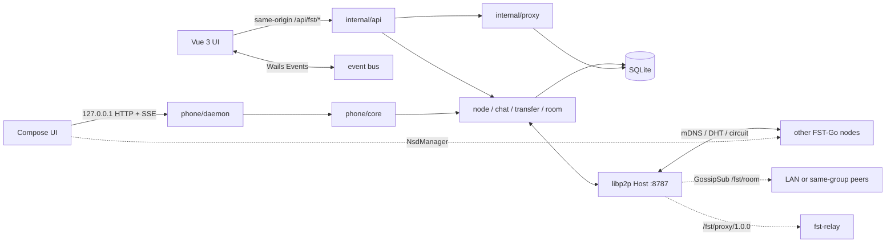

[**English**](README.md) | [简体中文](README_zh.md) | [日本語](README_ja.md)

# FST-Go

**File Safe Transfer** — peer-to-peer file transfer and chat over LAN or across NAT, in Go.

No accounts, no central business server. Every device is both a client and a full libp2p node: LAN discovery is automatic, and crossing network boundaries needs nothing but a relay you host yourself.

Current release (v1.2.0): **Windows desktop** (`fst.exe`) + **Android app** (APK) + **Linux headless relay** (`fst-relay`) + **Linux server package** (`fst` deb, browser UI). Released under the [MIT License](LICENSE).


### This program is provided for learning and reference only. Do not use it for illegal purposes. It is meant to be helpful, but the author provides no warranty of any kind.

| Name | Meaning |
|---|---|
| **FST** | **F**ile **S**afe **T**ransfer |
| **Go** | Written in Go; it also suggests "sending files out" |

The repository and CLI still use the short name `fst` (for example `fst.exe`, `fst-relay`, protocol IDs under `/fst/...`); it is the same project as the product name FST-Go.

[](LICENSE)
[](https://go.dev/)
[](https://vuejs.org/)
[](https://kotlinlang.org/)
[](https://libp2p.io/)

---

## Contents

- [What it solves](#what-it-solves)
- [Features](#features)
- [Design highlights](#design-highlights)
- [Architecture](#architecture)
- [Tech stack](#tech-stack)
- [Protocols](#protocols)
- [Requirements](#requirements)
- [Install](#install)
- [Build the desktop app](#build-the-desktop-app)
- [Build the Android app](#build-the-android-app)
- [Packaging and release artifacts](#packaging-and-release-artifacts)
- [Relay: build, deploy and configure](#relay-build-deploy-and-configure)
- [Relay groups and exit authorization](#relay-groups-and-exit-authorization)
- [How a client connects to a relay](#how-a-client-connects-to-a-relay)
- [Network proxy (optional)](#network-proxy-optional)
- [Configuration and data directory](#configuration-and-data-directory)
- [Headless service mode (fst serve)](#headless-service-mode-fst-serve)
- [LAN discovery and troubleshooting](#lan-discovery-and-troubleshooting)
- [Local development and debugging](#local-development-and-debugging)
- [Status and limitations](#status-and-limitations)
- [License](#license)

---

## What it solves

Cloud drives, messengers and commercial VPNs keep your traffic, files and contact list on someone else's server. In an office LAN, at home, or between two machines behind NAT, people usually just want:

1. **See each other, chat and send files on the same subnet** — no sign-up, no public account.
2. **When not on the same subnet**, use one of your own VPSes as introducer/forwarder instead of uploading to a cloud drive.
3. Optionally route some or all traffic **through your own relay** instead of installing an unrelated proxy stack.

FST-Go puts all three into one process and one service port. Device identity is a libp2p PeerID; discovery, chat, files and proxying are multiplexed over an encrypted connection. Files travel over an end-to-end encrypted channel with whole-file SHA-256 verification and resumable transfer — never through a third-party cloud drive.

Desktop and Android share the **same Go core** (`internal/*`), so the protocol does not fork: messaging, transfer, resume and offline queueing behave identically on phone and PC.

---

## Features

| Capability | Detail |
|---|---|
| Discovery | Automatic LAN mDNS (`_fst._tcp` DNS-SD plus the legacy `fst` label); across networks via relay directory + private DHT. Peers can be added by full multiaddr, PeerID+relay, or PeerID only |
| Cross-platform | Windows / Linux / Android share one protocol and data model; phone↔PC and phone↔phone connect directly, with no intermediary on the LAN |
| 1:1 chat | Encrypted channel, local archive, delivery ACK, unread counts, rich text (≤32000 chars); text / image / file-card bubbles; recall within 2 minutes; avatar synced via HELLO |
| Offline queue | Messages to offline peers become "pending", retried every 15 s with exponential backoff (cap 10 min, 20 attempts), flushed immediately on `peer:online`; manual retry per bubble |
| Group chat | GossipSub auto-rooms: one per LAN, plus per relay-group rooms derived from the group key. Text only, local history, de-duplicated by message ID, reusing port 8787 |
| File transfer | Multi-select / drag onto a device card, confirm dialog, trust or auto-accept, concurrency 1–8, `.fstpart` resume, whole-file SHA-256, global rate limit, pre-hash skip, continue-on-failure |
| Folder transfer | Recursive send with relative paths and empty directories preserved; ≤1000 files per batch, larger sets auto-split |
| Across NAT | AutoNAT, DCUtR hole punching, Circuit Relay; the redundant relay connection is dropped once a direct path exists |
| Self-hosted relay | `fst-relay`: circuit relay + online directory + DHT server, with group isolation, key expiry and per-group soft caps |
| Exit authorization | PeerID allow-list, expiring tokens and group restriction, intersected; unconfigured means legacy behaviour |
| Outbound proxy | TUN split routing (CIDR/domain) or global; IPv4 TCP+UDP with experimental IPv6; local SOCKS5 inbound at `127.0.0.1:20300` by default |
| Mobile app | Four-tile home (devices / chats / transfers / settings), foreground service, system DNS-SD discovery, SAF file picking, MediaStore export, settings shared with desktop |
| Desktop integration | Tray, close behaviour (ask / minimize / quit), native notifications, launch at login, single or multi instance |

---

## Design highlights

- **Identity is a PeerID, not IP/MAC.** The key lives in `%APPDATA%\FST\identity.key`; nickname and addresses may change, the device stays the same.
- **One business port, 8787** (TCP and QUIC/UDP). Chat, files and proxying all ride libp2p streams; the only extra listener is the loopback SOCKS5 inbound.
- **File bytes never enter the frontend.** Vue only receives a local path; I/O, hashing and progress stay in Go.
- **One core, three shells.** The Android app does not reimplement the protocol: `phone/core` imports `internal/node|chat|transfer` directly and crosses the language boundary with JSON only.
- **No central database.** Chat and transfer history live in local SQLite; schema upgrades go through `user_version` migrations.
- **No home-grown crypto.** Application messages use libp2p secure channels (Noise/TLS over TCP, built into QUIC).
- **Exit is fail-closed.** A relay started with `-exit` and an empty allow-list lets nobody through; tokens are compared against digests and never logged.

---

## Architecture



Desktop: open the data directory → migrate SQLite → load or generate identity → build the libp2p host → attach chat, transfer and room services → optionally start SOCKS5/TUN → Wails embeds `front/dist` and routes `/api/*` into Go.

Android: the foreground service starts `libfstcored.so` as a child process (loopback HTTP + SSE) → Kotlin injects the device IPv4 and DNS-SD results → the Compose UI calls the same API over HTTP. Encryption, framing and transfer all stay in Go.

---

## Tech stack

| Layer | Choice |
|---|---|
| Language | Go — module `fst`, `go 1.26.0` directive; built here with the Go 1.27 toolchain |
| Desktop shell | Wails v3 `v3.0.0-beta.29` — window, tray, native dialogs, drag & drop, notifications, single instance |
| P2P | go-libp2p v0.50, kad-dht v0.42 (private `/fst` DHT), go-libp2p-pubsub (GossipSub), AutoNATv2, DCUtR, Circuit Relay |
| Discovery | `internal/lanmdns` on top of zeroconf v2 + miekg/dns; Android uses the system `NsdManager` |
| Proxy | tun2socks v2.6 + gVisor netstack + WireGuard TUN (needs `wintun.dll` on Windows) |
| Storage | `modernc.org/sqlite` (pure Go, no CGO) + `database/sql` |
| Config / HTTP / logging | `go.yaml.in/yaml/v3` · stdlib `net/http` · `log/slog` → rotating `fst.log` |
| Frontend | Vue 3.5 + TypeScript, Vite 8, Element Plus 2.13, Tailwind CSS v4, Pinia 3, vue-router, axios, pnpm |
| Mobile | Kotlin 2.0.21 + Jetpack Compose (Material 3), AGP 8.7.3, minSdk 26 / targetSdk 35, arm64-v8a |

UI ↔ Go is plain HTTP, not libp2p: same-origin `/api/fst/*` with a `{code, message, data}` envelope (business errors are HTTP 200 + `code: 400`), plus Wails events on desktop and SSE in `fst serve` / on mobile.

---

## Protocols

Defined in `internal/proto`; transport, encryption and multiplexing come from libp2p.

| Protocol ID | Purpose | Framing |
|---|---|---|
| `/fst/msg/1.0.0` | Control and chat: HELLO, CHAT, CHAT_ACK, CHAT_RECALL, FILE_OFFER/ACCEPT/REJECT/CANCEL, ERROR | uvarint length + JSON, ≤1 MiB per frame |
| `/fst/file/1.0.0` | Single file body | JSON `FileHeader` → raw bytes `[offset,size)` → 32-byte SHA-256 → JSON `FileResult` |
| `/fst/proxy/1.0.0` | Exit through a relay | JSON `ProxyReq/Resp`; raw bidirectional copy for TCP, 2-byte big-endian length prefix for UDP |
| GossipSub `fst/room/1.0.0/<room>` | Group chat | Signed JSON `RoomMsg`; `lan` room, `g-<hash>` group room (the hash reveals nothing) |
| mDNS `_fst._tcp` / `fst` | LAN discovery | UDP 5353 multicast; the TXT record carries `dnsaddr=` and the PeerID |
| Private Kademlia `/fst` | Address lookup by PeerID | Peer routing only; never joins the public DHT |

Protocol IDs have not changed since 1.0.0, so **v1.2.0 interoperates with older builds**; `internal/proto.Version` (`1.2.0`) is for display and troubleshooting only.

---

## Requirements

**Desktop** — Windows 10/11 x64 with WebView2 (usually present on Win11); the LAN needs **TCP/UDP 8787** and **UDP 5353** open with router AP/client isolation disabled; cross-network needs 8787 reachable to your relay; the TUN proxy needs administrator rights plus `wintun.dll`; SOCKS5 inbound needs neither. Linux desktop (verified on Ubuntu 24.04) needs the GTK4 + WebKitGTK 6.0 runtime.

**Android** — Android 8.0 (API 26)+, arm64-v8a, notification and nearby-devices permissions; the same Wi-Fi as the PC for discovery.

**Service mode / deb** — any modern browser; the backend binds `127.0.0.1:9797` unless told otherwise.

**Relay** — Linux with a public IPv4 (amd64 deb today); open **TCP 8787 and UDP 8787**; exit mode additionally needs outbound TCP/UDP to its targets.

---

## Install

Grab the artifact for your platform from [Releases](https://github.com/xuey490/Fst-go/releases):

| Platform | File | Notes |
|---|---|---|
| Windows x64 | `fst-1.2.0-windows-amd64.zip` | **Recommended**: `fst.exe` + `wintun.dll` (needed for the TUN proxy) |
| Windows x64 | `fst-1.2.0-windows-amd64.exe` | Single file; LAN features only, the cross-network TUN proxy needs `wintun.dll` |
| Android arm64 | `fst-1.2.0-android-arm64.apk` | debug-signed, installs directly; a release keystore is required for store distribution |
| Debian / Ubuntu amd64 | `fst_1.2.0-1_amd64.deb` | **Service mode** (`fst serve`, browser UI) |

**Windows**: unzip anywhere (not into `%APPDATA%\FST`) and run `fst.exe`; the first launch creates the identity and database under `%APPDATA%\FST\`.

**Android**: side-load the APK, allow "install unknown apps", grant notifications and nearby-devices; the core runs as an extracted native library inside a foreground service.

**Debian / Ubuntu**:

```bash
sudo dpkg -i fst_1.2.0-1_amd64.deb
fst serve          # prints the URL, access token and data directory
# open http://127.0.0.1:9797 and paste the token
```

The deb ships the **service build**, not a GTK window build: the GTK4 + WebKitGTK desktop target must be compiled with CGO on Linux. That configuration is kept in `build/linux/nfpm/nfpm.yaml`; run `nfpm package -f build/linux/nfpm/nfpm.yaml -p deb` on any Linux host to produce the windowed package.

**First-connection checklist**: same subnet, AP/client isolation off, TCP/UDP 8787 and UDP 5353 allowed on both sides. If the device list stays empty, follow [LAN discovery and troubleshooting](#lan-discovery-and-troubleshooting).

---

## Build the desktop app

Requirements: Go 1.26+, Node 22+, [pnpm](https://pnpm.io/), [Wails v3 CLI](https://v3.wails.io/) matching the version in `go.mod`.

```powershell
go install github.com/wailsapp/wails/v3/cmd/wails3@v3.0.0-beta.29
$env:Path += ";$(go env GOPATH)\bin"

cd front
pnpm install
cd ..

# stop the running process before overwriting bin\fst.exe
Stop-Process -Name fst -ErrorAction SilentlyContinue
wails3 build
```

Output: `bin/fst.exe` plus `bin/wintun.dll` copied from `build/windows/wintun/`. The frontend is embedded, so `front/` is not needed at runtime.

A reproducible script is also provided (it generates the icon/manifest `.syso` and drops artifacts into `dist/`):

```bash
scripts/build-exe.sh          # → bin/fst.exe, dist/fst-<version>-windows-amd64.exe
```

For a console-subsystem build (logs straight to the terminal — recommended for `serve`):

```powershell
go build -o bin\fst-serve.exe .
```

### Linux desktop (verified on Ubuntu 24.04 LTS)

GTK4 + WebKitGTK are C libraries, so CGO is mandatory and `GOOS=linux` cross-compilation does not work — build on Linux:

```bash
sudo apt update
sudo apt install -y build-essential pkg-config curl git libgtk-4-dev libwebkitgtk-6.0-dev

go install github.com/wailsapp/wails/v3/cmd/wails3@latest
export PATH=$PATH:$(go env GOPATH)/bin

cd front && pnpm install && pnpm build && cd ..
wails3 build          # → bin/fst
```

Ubuntu 22.04 has no WebKitGTK 6.0: use `libgtk-3-dev libwebkit2gtk-4.1-dev` and build with `-tags gtk3`. If you only need service mode, skip GTK entirely with `scripts/build-deb.sh` (`CGO_ENABLED=0 -tags server,production`).

---

## Build the Android app

The mobile core is a **static executable** placed in `jniLibs` and launched as a child process; Kotlin talks to it over loopback HTTP + SSE. No NDK, no gomobile, and `internal/*` is reused verbatim.

Requirements: Go 1.26+, Android SDK 35, JDK 17/21, Gradle 8.9+ (8.13 used here).

```bash
phone/scripts/build-core.sh           # → jniLibs/arm64-v8a/libfstcored.so
phone/scripts/build-apk.sh            # debug; 'release' also builds, debug-signed without a keystore
adb install -r phone/android/app/build/outputs/apk/debug/app-debug.apk
```

Three platform constraints worth knowing before changing the build (`build-core.sh` self-checks them):

- **Static, non-PIE**: `-buildmode=pie` writes `PT_INTERP=/lib/ld-linux-aarch64.so.1` (a glibc path); on Android `execve` then fails with ENOENT and the process silently never starts.
- **Do not switch to `GOOS=android`**: it enables `wlynxg/anet`'s Android branch, which `//go:linkname`s `net.zoneCache` — removed in Go 1.27, so linking fails with no upstream fix.
- **Loopback HTTP needs a `network_security_config`**: targetSdk ≥ 28 blocks cleartext, loopback included before API 37. Without it `/health` always fails and the UI reports "core health check timed out".

See [phone/README.md](phone/README.md) for mobile architecture and Android specifics.

---

## Packaging and release artifacts

Copying FST-Go to another Windows machine needs **only `bin/fst.exe`** (plus `wintun.dll` beside it if you want the TUN proxy). Never copy `%APPDATA%\FST\` — `identity.key` is the device identity and two live machines would collide on PeerID.

Optional installer (requires [NSIS](https://nsis.sourceforge.io/)):

```powershell
wails3 package
```

All three platforms, with output collected in `dist/` (git-ignored):

```bash
scripts/build-exe.sh                                        # Windows
scripts/build-deb.sh                                        # Linux service-mode deb (needs nfpm)
phone/scripts/build-core.sh && phone/scripts/build-apk.sh    # Android
```

`scripts/build-deb.sh` needs [nfpm](https://nfpm.goreleaser.com/): `go install github.com/goreleaser/nfpm/v2/cmd/nfpm@latest`.

Diagnostic tools build on demand (Windows only), for example `go build -o bin\mdnsview.exe .\cmd\mdnsview`.

---

## Relay: build, deploy and configure

The relay has no UI and no mDNS. It provides circuit relaying, a private DHT, and an online directory of connected PeerIDs. With `-exit` it can also act as an outbound gateway.

```powershell
$env:GOOS = "linux"; $env:GOARCH = "amd64"; $env:CGO_ENABLED = "0"
go build -trimpath -ldflags "-s -w" -o bin/fst-relay-linux-amd64 ./cmd/fst-relay
Remove-Item Env:GOOS, Env:GOARCH, Env:CGO_ENABLED
wails3 tool package -name fst-relay -format deb -config ./build/relay/nfpm.yaml -out ./bin
```

```bash
sudo ufw allow 8787/tcp && sudo ufw allow 8787/udp
sudo dpkg -i fst-relay_0.1.4_amd64.deb
sudo systemctl status fst-relay && journalctl -u fst-relay -e
```

The binary lands in `/usr/bin/fst-relay`, the unit in `/lib/systemd/system/`, and post-install runs `enable --now`. Data defaults to `/var/lib/fst-relay` (`identity.key` defines the PeerID — changing the directory changes the identity).

The startup log prints the address to give clients: `/ip4/<PUBLIC_IP>/tcp/8787/p2p/<PeerID>`.

| Flag | Default | Meaning |
|---|---|---|
| `-data` | `/var/lib/fst-relay` | Data directory (identity + database) |
| `-port` | `8787` | TCP + UDP(QUIC) listen port |
| `-name` | `fst-relay` | Name shown in device lists |
| `-group` | empty | Single group key: only peers presenting it are introduced to each other |
| `-group-file` | empty | Group table, one `name:key[:expiry]` per line; hot-reloaded within 10 s; mutually exclusive with `-group` |
| `-group-max-terminals` | `0` | Per-group soft cap on online terminals; over the cap only directory/arrival notices stop |
| `-exit` | off | Enable the outbound gateway (still requires a non-empty `-exit-allow`) |
| `-exit-allow` | empty | File of PeerIDs, one per line; empty or missing means **deny everyone** (fail-closed) |
| `-exit-token` | empty | Token file, one `token[:expiry]` per line (RFC3339 or Unix seconds) |
| `-exit-group` | empty | Only this group may use the exit; same-group peers skip the token |
| `-exit-group-slots` | `0` | Concurrent exit sessions per group; 0 means only the global 1024 applies |

Change flags with a systemd drop-in so reinstallation does not overwrite them:

```bash
sudo systemctl edit fst-relay
```

```ini
[Service]
ExecStart=
ExecStart=/usr/bin/fst-relay -data /var/lib/fst-relay -port 8787 -group-file /etc/fst-relay/groups.txt -exit -exit-allow /etc/fst-relay/allow.txt -exit-token /etc/fst-relay/tokens.txt
```

Without an exit requirement the default `ExecStart=/usr/bin/fst-relay -data /var/lib/fst-relay -port 8787` is enough; chat and file transfer still use the circuit relay.

---

## Relay groups and exit authorization

Groups isolate multiple tenant sets on one relay: clients set a group key (settings page or `config.yaml: group`), the relay validates it with `-group` / `-group-file`, and only same-group peers are introduced. Group entries expire (`name:key[:expiry]`), after which directory and arrival notices stop and HELLO returns `group_error`. The group file is hot-reloaded; deleting a group or rotating its key revokes access immediately.

Exit authorization intersects three layers, checked in the order **allow-list → group → token**:

1. `-exit-allow` — PeerID allow-list; always enforced, empty means fail-closed.
2. `-exit-group` — restrict to one group; same-group peers skip the token.
3. `-exit-token` — presented as `proxy.token`, compared in constant time, supports multiple expiring tokens.

Per-group concurrency comes from `-exit-group-slots`; the global cap is 1024. Groups are a shared-key model: the table is hot-reloadable and supports expiry, but there is no online rotation API yet. The relay still sees the encrypted stream; end-to-end security is libp2p's job.

---

## How a client connects to a relay

1. Settings → **Allow cross-network**, add `/ip4/<PUBLIC_IP>/tcp/8787/p2p/<PeerID>`, save, **restart FST-Go**.
2. Once both clients reach the relay, a relay card appears in the device page; after the directory is pushed, the peer shows up as online.
3. If only the relay is listed, use "Add device" → PeerID (DHT) or PeerID + relay.
4. Card badge: **relay** means traffic is being forwarded, **direct** means a direct path (punched or native).

`config.yaml` sits next to the executable (project root during development):

```yaml
enable_relay: true
relays:
  - /ip4/<PUBLIC_IP>/tcp/8787/p2p/<RELAY_PEER_ID>
group: ""                # relay group key; empty = no grouping
proxy:
  enable: false
  mode: split            # split | global
  exit: /ip4/<PUBLIC_IP>/tcp/8787/p2p/<RELAY_PEER_ID>
  routes: [93.184.216.0/24]
  domains: [example.com]
  token: ""              # exit token expected by relay -exit-token
  ipv6: false            # experimental: TUN IPv6 stack + fake AAAA
  socks_enable: true
  socks_user: ""
  socks_pass: ""
  socks_allow: []        # source CIDRs; non-empty forces RFC1929 auth
  socks_max_conn: 0
  socks_max_per_ip: 0
```

---

## Network proxy (optional)

Traffic exits through the **same** `/fst/proxy/1.0.0` stream to `fst-relay` — no extra public port. Requires cross-network enabled and a relay configured as exit.

- **split** — only the listed CIDRs and/or domains enter the tunnel (fake-IP `198.18.0.0/15`, DNS `198.18.0.2`); with domain rules, system/public DNS `/32` also goes into the TUN and unresolved names are resolved at the exit.
- **global** — default route into the TUN; LAN, system DNS, well-known public DNS and the relay IP keep the original gateway.
- **Transport** — IPv4 TCP + UDP; `proxy.ipv6=true` adds IPv6 (AAAA, literals, `tcp6`/`udp6`) and a v6 stack, falling back to IPv4 on failure.
- **Exit safety** — loopback, private, link-local, ULA and multicast targets are refused.
- **SOCKS5 inbound** — `127.0.0.1:20300` (random port if taken), CONNECT + UDP ASSOCIATE, optional RFC1929 credentials, source CIDRs and concurrency caps. Configuring CIDRs without a password refuses the hardened mode and logs a warning.

Verify:

```powershell
nslookup www.google.com 8.8.8.8          # global mode should answer 198.18.x.x
curl.exe -x socks5h://127.0.0.1:20300 -I --ssl-no-revoke https://www.google.com
```

The Android app has **no** TUN or cross-network proxy: proxy settings are simply absent there.

---

## Configuration and data directory

| Location | Content |
|---|---|
| `%APPDATA%\FST\identity.key` | Device identity — never share it between two machines online at once |
| `%APPDATA%\FST\fst.db` | Devices, chats, transfers and some settings (WAL) |
| `%APPDATA%\FST\fst.log` | Rotating log |
| `config.yaml` (next to the exe) | Cross-network, relays, group, proxy and SOCKS5 |
| Default download dir | `%USERPROFILE%\Downloads\FST` |

Android keeps everything in the app-private directory (`/data/data/com.fst.phone/`); received files are exported to `Downloads/FST` via MediaStore. Uninstalling removes the identity as well.

The schema is at **v7** today (v2 `transfers.rel_path`, v3 message `kind/recalled/attach`, v4 `peers.avatar`, v5 retry fields, v6 `rooms`/`room_messages`, v7 message `reply`); upgrades are automatic.

Environment variables: `FST_DATA_DIR`, `FST_PORT` (desktop/service), `FST_LAN_IP` (mobile core, injected by Kotlin).

---

## Headless service mode (fst serve)

Same code and data, no window: the full UI is served over HTTP so any browser on any device can use it.

```bash
fst serve                      # 127.0.0.1:9797, local only
fst serve -addr 0.0.0.0:9797   # expose on the LAN (logs a security warning)
```

- The first start generates a random **access token**, printed in the log and stored in `settings.web_token`; enter it once in the browser (30-day session cookie).
- Realtime updates go over SSE; P2P traffic still uses 8787, the HTTP port only serves the browser.
- File upload from the browser is a multipart POST; folder sending is desktop-only.
- Stop with `Ctrl+C` for a graceful shutdown.

systemd unit on a Linux server:

```ini
# /etc/systemd/system/fst.service
[Unit]
Description=FST headless web service
After=network-online.target

[Service]
ExecStart=/opt/FST/fst serve -addr 0.0.0.0:9797
Restart=on-failure
User=fst

[Install]
WantedBy=multi-user.target
```

---

## LAN discovery and troubleshooting

Discovery is the one gate every cross-device feature depends on, and historically the most fragile layer. Current implementation:

- **Two service types**: `_fst._tcp` (standard DNS-SD — Android `NsdManager` and iOS `NWBrowser` only accept the underscore-prefixed form) plus the legacy `fst` label.
- **Instance names carry the full PeerID** (`FST-<PeerID>`): some ROMs drop the TXT record on resolve, leaving the instance name as the only source of the PeerID; the SRV port plus the A record then reconstruct a dialable address.
- **The phone re-announces every 3 minutes** because some ROMs stop answering multicast queries in doze; **the desktop bridges the legacy label** for the phone (`lanmdns.Bridge`).
- **Address rewriting**: Android cannot enumerate interfaces (`NETLINK_ROUTE` denied), so libp2p only had `127.0.0.1`; the real IPv4 is injected and `AddrsFactory` rewrites it, hot-updated on Wi-Fi change.
- **Group membership binds real LAN interfaces only**, avoiding WSL/Hyper-V/APIPA adapters swallowing the multicast.

Troubleshooting ladder (tools under `cmd/`, Windows builds):

| Step | Command | Signal |
|---|---|---|
| Are packets flowing? | `mdnsview` | The peer's `_fst._tcp` queries/answers; silence means multicast never left or is filtered |
| Are they correct? | `mdnssniff` | Hex dump to inspect TXT/SRV (`dnsaddr=`, port, instance name) |
| Is the adapter usable? | `netdiag` | Per-adapter setsockopt probe — no routable IPv4 / virtual adapter / multicast blocked |
| Can it be parsed? | `mdnsfake` | Forge a record and test the client's parsing and fallback paths |
| Is it isolation? | `fstproxy` | Relay TCP through a reachable machine; success means AP/client isolation, not a protocol bug |

The three most common external causes: Windows Firewall blocking UDP 5353, router AP isolation, and the phone being frozen by battery optimisation (mitigated by the foreground service). Details in [docs/局域网发现排查报告.md](docs/局域网发现排查报告.md).

---

## Local development and debugging

```bash
go build ./...
go test ./...                  # unit tests, including the multi-node e2e suite
go vet ./...

cd front && npx vue-tsc --noEmit
```

Proxy tests mock all dialing and never touch real adapters; IPv6 dual-stack, NAT punching and Windows TUN need manual regression on real hardware.

**Desktop hot reload**: `wails3 dev`.

**Two instances on one machine** (separate identity and port; they will discover each other):

```powershell
$env:FST_DATA_DIR = "D:\fst-dev-1"; $env:FST_PORT = "8787"; .\bin\fst.exe
$env:FST_DATA_DIR = "D:\fst-dev-2"; $env:FST_PORT = "8788"; .\bin\fst.exe
```

**Service mode debugging**:

```bash
go build -o bin/fst-serve . && ./bin/fst-serve serve -addr 127.0.0.1:9797
cd front && pnpm build     # rebuild the UI only, then restart serve
```

**Mobile core without a phone**: `phone/daemon` exposes the same core over loopback HTTP; the script starts it in a temp directory and runs an IPC smoke test:

```bash
go build -o /tmp/fstcored ./phone/daemon
phone/scripts/e2e-ipc.sh
# manual variant (--noproxy matters if a system proxy is running):
FST_DATA_DIR=/tmp/fstd FST_TOKEN=t0k FST_PORT=18787 /tmp/fstcored
curl --noproxy '*' -H "X-FST-Token: t0k" http://127.0.0.1:18787/settings
```

Logs: `fst.log` in the data directory (rotating) on desktop/server; in the app-private directory on Android, viewable from the settings page.

Conventions live in [AGENTS.md](AGENTS.md); mobile details in [phone/README.md](phone/README.md).

---

## Status and limitations

- **Three platforms, not feature-identical.** Desktop is the reference; Android deliberately omits TUN/cross-network proxy, group chat, folder sending and multi-device sync. macOS is untested.
- **The Linux deb is service mode**, not a GTK window build — that target requires CGO on a Linux host (`build/linux/nfpm/nfpm.yaml` is kept for it).
- **No on-device regression for mobile yet**: the build machine has no Android device or emulator; the APK is verified to compile, sign, unpack and contain an executable core, but runtime layout (especially the four-tile home on narrow screens) needs a real phone.
- **The APK is debug-signed** — installable, but a release keystore is required for store distribution.
- IPv6 proxying is experimental; no proxy chaining.
- SOCKS5 hardening is off by default: loopback, unauthenticated, usable by any local process until credentials are configured.
- Relay groups are shared-key only (hot reload and expiry supported, no online rotation).
- Rate limiting is process-wide; pre-hash reads the source file one extra time.
- Group chat is text-only with local history; no backfill, no member management.
- Offline messages retry up to 20 times (backoff capped at 10 min), then fail and need a manual retry.
- Message recall is limited to your own messages within 2 minutes; avatars are capped at ~12KB with no server-side cropping.
- Mobile sends create a temporary copy (the transfer engine needs a seekable local path, and SAF URIs are not paths).

---

## ⚠️ Disclaimer

This software is for learning and research only. Follow your local laws. Any consequences of use are the user's own responsibility.

---

## License

Copyright (c) 2026 FST-Go contributors

Released under the [MIT License](LICENSE) — free to use, modify, distribute and use commercially, provided the copyright and license notices are retained. Dependencies remain under their own licenses.
