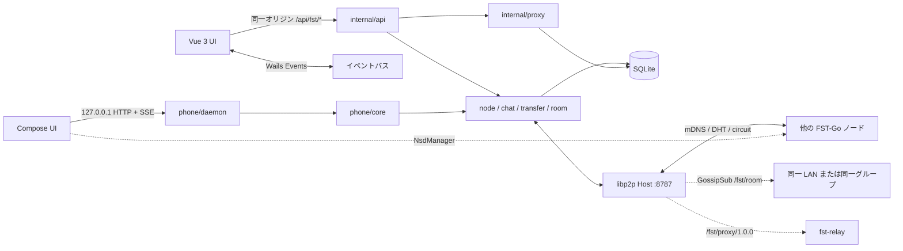

[English](README.md) | [简体中文](README_zh.md) | **日本語**

# FST-Go

**File Safe Transfer** — LAN / クロスネットワーク対応の P2P ファイル転送とチャット。Go 実装。

アカウント不要、中央の業務サーバーもありません。各デバイスはクライアントであると同時に完全な libp2p ノードです。同一 LAN 内は自動検出され、ネットワークをまたぐ場合も自分で用意したリレー 1 台があれば十分です。

現在の配布形態（v1.2.0）：**Windows デスクトップ**（`fst.exe`）+ **Android アプリ**（APK）+ **Linux ヘッドレスリレー**（`fst-relay`）+ **Linux サーバーパッケージ**（`fst` deb、ブラウザ UI）。本リポジトリは [MIT License](LICENSE) で公開されています。


### 本プログラムは学習・参考用です。違法な目的には使用しないでください。お役に立てれば幸いですが、作者はいかなる保証も行いません。

| 名称 | 意味 |
|---|---|
| **FST** | **F**ile **S**afe **T**ransfer（安全なファイル転送） |
| **Go** | バックエンドとノードを Go で実装。ファイルを「送り出す」という意味も持つ |

リポジトリと CLI では短縮名 `fst` を使用します（`fst.exe`、`fst-relay`、プロトコル ID `/fst/...` など）。製品名 FST-Go と同じプロジェクトです。

[](LICENSE)
[](https://go.dev/)
[](https://vuejs.org/)
[](https://kotlinlang.org/)
[](https://libp2p.io/)

---

## 目次

- [解決する課題](#解決する課題)
- [機能](#機能)
- [設計上の特徴](#設計上の特徴)
- [アーキテクチャ](#アーキテクチャ)
- [技術スタック](#技術スタック)
- [プロトコル](#プロトコル)
- [動作環境](#動作環境)
- [インストール](#インストール)
- [デスクトップ版のビルド](#デスクトップ版のビルド)
- [Android 版のビルド](#android-版のビルド)
- [パッケージングと配布物](#パッケージングと配布物)
- [リレー：ビルド・デプロイ・設定](#リレービルドデプロイ設定)
- [リレーのグループと出口認証](#リレーのグループと出口認証)
- [クライアントからリレーへの接続](#クライアントからリレーへの接続)
- [ネットワークプロキシ（任意）](#ネットワークプロキシ任意)
- [設定とデータディレクトリ](#設定とデータディレクトリ)
- [ヘッドレスサービスモード（fst serve）](#ヘッドレスサービスモードfst-serve)
- [LAN ディスカバリとトラブルシューティング](#lan-ディスカバリとトラブルシューティング)
- [ローカル開発とデバッグ](#ローカル開発とデバッグ)
- [現状と制限](#現状と制限)
- [ライセンス](#ライセンス)

---

## 解決する課題

一般的なクラウドストレージ、メッセンジャー、商用 VPN は、通信・ファイル・連絡先を他者のサーバーに置きます。オフィスの LAN、家庭内、あるいは両方とも NAT の内側にある 2 台のマシンで必要なのは、たいてい次の 3 点です。

1. **同一サブネット内で互いを認識し、メッセージとファイルをやり取りする** — 登録もパブリックアカウントも不要。
2. **同一サブネットにいない場合**は、自前の VPS を紹介役／転送役として使い、クラウドストレージにアップロードしない。
3. 必要なら、無関係なプロキシスタックを追加せず、**自分のリレー経由で出口通信**を確保する。

FST-Go はこの 3 つを 1 プロセス・1 業務ポートにまとめます。デバイス識別子は libp2p の PeerID で、検出・チャット・ファイル・プロキシはすべて暗号化接続上で多重化されます。ファイルは End-to-End の暗号化チャネルを通り、ファイル全体の SHA-256 検証とレジューム転送を備え、第三者のクラウドを経由しません。

デスクトップ版と Android 版は**同一の Go コア**（`internal/*`）を共有するため、プロトコルは分岐しません。メッセージ送信、転送、レジューム、オフラインキューの挙動はスマートフォンと PC で完全に同じです。

---

## 機能

| 機能 | 内容 |
|---|---|
| デバイス検出 | LAN は mDNS で自動検出（標準 `_fst._tcp` + 旧 `fst` ラベルの二重登録）。ネットワークをまたぐ場合はリレーのディレクトリ + プライベート DHT。multiaddr 全体、PeerID+リレー、PeerID のみのいずれでも追加可能 |
| クロスプラットフォーム | Windows / Linux / Android が同一プロトコル・同一データモデルを共有。スマホ↔PC、スマホ↔スマホは LAN 内で直接接続（中継不要） |
| 1 対 1 チャット | 暗号化チャネル、ローカル保存、配送 ACK、未読数、リッチテキスト（1 件 ≤32000 文字）。テキスト／画像／ファイルカードの 3 種のバブル、2 分以内の取り消し、アバターは HELLO で同期 |
| オフライン送信 | 相手がオフライン／タイムアウトの場合は「送信待ち」として保持し、15 秒間隔・指数バックオフ（上限 10 分、20 回）で自動再送。`peer:online` で即時フラッシュ、バブルから手動再送も可能 |
| グループチャット | GossipSub による自動ルーム。同一 LAN に 1 つ、リレーのグループキーを設定すると同グループ用のルームも追加。テキストのみ、履歴はローカルのみ、メッセージ ID で重複排除、ポート 8787 を共用 |
| ファイル転送 | 複数選択／デバイスカードへのドラッグ、確認ダイアログ、信頼済みまたは自動受信、同時 1〜8、`.fstpart` によるレジューム、ファイル全体の SHA-256、全体帯域制限、送信前ハッシュによるスキップ、失敗しても残りを継続 |
| フォルダ転送 | ディレクトリを再帰送信し、相対パスと空ディレクトリを保持。1 バッチ ≤1000 ファイル、超過分は自動分割 |
| NAT 越え | AutoNAT、DCUtR によるホールパンチング、Circuit Relay。直結できた時点で冗長なリレー接続を破棄 |
| 自前リレー | `fst-relay`：サーキットリレー + オンラインディレクトリ + DHT サーバー。グループ分離、キー有効期限、グループ単位のソフト上限に対応 |
| 出口認証 | PeerID 許可リスト、有効期限付きトークン、グループ制限の 3 層の積集合。未設定なら従来の挙動 |
| 出口プロキシ | TUN 分割ルーティング（CIDR / ドメイン）またはグローバル。IPv4 の TCP+UDP、実験的な IPv6、ローカル SOCKS5 受信（既定 `127.0.0.1:20300`） |
| モバイルアプリ | ホームは 4 つのタイル（デバイス／チャット／転送／設定）、フォアグラウンドサービスで常駐、システム DNS-SD による検出、SAF でファイル選択、MediaStore で書き出し、設定はデスクトップと共通 |
| デスクトップ統合 | トレイ、閉じる動作（確認／トレイ／終了）、ネイティブ通知、ログイン時起動、単一／複数インスタンス |

---

## 設計上の特徴

- **識別子は PeerID で、IP や MAC ではない。** 鍵は `%APPDATA%\FST\identity.key`。ニックネームやアドレスは変わってもデバイスの同一性は保たれます。
- **業務ポートは 8787 の 1 本**（TCP と QUIC/UDP が同番号）。チャット・ファイル・プロキシはすべて libp2p ストリーム上を流れ、追加の待ち受けはループバックの SOCKS5 のみです。
- **ファイルのバイト列はフロントエンドに渡さない。** Vue が受け取るのはローカルパスだけで、I/O・ハッシュ・進捗は Go 側に閉じます。
- **1 つのコアを 3 つのシェルで共有。** Android 版はプロトコルを再実装せず、`phone/core` が `internal/node|chat|transfer` を直接利用し、言語境界を越えるのは JSON と基本型のみです。
- **中央データベースを持たない。** チャットと転送履歴はローカルの SQLite のみ。スキーマ更新は `user_version` のマイグレーションで行います。
- **暗号は自作しない。** アプリケーションメッセージは libp2p のセキュアチャネル（TCP では Noise/TLS、QUIC は標準装備）を使用します。
- **出口は fail-closed。** `-exit` を有効にしても許可リストが空なら誰も通せません。トークンはハッシュ同士で比較し、ログに平文を出しません。

---

## アーキテクチャ



デスクトップ版の起動順：データディレクトリを開く → SQLite をマイグレーション → 識別情報を読み込みまたは生成 → libp2p ホストを構築 → チャット・転送・ルームを接続 → 設定に応じて SOCKS5/TUN を起動 → Wails が `front/dist` を埋め込み、`/api/*` を Go が処理します。

Android 版の起動順：フォアグラウンドサービスが `libfstcored.so` を子プロセスとして起動（ループバック HTTP + SSE）→ Kotlin 側が自機 IPv4 と DNS-SD の検出結果を注入 → Compose UI が同じ API を HTTP で呼び出します。暗号化・フレーミング・転送はすべて Go 側です。

---

## 技術スタック

| レイヤー | 採用技術 |
|---|---|
| 言語 | Go — モジュール `fst`、`go 1.26.0` 指定。本リポジトリは Go 1.27 ツールチェーンでビルド |
| デスクトップシェル | Wails v3 `v3.0.0-beta.29` — ウィンドウ、トレイ、ネイティブダイアログ、ドラッグ＆ドロップ、通知、単一インスタンス |
| P2P | go-libp2p v0.50、kad-dht v0.42（プライベート `/fst` DHT）、go-libp2p-pubsub（GossipSub）、AutoNATv2、DCUtR、Circuit Relay |
| 検出 | `internal/lanmdns`（zeroconf v2 + miekg/dns）。Android は OS の `NsdManager` を使用 |
| プロキシ | tun2socks v2.6 + gVisor netstack + WireGuard TUN（Windows は `wintun.dll` が必要） |
| ストレージ | `modernc.org/sqlite`（純 Go、CGO 不要）+ `database/sql` |
| 設定 / HTTP / ログ | `go.yaml.in/yaml/v3` ／ 標準 `net/http` ／ `log/slog` → ローテーションする `fst.log` |
| フロントエンド | Vue 3.5 + TypeScript、Vite 8、Element Plus 2.13、Tailwind CSS v4、Pinia 3、vue-router、axios、pnpm |
| モバイル | Kotlin 2.0.21 + Jetpack Compose（Material 3）、AGP 8.7.3、minSdk 26 / targetSdk 35、arm64-v8a |

UI ↔ Go は libp2p ではなく素の HTTP です。同一オリジンの `/api/fst/*` に `{code, message, data}` のエンベロープ（業務エラーは HTTP 200 + `code: 400`）を返し、デスクトップは Wails イベント、`fst serve` とモバイルは SSE を使います。

---

## プロトコル

定義は `internal/proto`。トランスポート・暗号化・多重化は libp2p が担当します。

| プロトコル ID | 用途 | フレーミング |
|---|---|---|
| `/fst/msg/1.0.0` | 制御とチャット：HELLO、CHAT、CHAT_ACK、CHAT_RECALL、FILE_OFFER/ACCEPT/REJECT/CANCEL、ERROR | uvarint 長 + JSON、1 フレーム ≤1 MiB |
| `/fst/file/1.0.0` | 単一ファイル本体 | JSON `FileHeader` → 生バイト `[offset,size)` → 32 バイト SHA-256 → JSON `FileResult` |
| `/fst/proxy/1.0.0` | リレー経由の出口 | JSON `ProxyReq/Resp`。TCP は双方向コピー、UDP は 2 バイトのビッグエンディアン長プレフィックス |
| GossipSub `fst/room/1.0.0/<room>` | グループチャット | 署名付き JSON `RoomMsg`。`lan` は LAN ルーム、`g-<hash>` はグループルーム（ハッシュから鍵は復元不可） |
| mDNS `_fst._tcp` / `fst` | LAN 検出 | UDP 5353 マルチキャスト。TXT に `dnsaddr=` と PeerID |
| プライベート Kademlia `/fst` | PeerID からアドレス解決 | ピアルーティング専用。パブリック DHT には参加しません |

プロトコル ID は 1.0.0 から変更していないため、**v1.2.0 は旧バージョンと相互接続できます**。`internal/proto.Version`（現在 `1.2.0`）は表示とトラブルシュート専用です。

---

## 動作環境

**デスクトップ** — Windows 10/11 x64 + WebView2（Win11 は通常同梱）。LAN 利用は **TCP/UDP 8787** と **UDP 5353** を開放し、ルーターの AP アイソレーション／クライアント分離を無効化。ネットワーク越えはリレーの 8787 への到達性が必要。TUN プロキシは管理者権限と `wintun.dll` が必要で、SOCKS5 受信はいずれも不要。Linux デスクトップ（Ubuntu 24.04 で確認）は GTK4 + WebKitGTK 6.0 のランタイムが必要です。

**Android** — Android 8.0（API 26）以上、arm64-v8a、通知と付近のデバイスの権限。検出には PC と同じ Wi-Fi が必要です。

**サービスモード / deb** — 任意のモダンブラウザ。バックエンドは既定で `127.0.0.1:9797` のみを待ち受けます。

**リレー** — パブリック IPv4 を持つ Linux（現行 deb は amd64）。**TCP 8787 と UDP 8787** を開放。出口モードでは対象への外向き TCP/UDP も必要です。

---

## インストール

[Releases](https://github.com/xuey490/Fst-go/releases) からプラットフォーム別の成果物を取得します。

| プラットフォーム | ファイル | 補足 |
|---|---|---|
| Windows x64 | `fst-1.2.0-windows-amd64.zip` | **推奨**：`fst.exe` + `wintun.dll`（TUN プロキシに必要） |
| Windows x64 | `fst-1.2.0-windows-amd64.exe` | 単体ファイル。LAN 機能のみで、`wintun.dll` がないと TUN プロキシは使えません |
| Android arm64 | `fst-1.2.0-android-arm64.apk` | debug 署名。直接インストール可能。ストア配布には release keystore が必要 |
| Debian / Ubuntu amd64 | `fst_1.2.0-1_amd64.deb` | **サービスモード**（`fst serve`、ブラウザ UI） |

**Windows**：任意の場所に解凍し（`%APPDATA%\FST` は避ける）`fst.exe` を実行します。初回起動で `%APPDATA%\FST\` に識別情報とデータベースが生成されます。

**Android**：APK をサイドロードし、「提供元不明のアプリ」を許可、通知と付近のデバイスを許可します。コアはネイティブライブラリとして展開され、フォアグラウンドサービス内で動作します。

**Debian / Ubuntu**：

```bash
sudo dpkg -i fst_1.2.0-1_amd64.deb
fst serve          # アクセス URL・トークン・データディレクトリが表示されます
# http://127.0.0.1:9797 を開き、トークンを入力
```

この deb は **サービスビルド**であり、GTK ウィンドウ版ではありません。GTK4 + WebKitGTK のデスクトップ版は Linux 上で CGO を使ってビルドする必要があります。その設定は `build/linux/nfpm/nfpm.yaml` に残してあり、Linux ホストで `nfpm package -f build/linux/nfpm/nfpm.yaml -p deb` を実行すればウィンドウ版のパッケージを作れます。

**初回接続チェック**：同一サブネット、AP／クライアント分離が無効、両側で TCP/UDP 8787 と UDP 5353 が許可されていること。デバイス一覧が空のままなら [LAN ディスカバリとトラブルシューティング](#lan-ディスカバリとトラブルシューティング) の順に切り分けてください。

---

## デスクトップ版のビルド

必要なもの：Go 1.26+、Node 22+、[pnpm](https://pnpm.io/)、`go.mod` と同じバージョンの [Wails v3 CLI](https://v3.wails.io/)。

```powershell
go install github.com/wailsapp/wails/v3/cmd/wails3@v3.0.0-beta.29
$env:Path += ";$(go env GOPATH)\bin"

cd front
pnpm install
cd ..

# bin\fst.exe を上書きする前に実行中のプロセスを終了する
Stop-Process -Name fst -ErrorAction SilentlyContinue
wails3 build
```

成果物は `bin/fst.exe` と、`build/windows/wintun/` からコピーされた `bin/wintun.dll`。フロントエンドは exe に埋め込まれるため、配布時に `front/` は不要です。

再現性のあるスクリプトも用意しています（アイコンと manifest を含む `.syso` を生成し、`dist/` に出力）。

```bash
scripts/build-exe.sh          # → bin/fst.exe、dist/fst-<version>-windows-amd64.exe
```

コンソールサブシステム版（ログがそのまま端末に出るため `serve` に最適）：

```powershell
go build -o bin\fst-serve.exe .
```

### Linux デスクトップ（Ubuntu 24.04 LTS で確認済み）

GTK4 + WebKitGTK は C ライブラリのため CGO が必須で、`GOOS=linux` でのクロスコンパイルはできません。Linux 上でビルドします。

```bash
sudo apt update
sudo apt install -y build-essential pkg-config curl git libgtk-4-dev libwebkitgtk-6.0-dev

go install github.com/wailsapp/wails/v3/cmd/wails3@latest
export PATH=$PATH:$(go env GOPATH)/bin

cd front && pnpm install && pnpm build && cd ..
wails3 build          # → bin/fst
```

Ubuntu 22.04 には WebKitGTK 6.0 がないため、`libgtk-3-dev libwebkit2gtk-4.1-dev` を使い `-tags gtk3` でビルドします。サービスモードだけでよければ `scripts/build-deb.sh`（`CGO_ENABLED=0 -tags server,production`）で GTK を完全に回避できます。

---

## Android 版のビルド

モバイルのコアは `jniLibs` に置いた**静的実行ファイル**で、子プロセスとして起動します。Kotlin はループバック HTTP + SSE で通信するため、NDK も gomobile も不要で、`internal/*` をそのまま再利用できます。

必要なもの：Go 1.26+、Android SDK 35、JDK 17/21、Gradle 8.9+（本リポジトリでは 8.13）。

```bash
phone/scripts/build-core.sh           # → jniLibs/arm64-v8a/libfstcored.so
phone/scripts/build-apk.sh            # debug。release も可（keystore 未設定なら debug 署名）
adb install -r phone/android/app/build/outputs/apk/debug/app-debug.apk
```

ビルドを変更する前に知っておくべき 3 つの制約（`build-core.sh` が自己検査します）：

- **静的・非 PIE であること**：`-buildmode=pie` を付けると `PT_INTERP=/lib/ld-linux-aarch64.so.1`（glibc のパス）が書き込まれ、Android では `execve` が ENOENT で失敗し、プロセスが無言で起動しません。
- **`GOOS=android` に変更しないこと**：`wlynxg/anet` の Android 分岐が有効になり、`//go:linkname` で `net.zoneCache` を参照します。この記号は Go 1.27 で削除済みで、リンクに失敗し上流にも修正がありません。
- **ループバック HTTP には `network_security_config` が必須**：targetSdk 28 以上は平文通信を禁止し、API 37 以前はループバックも例外ではありません。未設定だと `/health` が常に失敗し、UI は「コアのヘルスチェックがタイムアウト」と表示します。

モバイルの構成と Android 固有の対応は [phone/README.md](phone/README.md) を参照してください。

---

## パッケージングと配布物

別の Windows マシンへ移すのに必要なのは **`bin/fst.exe` だけ**です（TUN プロキシを使うなら同じディレクトリに `wintun.dll`）。`%APPDATA%\FST\` はコピーしないでください。`identity.key` はデバイス識別子で、2 台同時稼働させると PeerID が衝突します。

任意のインストーラー（[NSIS](https://nsis.sourceforge.io/) が必要）：

```powershell
wails3 package
```

3 プラットフォーム分をまとめて生成（出力は `dist/`、.gitignore 済み）：

```bash
scripts/build-exe.sh                                        # Windows
scripts/build-deb.sh                                        # Linux サービスモード deb（nfpm が必要）
phone/scripts/build-core.sh && phone/scripts/build-apk.sh    # Android
```

`scripts/build-deb.sh` は [nfpm](https://nfpm.goreleaser.com/) を使います：`go install github.com/goreleaser/nfpm/v2/cmd/nfpm@latest`。

診断ツールは必要に応じて個別にビルドします（Windows のみ）。例：`go build -o bin\mdnsview.exe .\cmd\mdnsview`。

---

## リレー：ビルド・デプロイ・設定

リレーには UI も mDNS もありません。役割はサーキットリレー、プライベート DHT、接続中 PeerID のオンラインディレクトリの 3 つです。`-exit` を付けると出口ゲートウェイにもなります。

```powershell
$env:GOOS = "linux"; $env:GOARCH = "amd64"; $env:CGO_ENABLED = "0"
go build -trimpath -ldflags "-s -w" -o bin/fst-relay-linux-amd64 ./cmd/fst-relay
Remove-Item Env:GOOS, Env:GOARCH, Env:CGO_ENABLED
wails3 tool package -name fst-relay -format deb -config ./build/relay/nfpm.yaml -out ./bin
```

```bash
sudo ufw allow 8787/tcp && sudo ufw allow 8787/udp
sudo dpkg -i fst-relay_0.1.4_amd64.deb
sudo systemctl status fst-relay && journalctl -u fst-relay -e
```

バイナリは `/usr/bin/fst-relay`、ユニットは `/lib/systemd/system/` に配置され、postinstall が `enable --now` を実行します。データは既定で `/var/lib/fst-relay`（`identity.key` が PeerID を決めるため、ディレクトリを変えると識別子も変わります）。

起動ログにクライアントへ設定するアドレスが出力されます：`/ip4/<PUBLIC_IP>/tcp/8787/p2p/<PeerID>`。

| フラグ | 既定値 | 意味 |
|---|---|---|
| `-data` | `/var/lib/fst-relay` | データディレクトリ（識別情報と DB） |
| `-port` | `8787` | TCP + UDP(QUIC) の待ち受けポート |
| `-name` | `fst-relay` | デバイス一覧に表示される名前 |
| `-group` | 空 | 単一グループキー。同じキーを示す端末同士だけを相互紹介 |
| `-group-file` | 空 | グループ表。1 行 `name:key[:expiry]`。`-group` とは排他。変更は 10 秒以内にホットリロード |
| `-group-max-terminals` | `0` | グループごとのオンライン端末ソフト上限。超過時はディレクトリ／到達通知のみ停止 |
| `-exit` | 無効 | 出口ゲートウェイを有効化（空でない `-exit-allow` が必須） |
| `-exit-allow` | 空 | PeerID を 1 行 1 件で列挙したファイル。空または未指定は**全拒否**（fail-closed） |
| `-exit-token` | 空 | トークンファイル。1 行 `token[:expiry]`（RFC3339 または Unix 秒） |
| `-exit-group` | 空 | 指定グループのみ出口を許可。同グループはトークン不要 |
| `-exit-group-slots` | `0` | グループごとの同時出口セッション上限。0 は全体 1024 のみ適用 |

フラグの変更は systemd の drop-in で行います（deb 再インストールで消えません）。

```bash
sudo systemctl edit fst-relay
```

```ini
[Service]
ExecStart=
ExecStart=/usr/bin/fst-relay -data /var/lib/fst-relay -port 8787 -group-file /etc/fst-relay/groups.txt -exit -exit-allow /etc/fst-relay/allow.txt -exit-token /etc/fst-relay/tokens.txt
```

出口が不要なら既定の `ExecStart=/usr/bin/fst-relay -data /var/lib/fst-relay -port 8787` のままで十分です。チャットとファイル転送はサーキットリレー経由で動作します。

---

## リレーのグループと出口認証

グループは 1 台のリレー上で複数の端末群を分離します。クライアントは設定画面または `config.yaml: group` にグループキーを設定し、リレーは `-group` / `-group-file` で検証します。同じグループの端末だけが相互紹介され、他グループからは見えません。グループ行は `name:key[:expiry]` で、期限切れ後はディレクトリ配信と到達通知が止まり、HELLO の応答に `group_error` が入ります。グループ表はホットリロードされ、削除やキー変更は即座に反映されます。

出口認証は 3 層の積集合で、**許可リスト → グループ → トークン** の順に検証します。

1. `-exit-allow` — PeerID の許可リスト。常に有効で、空なら fail-closed。
2. `-exit-group` — 指定グループのみ許可。同グループはトークン不要。
3. `-exit-token` — `proxy.token` として提示。定時間比較で、複数トークンと有効期限に対応。

グループ単位の同時数は `-exit-group-slots`、全体上限は 1024 です。グループは共有鍵モデルで、表のホットリロードと期限切れには対応しますが、オンラインでのローテーション API はまだありません。リレーは暗号化ストリーム自体は通過させますが、End-to-End の安全性は libp2p が担保します。

---

## クライアントからリレーへの接続

1. 設定 → **クロスネットワークを許可** を開き、`/ip4/<PUBLIC_IP>/tcp/8787/p2p/<PeerID>` を 1 行追加して保存し、**FST-Go を再起動**します。
2. 両方の端末が同じリレーに接続すると、デバイス画面にリレーのカードが現れます。ディレクトリが配信されれば相手も「オンライン」に表示されます。
3. リレーだけが表示される場合は「デバイスを追加」から PeerID（DHT）または PeerID + リレーで追加します。
4. カードのバッジが **リレー** なら転送中、**直接** ならホールパンチング済みまたは元から直結です。

`config.yaml` は実行ファイルと同じディレクトリ（開発時はプロジェクトルート）に置きます。

```yaml
enable_relay: true
relays:
  - /ip4/<PUBLIC_IP>/tcp/8787/p2p/<RELAY_PEER_ID>
group: ""                # リレーのグループキー。空ならグループなし
proxy:
  enable: false
  mode: split            # split | global
  exit: /ip4/<PUBLIC_IP>/tcp/8787/p2p/<RELAY_PEER_ID>
  routes: [93.184.216.0/24]
  domains: [example.com]
  token: ""              # リレーの -exit-token に対応する出口トークン
  ipv6: false            # 実験的：TUN IPv6 スタック + fake AAAA
  socks_enable: true
  socks_user: ""
  socks_pass: ""
  socks_allow: []        # 送信元 CIDR。非空なら RFC1929 認証が必須
  socks_max_conn: 0
  socks_max_per_ip: 0
```

---

## ネットワークプロキシ（任意）

通信は**同じ** `/fst/proxy/1.0.0` ストリームで `fst-relay` から出ます。追加のパブリックポートは開けません。クロスネットワークを有効にし、リレーを出口として設定しておく必要があります。

- **split** — 指定した CIDR とドメインのみトンネルへ（fake-IP `198.18.0.0/15`、DNS `198.18.0.2`）。ドメインルールがある場合、システム／パブリック DNS の `/32` も TUN に入り、未解決のドメインは出口側で解決されます。
- **global** — 既定ルートを TUN へ。LAN、システム DNS、主要なパブリック DNS、リレー IP は元のゲートウェイを使います。
- **トランスポート** — IPv4 の TCP + UDP。`proxy.ipv6=true` で IPv6（AAAA、リテラル、`tcp6`/`udp6`）と v6 スタックを追加し、失敗時は IPv4 に自動フォールバックします。
- **出口の安全性** — ループバック、プライベート、リンクローカル、ULA、マルチキャスト宛は拒否します。
- **SOCKS5 受信** — `127.0.0.1:20300`（使用中ならランダムポート）。CONNECT と UDP ASSOCIATE に対応し、RFC1929 認証、送信元 CIDR、同時接続上限を任意で設定できます。CIDR のみ設定してパスワードがない場合は強化モードを拒否し、警告を記録します。

確認：

```powershell
nslookup www.google.com 8.8.8.8          # グローバルモードでは 198.18.x.x が返る
curl.exe -x socks5h://127.0.0.1:20300 -I --ssl-no-revoke https://www.google.com
```

Android 版には TUN もクロスネットワークプロキシも**ありません**。プロキシ関連の設定項目自体が表示されません。

---

## 設定とデータディレクトリ

| 場所 | 内容 |
|---|---|
| `%APPDATA%\FST\identity.key` | デバイス識別情報。同時稼働する 2 台で共有しないこと |
| `%APPDATA%\FST\fst.db` | デバイス、チャット、転送、一部設定（WAL） |
| `%APPDATA%\FST\fst.log` | ログ（サイズでローテーション） |
| `config.yaml`（exe の隣） | クロスネットワーク、リレー、グループ、プロキシ、SOCKS5 |
| 既定のダウンロード先 | `%USERPROFILE%\Downloads\FST` |

Android 版はすべてアプリ専用領域（`/data/data/com.fst.phone/`）に保存します。受信ファイルは MediaStore 経由で `Downloads/FST` に書き出します。アンインストールすると識別情報も削除されます。

スキーマは現在 **v7**（v2 `transfers.rel_path`、v3 メッセージ `kind/recalled/attach`、v4 `peers.avatar`、v5 再送フィールド、v6 `rooms`/`room_messages`、v7 メッセージ `reply`）。更新は自動です。

環境変数：`FST_DATA_DIR`、`FST_PORT`（デスクトップ／サービス）、`FST_LAN_IP`（モバイルコア、Kotlin が注入）。

---

## ヘッドレスサービスモード（fst serve）

同じコードと同じデータのまま、ウィンドウなしで HTTP 上に完全な UI を提供します。任意のデバイスのブラウザから利用できます。

```bash
fst serve                      # 127.0.0.1:9797、ローカルのみ
fst serve -addr 0.0.0.0:9797   # LAN に公開（セキュリティ警告がログに出ます）
```

- 初回起動時にランダムな**アクセストークン**を生成し、ログに出力します（`settings.web_token` にも保存）。ブラウザで一度入力すれば以降はセッション Cookie（30 日）で通ります。
- リアルタイム更新は SSE。P2P 通信は従来どおり 8787 を使い、HTTP ポートはブラウザ専用です。
- ブラウザからのファイル送信は multipart POST。フォルダ送信はデスクトップ版のみです。
- 終了は `Ctrl+C`（グレースフルシャットダウン）。

Linux サーバーでは systemd での常駐を推奨します。

```ini
# /etc/systemd/system/fst.service
[Unit]
Description=FST headless web service
After=network-online.target

[Service]
ExecStart=/opt/FST/fst serve -addr 0.0.0.0:9797
Restart=on-failure
User=fst

[Install]
WantedBy=multi-user.target
```

---

## LAN ディスカバリとトラブルシューティング

検出層はクロスデバイス機能すべての前提であり、歴史的に最も壊れやすい部分でした。現在の実装は次のとおりです。

- **2 つのサービス種別**：`_fst._tcp`（標準 DNS-SD。Android の `NsdManager` と iOS の `NWBrowser` はアンダースコア始まりの正規形式しか受け付けません）と、旧来の `fst` ラベル。
- **インスタンス名に完全な PeerID を含める**（`FST-<PeerID>`）：一部の ROM は resolve 時に TXT を落とすため、インスタンス名が PeerID の唯一の情報源になります。SRV のポートと A レコードを組み合わせて接続可能なアドレスを復元します。
- **スマートフォンは 3 分ごとに再アナウンス**します（一部 ROM は省電力時にマルチキャスト問い合わせに応答しなくなるため）。**デスクトップ側は旧ラベルを代行アナウンス**します（`lanmdns.Bridge`）。
- **アドレス書き換え**：Android はインターフェースを列挙できない（`NETLINK_ROUTE` が拒否される）ため、libp2p のアドレスは `127.0.0.1` だけになります。実際の IPv4 を注入し、`AddrsFactory` で書き換えます（Wi-Fi 変更時はホットアップデート）。
- **マルチキャストは実 LAN インターフェースのみにバインド**し、WSL / Hyper-V / APIPA の仮想アダプタがパケットを吸わないようにします。

切り分けの順序（ツールは `cmd/` 配下、Windows のみビルド）：

| 手順 | コマンド | 判断材料 |
|---|---|---|
| パケットは流れているか | `mdnsview` | 相手の `_fst._tcp` クエリ／応答。無反応ならマルチキャストが出ていないか遮断されている |
| 内容は正しいか | `mdnssniff` | 16 進ダンプで TXT/SRV（`dnsaddr=`、ポート、インスタンス名）を確認 |
| アダプタは使えるか | `netdiag` | アダプタごとの setsockopt 検査。ルーティング可能な IPv4 がない／仮想アダプタ／マルチキャスト禁止を判別 |
| 解析できるか | `mdnsfake` | レコードを偽装し、クライアントの解析とフォールバックを検証 |
| 分離ではないか | `fstproxy` | 到達可能なマシンで TCP 中継。接続できれば AP／クライアント分離が原因 |

外部要因で多いのは、Windows ファイアウォールによる UDP 5353 の遮断、ルーターの AP アイソレーション、省電力によるアプリの凍結（フォアグラウンドサービスで緩和）です。詳細は [docs/局域网发现排查报告.md](docs/局域网发现排查报告.md) を参照してください。

---

## ローカル開発とデバッグ

```bash
go build ./...
go test ./...                  # ユニットテスト（複数ノードの e2e を含む）
go vet ./...

cd front && npx vue-tsc --noEmit
```

プロキシのテストはダイヤルをすべてモックし、実アダプタには触れません。IPv6 デュアルスタック、NAT ホールパンチング、Windows TUN は実機での手動回帰が必要です。

**デスクトップのホットリロード**：`wails3 dev`。

**同一マシンで 2 インスタンス**（識別情報とポートを分離。互いに検出されます）：

```powershell
$env:FST_DATA_DIR = "D:\fst-dev-1"; $env:FST_PORT = "8787"; .\bin\fst.exe
$env:FST_DATA_DIR = "D:\fst-dev-2"; $env:FST_PORT = "8788"; .\bin\fst.exe
```

**サービスモードのデバッグ**：

```bash
go build -o bin/fst-serve . && ./bin/fst-serve serve -addr 127.0.0.1:9797
cd front && pnpm build     # UI だけ再ビルドして serve を再起動
```

**スマートフォンなしでモバイルコアを検証**：`phone/daemon` が同じコアをループバック HTTP で公開します。スクリプトは一時ディレクトリで起動し、IPC のスモークテストを実行します。

```bash
go build -o /tmp/fstcored ./phone/daemon
phone/scripts/e2e-ipc.sh
# 手動の場合（システムプロキシがある場合は --noproxy が重要）：
FST_DATA_DIR=/tmp/fstd FST_TOKEN=t0k FST_PORT=18787 /tmp/fstcored
curl --noproxy '*' -H "X-FST-Token: t0k" http://127.0.0.1:18787/settings
```

ログ：デスクトップ／サーバーはデータディレクトリの `fst.log`（ローテーション）。Android はアプリ専用領域にあり、設定画面から確認できます。

開発規約は [AGENTS.md](AGENTS.md)、モバイルの詳細は [phone/README.md](phone/README.md) を参照してください。

---

## 現状と制限

- **3 プラットフォームは機能同等ではありません。** デスクトップが基準で、Android は TUN／クロスネットワークプロキシ、グループチャット、フォルダ送信、複数デバイス同期を意図的に省略しています。macOS は未検証です。
- **Linux の deb はサービスモード**であり、GTK ウィンドウ版ではありません。ウィンドウ版は Linux ホストで CGO が必要です（`build/linux/nfpm/nfpm.yaml` を同梱）。
- **モバイルは実機回帰が未実施**：ビルド環境に Android 実機もエミュレーターもありません。APK はコンパイル・署名・展開・コアの実行可能性まで確認済みですが、実行時のレイアウト（特に狭い画面での 4 タイル）は実機での確認が必要です。
- **APK は debug 署名**です。インストールは可能ですが、ストア配布には release keystore が必要です。
- IPv6 プロキシは実験的で、プロキシチェーンには対応しません。
- SOCKS5 の強化は既定で無効です。資格情報を設定するまでループバック・認証なしで、同一マシンの任意のプロセスが利用できます。
- リレーのグループは共有鍵モデルです（ホットリロードと期限切れに対応、オンラインローテーションは未対応）。
- 帯域制限はプロセス全体に適用され、相手や方向ごとの設定はできません。事前ハッシュはソースを余分に 1 回読みます。
- グループチャットはテキストのみで履歴はローカル保存です。参加前の履歴配信やメンバー管理はありません。
- オフラインメッセージの自動再送は最大 20 回（バックオフ上限 10 分）。以降は失敗となり手動再送が必要です。
- メッセージの取り消しは自分が送信したもの 2 分以内に限られます。アバターは約 12KB までで、サーバー側の切り抜きは行いません。
- モバイルからの送信では一時コピーが発生します（転送エンジンはシーク可能なローカルパスを必要とし、SAF の URI はパスではないため）。

---

## ⚠️ 免責事項

本ソフトウェアは学習・研究目的です。お住まいの地域の法令を遵守してください。使用によって生じたいかなる結果も利用者の責任となります。

---

## ライセンス

Copyright (c) 2026 FST-Go contributors

[MIT License](LICENSE) で公開されています。著作権表示とライセンス表示を保持すれば、使用・変更・配布・商用利用は自由です。依存ライブラリはそれぞれのライセンスに従います。
