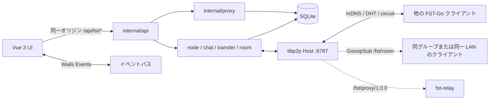

[English](README.md) | [简体中文](README_zh.md) | **日本語**

# FST-Go

**File Safe Transfer** — 安全なファイル転送。

Go で実装された LAN / クロスネットワーク対応の P2P デスクトップアプリケーションです。P2P のファイル転送、チャット、任意の自前出口プロキシを提供します。アカウント不要、中央の業務サーバーもありません。各マシンはクライアントであると同時に完全なノードです。同一 LAN 内は自動検出され、ネットワークをまたぐ場合も自分のリレーが 1 台あれば十分です。


### 本プログラムは学習・参考用です。違法な目的には使用しないでください。お役に立てれば幸いですが、作者はいかなる保証も行いません。

| 名称 | 意味 |
|---|---|
| **FST** | **F**ile **S**afe **T**ransfer（安全なファイル転送） |
| **Go** | バックエンドとノードを Go で実装。ファイルを「送り出す」という意味も持つ |

リポジトリと CLI では短縮名 `fst` を使用します（`fst.exe`、`fst-relay`、プロトコル ID `/fst/...` など）。製品名 FST-Go と同じプロジェクトです。

[](LICENSE)
[](https://go.dev/)
[](https://vuejs.org/)
[](https://libp2p.io/)

現在の配布形態：**Windows デスクトップ**（`fst.exe`）+ **Linux ヘッドレスリレー**（`fst-relay`）。本リポジトリは [MIT License](LICENSE) で公開されています。

---

## 目次

- [解決する課題](#解決する課題)
- [機能](#機能)
- [特長](#特長)
- [アーキテクチャ](#アーキテクチャ)
- [モジュール](#モジュール)
- [プロトコル](#プロトコル)
- [オープンソースコンポーネント](#オープンソースコンポーネント)
- [動作環境](#動作環境)
- [デスクトップ版のビルド](#デスクトップ版のビルド)
- [パッケージングと配布](#パッケージングと配布)
- [リレー：ビルド・デプロイ・設定](#リレービルドデプロイ設定)
- [リレーのグループと出口認証](#リレーのグループと出口認証)
- [クライアントからリレーへの接続](#クライアントからリレーへの接続)
- [ネットワークプロキシ（任意）](#ネットワークプロキシ任意)
- [設定とデータディレクトリ](#設定とデータディレクトリ)
- [開発とテスト](#開発とテスト)
- [現状と制限](#現状と制限)
- [ライセンス](#ライセンス)

---

## 解決する課題

一般的なクラウドストレージ、メッセンジャー、商用 VPN は、通信・ファイル・連絡先を他人のサーバー上に置きます。オフィスや家庭の LAN、あるいは両方とも NAT 配下にある 2 台の PC は、しばしば次のことだけを望みます。

1. **同一サブネット内で互いを認識し、メッセージを送り、ファイルを転送する** — 登録もパブリックアカウントも不要。
2. **同一サブネットでない場合**、ファイルをクラウドに置く代わりに、自分の VPS を「紹介役／転送役」として使う。
3. 必要に応じて、無関係なプロキシスタックを追加せず、本機の通信の一部または全部を**自分のリレー経由で出口**させる（自前出口）。

FST-Go はこの 3 つを 1 つのプロセス、1 つの業務ポートにまとめます。デバイス ID は libp2p PeerID で、検出・チャット・ファイル・プロキシはすべて暗号化接続上で多重化されます。ファイルはエンドツーエンド暗号化チャネルを通り、ファイル全体の SHA-256 検証とレジューム転送を行い、第三者のクラウドを経由しません。

---

## 機能

| 機能 | 説明 |
|---|---|
| デバイス検出 | 同一 LAN は mDNS で自動接続。クロスネットワークはリレーのディレクトリ + プライベート DHT。完全な multiaddr、PeerID + リレー、PeerID のみの 3 通りで追加可能 |
| P2P チャット | 暗号化チャネル、ローカル保存、配送 ACK、未読、リッチテキスト（1 メッセージ ≤32,000 文字）。テキスト / 画像 / ファイルカードの 3 種類の吹き出し。2 分以内の取り消し。アバターは HELLO で同期 |
| オフラインメッセージ | 相手がオフラインまたはタイムアウトの場合は「送信待ち」にし、15 秒ごとに指数バックオフで再送（上限 10 分・20 回）。相手のオンライン時に即座に送信。吹き出しから手動再送も可能 |
| グループチャット | GossipSub による自動ルーム。同一 LAN で 1 ルーム、リレーのグループキーを設定すると同グループのルームを追加。テキストのみ、履歴はローカル、メッセージ ID で重複排除。8787 を再利用しポートは追加しない |
| ファイル転送 | 複数選択 / デバイスカードへドラッグ、確認ダイアログ、信頼済みまたは自動受信、同時 1–8、`.fstpart` によるレジューム、ファイル全体の SHA-256、全体帯域制限、送信前ハッシュによるスキップ、失敗後のバッチ継続 |
| フォルダ転送 | ディレクトリを再帰送信し、相対構造と空ディレクトリを保持。1 バッチ ≤1000 ファイル、超過分は自動分割。シンボリックリンク / 特殊ファイルは送信前に通知 |
| クロスネットワーク | AutoNAT、DCUtR ホールパンチング、Circuit Relay。パンチング成功後は冗長なリレー接続を切断し直接接続へ昇格 |
| 自前リレー | `fst-relay`：サーキットリレー + オンラインディレクトリ + DHT サーバー。グループ分離、グループ有効期限、グループごとのソフト上限 |
| 出口認証 | `-exit-allow` の PeerID 許可リスト、`-exit-token` の複数トークン + 有効期限、`-exit-group` のグループ制限を積集合で適用。すべて未設定なら従来の動作 |
| 出口プロキシ | TUN 分割（CIDR / ドメイン）またはグローバル。IPv4 TCP+UDP、任意で実験的な IPv6。ローカル SOCKS5 受信（既定 `127.0.0.1:20300`） |
| SOCKS5 強化 | 任意の RFC1929 認証、送信元 CIDR 許可リスト、IP 単位 / 全体の同時接続上限。認証情報がなければループバック限定・認証なしのまま |
| デスクトップ統合 | トレイ、閉じる動作（確認 / トレイ / 終了）、システム通知、自動起動、単一 / 複数インスタンス |
| 基盤 | `user_version` によるスキーマ移行、オフラインアイコン、4 つの業務ページの zh/en 文言 |

---

## 特長

- **ID は PeerID であり、IP / MAC ではない。** 秘密鍵は `%APPDATA%\FST\identity.key` にあり、ニックネームやアドレスは変わってもデバイスの主キーは変わりません。
- **業務ポートは 8787 の 1 つだけ**（TCP + QUIC/UDP が同じ番号）。チャット、ファイル、プロキシはすべて libp2p ストリームを通り、機能ごとに公開ポートを増やしません。唯一の例外はローカル SOCKS5 受信（既定 `127.0.0.1:20300`、ループバックのみ）です。
- **ファイルのバイト列はフロントエンドに入らない。** Vue はローカルパスだけを受け取り、I/O・ハッシュ・進捗はすべて Go 側で処理し、進捗イベントは間引いて送信します。チャットの画像 / ファイルカードは transfer ID のみを扱います。
- **中央の業務データベースはない。** チャットと転送履歴はローカルの SQLite にのみ保存され、ノード間でメッセージを同期しません。スキーマ更新は `user_version` 移行で行います。
- **独自暗号は実装しない。** アプリケーション層のメッセージは libp2p の安全なチャネル（TCP では Noise/TLS、QUIC は標準搭載）を使用します。
- **出口は fail-closed。** リレーで `-exit` を有効にしても許可リストが空なら、そのマシンをプロキシとして誰も使えません。トークンはダイジェストのみ比較し、平文をログに出しません。
- **リレーは完全に自前で運用可能。** 公開リレーは同梱していません。設定した相手のアドレスにだけ通信が流れます。
- **高リスク機能は既定で無効。** プロキシ IPv6、SOCKS5 の LAN 送信元、出口トークン未設定時は従来版と同じ動作です。

---

## アーキテクチャ



デスクトップ版の起動後：データディレクトリを開く → SQLite を移行 → ID を読み込みまたは生成 → libp2p Host を構築 → チャット・転送・グループチャットを接続 → 設定に応じて SOCKS5/TUN を任意で起動 → Wails ウィンドウが `front/dist` を埋め込み、`/api/*` は Go が処理します。

---

## モジュール

| パス | 役割 |
|---|---|
| `main.go` / `instance.go` / `config.go` | ウィンドウ、トレイ、インスタンスディレクトリ、`config.yaml`、プロキシの組み立て |
| `internal/api` | `/api/fst/*`、`{code,message,data}` エンベロープ、読み取り専用メディアエンドポイント |
| `internal/node` | Host、mDNS、DHT、リレー予約、HELLO/ディレクトリ、在線状態、グループ表、アバター |
| `internal/chat` | チャット送受信、kind/attach、取り消し、オフラインキューと指数バックオフ、保存、ACK |
| `internal/room` | GossipSub グループチャット：自動ルーム、topic 導出、LAN 直結構成の検証、ローカル履歴 |
| `internal/transfer` | ファイル / フォルダの offer、自動分割、ストリームコピー、レジューム、検証、帯域制限、事前ハッシュ、進捗 |
| `internal/store` | SQLite（WAL、純 Go ドライバ）、`user_version` 移行 |
| `internal/proto` | プロトコル ID、JSON フレーミング、メッセージ構造 |
| `internal/proxy` | 出口クライアント、TUN、経路バイパス、fake-IP DNS、SOCKS5、出口トークン、IPv6 |
| `internal/e2e` | プロセス内マルチノード統合テスト |
| `cmd/fst-relay` | ヘッドレスリレー / 出口のエントリーポイント |
| `front/src/views/fst` | デバイス / チャット / 転送 / 設定 |
| `front/src/api/fst` + `types/api/fst.d.ts` | 唯一の業務 HTTP ラッパーと型契約 |
| `front/src/store/modules/fst.ts` | 唯一の Wails イベント購読ポイント |

---

## プロトコル

アプリケーション層のプロトコルは `internal/proto` に定義されています。下位の接続は libp2p が担当します（マルチアドレス、暗号化、多重化）。

| プロトコル ID | 用途 | フレーム形式 |
|---|---|---|
| `/fst/msg/1.0.0` | 制御とチャット：HELLO、CHAT、CHAT_ACK、CHAT_RECALL、FILE_OFFER/ACCEPT/REJECT/CANCEL、ERROR | uvarint 長 + JSON、1 フレーム ≤ 1 MiB |
| `/fst/file/1.0.0` | 単一ファイルの内容 | JSON `FileHeader` → 生バイト `[offset,size)` → 32 バイト SHA-256 → JSON `FileResult` |
| `/fst/proxy/1.0.0` | リレー経由の出口 | JSON `ProxyReq/Resp`。TCP 後は双方向コピー、UDP 後は 2 バイトのビッグエンディアン長プレフィックス付きデータグラム |
| GossipSub `fst/room/1.0.0/<room>` | グループチャット配信 | 署名付き JSON `RoomMsg`。`lan` は LAN ルーム、`g-<hash>` はグループルーム（ハッシュはキーを漏らさない） |
| mDNS サービス名 `fst` | LAN 検出 | UDP 5353 マルチキャスト |
| プライベート Kademlia `/fst` | PeerID によるアドレス検索 | peer routing のみ。公開 DHT には参加しない |

HELLO では、通常ノードは接続済みピアの LAN multiaddr を載せ（peer exchange）、**リレーのみ**が `Directory`（オンラインクライアントの PeerID）を記入します。クライアントは自分が設定したリレーから届いたディレクトリだけを信頼します。`group` は設定したリレーにのみ送信され、リレーの返信には `group_name` / `group_expires` / `group_error` が含まれます。アバターは base64 の小さな画像（≤16KB base64）のみで、ファイルのバイト列は送りません。

プライベートチャットには `queued`（送信待ち）状態があります。相手がオフラインまたはタイムアウトの場合はローカルキューに入り、バックオフしながら自動再送されます。`chat:ack` が状態変化を通知し、`POST /messages/{id}/retry` で手動再送できます。グループメッセージは GossipSub でのみ送信され、`/fst/msg` には入りません。LAN ルームは、元の送信者が直接接続された非 circuit の隣接ピアである場合のみ受け付けます。

`FileInfo` は `{id,name,size,rel_path?,sha256?}` です。`rel_path` はフォルダ転送に使われ、受信側は信頼できない入力として必ずサニタイズする必要があります。`ProxyReq` は `{net,addr,port,family?,token?}` で、`family` が `ip4`/`ip6` を明示し、出口側でデュアルスタックの推測は行いません。

UI と Go の間は libp2p では**ありません**。同一オリジンの HTTP `/api/fst/*`（業務エラーは HTTP 200 + `code: 400`）と Wails イベント（`peer:*`、`chat:*`、`transfer:*`、`proxy:status` など）を使います。

---

## オープンソースコンポーネント

直接の依存（バージョンは `go.mod` / `front/package.json` を参照）：

| コンポーネント | 用途 |
|---|---|
| [go-libp2p](https://github.com/libp2p/go-libp2p) v0.50 | PeerID、mDNS、Noise/TLS、yamux、TCP+QUIC、AutoNATv2、DCUtR、Circuit Relay |
| [go-libp2p-kad-dht](https://github.com/libp2p/go-libp2p-kad-dht) v0.42 | プライベート DHT |
| [go-libp2p-pubsub](https://github.com/libp2p/go-libp2p-pubsub) v0.18 | GossipSub グループチャット配信 |
| [Wails v3](https://wails.io/) `v3.0.0-beta.29` | デスクトップシェル、トレイ、ネイティブダイアログ、ドラッグ＆ドロップ、フロントエンドの埋め込み |
| [tun2socks](https://github.com/xjasonlyu/tun2socks) v2.6 + [gVisor](https://gvisor.dev/) | ユーザー空間 TUN スタック |
| [golang.zx2c4.com/wireguard](https://git.zx2c4.com/wireguard-go) / [Wintun](https://www.wintun.net/) | Windows TUN アダプター（公式署名済み `wintun.dll` が必要） |
| [modernc.org/sqlite](https://gitlab.com/cznic/sqlite) v1.60 | 純 Go の SQLite。実行時に CGO 不要 |
| [yaml.v3](https://github.com/go.yaml/yaml) v3.0.5 | `config.yaml` |
| Vue 3.5、Vite 8、Element Plus 2.13、Tailwind CSS v4、Pinia、vue-router、axios、wangEditor、DOMPurify、Iconify | UI、ビルド、オフラインアイコン |

サードパーティライブラリはそれぞれのライセンスに従います。本リポジトリのソースは MIT で提供されます。

---

## 動作環境

**デスクトップ**

- Windows 10/11 x64
- [WebView2](https://developer.microsoft.com/microsoft-edge/webview2/)（Windows 11 は通常プリインストール済み）
- LAN：ファイアウォールで **TCP/UDP 8787** と **UDP 5353**（mDNS）を許可。ルーターの AP / クライアント分離を無効化
- クロスネットワーク：リレーへの 8787 も許可し、設定で「クロスネットワークを許可」を有効化
- TUN プロキシ：管理者権限 + exe と同じディレクトリの `wintun.dll`
- SOCKS5 受信：管理者権限も `wintun.dll` も不要。既定ではループバックのみ待ち受け
- Linux デスクトップ（Ubuntu 24.04 で確認）：GTK4 + WebKitGTK 6.0 ランタイム。TUN プロキシには root / `CAP_NET_ADMIN` と `/dev/net/tun` が必要

**リレー**

- パブリック IPv4 を持つ Linux（現在の deb は amd64）
- セキュリティグループ / `ufw` で **TCP 8787 と UDP 8787** を許可
- 出口モードでは、リレーから対象アドレスへの TCP/UDP 送信も許可

---

## デスクトップ版のビルド

必要なもの：Go 1.26+、Node 22+、[pnpm](https://pnpm.io/)、[Wails v3 CLI](https://v3.wails.io/)（`go.mod` の Wails バージョンと一致させる）。

```powershell
go install github.com/wailsapp/wails/v3/cmd/wails3@v3.0.0-beta.29
$env:Path += ";$(go env GOPATH)\bin"

cd front
pnpm install
cd ..

# bin\fst.exe を上書きする前に実行中のプロセスを終了する
Stop-Process -Name fst -ErrorAction SilentlyContinue
wails3 build
```

成果物：`bin/fst.exe`、および `build/windows/wintun/` からコピーされた `bin/wintun.dll`。フロントエンドは exe に埋め込まれるため、配布時に `front/` を持ち運ぶ必要はありません。

ホットリロードでの開発（`bin/` には書き込まない）：

```powershell
wails3 dev
```

同じマシンで 2 つ目のインスタンスを起動（ID とポートを分離）：

```powershell
$env:FST_DATA_DIR = "D:\fst-dev-2"
$env:FST_PORT = "8788"
```

### Linux デスクトップ（Ubuntu 24.04 LTS で動作確認済み）

デスクトップ版は GTK4 + WebKitGTK（C ライブラリ、CGO 必須）に依存するため、`GOOS=linux` でのクロスコンパイルは**できません**。Linux 上でビルドしてください：

```bash
# システム依存
sudo apt update
sudo apt install -y build-essential pkg-config curl git
sudo apt install -y build-essential pkg-config libgtk-4-dev libwebkitgtk-6.0-dev

# ツールチェーン：Go 1.26+、Node 22+、pnpm（各公式ドキュメントに従ってインストール）
go install github.com/wailsapp/wails/v3/cmd/wails3@latest
export PATH=$PATH:$(go env GOPATH)/bin

# フロントエンド（Windows でビルドして front/dist をコピーしても可。embed には dist の存在が必要）
cd front
pnpm install
pnpm build
cd ..

# ビルド
wails3 build
```

成果物：`bin/fst`。

- Ubuntu 22.04 には WebKitGTK 6.0 がないため、GTK3 スタックへ変更します：`sudo apt install -y libgtk-3-dev libwebkit2gtk-4.1-dev`、ビルド時に `-tags gtk3` を付与。Ubuntu 20.04 以前は非対応。
- glibc 互換性：あるリリースでビルドしたバイナリは、そのリリース以降でのみ動作します。対象に 22.04 が含まれる場合は 22.04 上でビルドしてください。
- TUN プロキシには root / `CAP_NET_ADMIN` と `/dev/net/tun` が必要です。SOCKS5 受信（`127.0.0.1:20300`）は特権不要です。
- まず X11 セッションで確認してください。Wayland では WebKitGTK に既知の互換性問題があります。

---

## パッケージングと配布

FST-Go を別の Windows マシンで使う場合、**必要なのは `bin/fst.exe` だけ**です（TUN プロキシを使う場合は同じディレクトリの `wintun.dll` も）。`%APPDATA%\FST\` はコピーしないでください。そこにある `identity.key` はデバイス ID であり、同時にオンラインになる 2 台で共有すると PeerID が衝突します。

任意のインストーラー（ビルド機に [NSIS](https://nsis.sourceforge.io/) が必要）：

```powershell
wails3 package
```

WebView2 のブートストラッパーが同梱されます。NSIS がない場合は exe をそのまま配布してください。

---

## リレー：ビルド・デプロイ・設定

リレーには**UI も mDNS もありません**。役割は 3 つです：Circuit Relay（NAT 配下の 2 クライアント間の中継）、プライベート DHT、接続してきた FST-Go クライアントの PeerID を HELLO ディレクトリへ書き込むこと。`-exit` を付けると出口としても動作します。

### Windows でクロスコンパイルして deb を作る

```powershell
$env:GOOS = "linux"
$env:GOARCH = "amd64"
$env:CGO_ENABLED = "0"
go build -trimpath -ldflags "-s -w" -o bin/fst-relay-linux-amd64 ./cmd/fst-relay
Remove-Item Env:GOOS, Env:GOARCH, Env:CGO_ENABLED

$env:Path += ";$(go env GOPATH)\bin"
wails3 tool package -name fst-relay -format deb -config ./build/relay/nfpm.yaml -out ./bin
```

例えば `bin/fst-relay_0.1.3_amd64.deb` が生成されます。

### Linux へのインストール

```bash
sudo ufw allow 8787/tcp
sudo ufw allow 8787/udp
sudo dpkg -i fst-relay_0.1.3_amd64.deb
sudo systemctl status fst-relay
journalctl -u fst-relay -e
```

deb はバイナリを `/usr/bin/fst-relay`、ユニットファイルを `/lib/systemd/system/fst-relay.service` に配置し、postinstall で `enable --now` を実行します。データディレクトリの既定は `/var/lib/fst-relay` です（`identity.key` が PeerID を決めるため、ディレクトリを変えると ID も変わります）。

起動ログに、クライアントへ入力するアドレスが表示されます：

```text
/ip4/<サーバーのパブリックIP>/tcp/8787/p2p/<PeerID>
```

### コマンドラインフラグ

| フラグ | 既定値 | 意味 |
|---|---|---|
| `-data` | `/var/lib/fst-relay` | データディレクトリ（ID と DB） |
| `-port` | `8787` | TCP + UDP(QUIC) の待ち受けポート |
| `-name` | `fst-relay` | クライアントのデバイス一覧に表示される名前 |
| `-group` | 空 | 単一グループキー。同じキーを提示したクライアント同士だけを相互紹介 |
| `-group-file` | 空 | グループ表ファイル。1 行 1 エントリ `name:key[:expiry]`。`-group` とは排他。変更後 10 秒以内にホットリロードされ、リレーの再起動は不要 |
| `-group-max-terminals` | `0` | グループごとのオンラインクライアントのソフト上限。超過時はディレクトリ / 到達通知の送信のみ停止し、接続は切断しない |
| `-exit` | 無効 | 出口を有効化（`-exit-allow` でクライアントを列挙しないと誰も使えない） |
| `-exit-allow` | 空 | ファイル。1 行 1 クライアント PeerID。空ファイルまたは省略 = 全員拒否（fail-closed） |
| `-exit-token` | 空 | 出口トークンファイル。1 行 `token[:expiry]`。expiry は RFC3339 または Unix 秒 |
| `-exit-group` | 空 | このグループのクライアントだけが出口を使える。同グループはトークン不要 |
| `-exit-group-slots` | `0` | グループごとの同時出口セッション上限。0 は全体の 1024 制限のみ |

ログには有効なグループ数 / トークン数と PeerID だけを出力し、キーやトークンの平文は出力しません。

ポートなどの変更は systemd の drop-in で行います（deb の再インストールでも上書きされません）：

```bash
sudo systemctl edit fst-relay
```

編集領域にだけ次を記述します：

```ini
[Service]
ExecStart=
ExecStart=/usr/bin/fst-relay -data /var/lib/fst-relay -port 8787 -group-file /etc/fst-relay/groups.txt -exit -exit-allow /etc/fst-relay/allow.txt -exit-token /etc/fst-relay/tokens.txt
```

```bash
sudo mkdir -p /etc/fst-relay
sudo chmod 700 /etc/fst-relay
# allow.txt：1 行 1 クライアント PeerID（設定画面からコピー可能）
# groups.txt：1 行 name:key[:expiry]。例 office:change-me:2027-01-01T00:00:00Z
# tokens.txt：1 行 token[:expiry]。クライアントの設定画面「出口トークン」に同じ値を入力
sudo systemctl restart fst-relay
```

出口が不要な場合は既定の `ExecStart=/usr/bin/fst-relay -data /var/lib/fst-relay -port 8787` のままで構いません。チャットとファイル転送は引き続きサーキットリレーを利用します。

---

## リレーのグループと出口認証

**グループ分離**は、1 台のリレーに複数のクライアント群を収容するための仕組みです。

- クライアントは設定画面または `config.yaml: group` に文字列キーを入力し、設定したリレーにのみ送信します。
- リレーは `-group`（単一グループ）または `-group-file`（複数グループ表）で検証し、同グループのクライアント同士だけを相互紹介します。異なるグループ同士は互いに見えません。
- グループ表の行は `name:key[:expiry]`。有効期限が切れると、リレーはディレクトリと到達通知の配信を停止し、HELLO の返信に `group_error` を含めます。設定画面には「グループの有効期限切れ / キー無効」と表示されます。
- **グループ表のホットリロード**：`-group-file` を変更すると、リレーは再起動なしで 10 秒以内に表を差し替えます。グループの削除、キーの変更、有効期限切れは、そのグループのディレクトリ / 出口権限を即座に失効させ、HELLO を再送します。クライアント側で新しい `group` を保存した場合も、即座にリレーへ再接続します。
- `-group-max-terminals` はソフト上限です。超過時はディレクトリと到達通知の送信だけを停止し、接続は切断しません。
- グループを設定しない場合の動作は従来版と完全に同じです。

**出口認証**は 3 層の積集合です（検証順：許可リスト → グループ → トークン）。

1. `-exit-allow`：PeerID の許可リスト。`fst-relay` では常に有効で、空の許可リストは fail-closed を意味します。
2. `-exit-group`：指定グループのみ出口を利用可能。同グループはトークン不要。
3. `-exit-token`：クライアントが `proxy.token` で送信。リレーは定数時間で比較し、複数トークンと有効期限に対応します。

`-exit-group-slots` はグループごとの同時接続を制限し、全体の同時接続は 1024 です。`-exit` には空でない `-exit-allow` が必須で、なければ誰も出口を使えません。

境界：グループは共有キーモデルで、オンラインでのローテーション / 失効 API はありません。表の変更後はリレーの再起動が必要で、クライアントも設定変更後に再起動が必要です。リレーは暗号化されたストリーム自体は見えますが、エンドツーエンドの安全性は libp2p が保証します。

---

## クライアントからリレーへの接続

1. 設定 → **クロスネットワークを許可** を開き、リレーアドレスを 1 行ずつ `/ip4/<パブリックIP>/tcp/8787/p2p/<PeerID>` の形式で入力し、保存後に **FST-Go を再起動**します。
2. 2 台のクライアントが同じリレーに接続すると、デバイスページにリレーのカードが表示されます。ディレクトリの配信に成功すると、相手も「オンラインデバイス」に現れます。
3. 一覧にリレーしかない場合は、「デバイスを追加」→ PeerID のみ（DHT）または PeerID + リレーを使用します。
4. チャットはカードの「チャット」、ファイルは「ファイルを送信」またはカードへのドラッグで開始します。カードが「リレー」ならサーバー経由で転送中、「直接」ならホールパンチング成功または元から直接接続できる状態です。

`config.yaml` は exe と同じディレクトリに置きます（開発時はプロジェクトルートでも可）。設定画面で保存するとこのファイルが書き換わります。**グループキーは保存後すぐにリレーへ再接続して有効になります**が、その他のクロスネットワーク / プロキシ関連項目は再起動が必要です。

```yaml
enable_relay: true
relays:
  - /ip4/<PUBLIC_IP>/tcp/8787/p2p/<RELAY_PEER_ID>
group: ""                # リレーのグループキー。空 = グループなし
proxy:
  enable: false
  mode: split            # split | global
  exit: /ip4/<PUBLIC_IP>/tcp/8787/p2p/<RELAY_PEER_ID>
  routes:
    - 93.184.216.0/24
  domains:
    - example.com
  token: ""              # リレーの -exit-token に対応する出口トークン
  ipv6: false            # 実験的：TUN IPv6 スタック + fake AAAA
  socks_enable: true     # ローカル SOCKS5 受信（既定で有効）
  socks_user: ""
  socks_pass: ""
  socks_allow: []        # 送信元 CIDR。空でない場合は認証情報が必須
  socks_max_conn: 0
  socks_max_per_ip: 0
```

---

## ネットワークプロキシ（任意）

**同じ** `/fst/proxy/1.0.0` ストリームで `fst-relay` から出口へ出ます。追加の公開ポートは開きません。プロキシを使うには、クロスネットワークを有効にし、出口としてリレーを設定しておく必要があります。

- **分割 `split`**：列挙した CIDR および / またはドメイン（fake-IP `198.18.0.0/15`、DNS `198.18.0.2`）だけをトンネルへ送ります。ドメインルールがある場合、システム / パブリック DNS の `/32` も TUN に入り、一致しないドメインは出口側で解決されます。
- **グローバル `global`**：既定ルートを TUN に入れます。LAN、システム DNS、一般的なパブリック DNS、出口リレーの IP は元のゲートウェイを使い、イントラネットと名前解決をトンネルに巻き込みません。
- **転送**：IPv4 TCP + UDP。`proxy.ipv6=true` の場合は IPv6 出口（AAAA、IPv6 リテラル、`tcp6`/`udp6`）と TUN の v6 スタックを追加し、失敗時は IPv4 へ自動的にフォールバックします。
- **出口の安全性**：ループバック、プライベート、リンクローカル、ULA、マルチキャスト宛先を拒否します。許可リスト、トークン、グループは設定されていれば認証に参加します。
- **SOCKS5 受信**：`127.0.0.1:20300`（使用中ならランダムポートへフォールバック）。CONNECT + UDP ASSOCIATE に対応し、ブラウザから `socks5h://` で利用できます。TUN の強制はありません。任意で RFC1929 認証、送信元 CIDR、同時接続上限を設定できます。送信元許可リストを設定してパスワードがない場合、強化版は起動を拒否します（ループバック限定・認証なしへフォールバックし、Warn を記録）。
- **TUN**：管理者権限 + `wintun.dll` が必要です。`proxy.ipv6=true` のときインターフェースに `fdfe:1::1/64` を追加し、fake AAAA は `fdfe:2::/64` を使用します。

Windows では `fst.exe` を管理者として起動します（SOCKS5 のみの場合は不要）。リレーは `-exit` 付きで起動し、許可リスト / トークン / グループの検証を通る必要があります。通らなければ外へは接続できません。失敗理由は設定画面のプロキシ状態、および `%APPDATA%\FST\fst.log` / `journalctl -u fst-relay` で確認できます。

確認方法：

```powershell
nslookup www.google.com 8.8.8.8          # グローバルモードでは 198.18.x.x が返る（ハイジャック）
curl.exe -x socks5h://127.0.0.1:20300 -I --ssl-no-revoke https://www.google.com
curl.exe -s -o NUL -w "%{http_code}" --ssl-no-revoke https://www.qq.com   # TUN 経由
```

---

## 設定とデータディレクトリ

| 場所 | 内容 |
|---|---|
| `%APPDATA%\FST\identity.key` | デバイス ID。同時にオンラインになる 2 台で共有しないこと |
| `%APPDATA%\FST\fst.db` | デバイス、チャット、転送、一部の設定（WAL） |
| `%APPDATA%\FST\fst.log` | ログ |
| `config.yaml`（exe の隣またはプロジェクトルート） | クロスネットワークのスイッチ、リレー一覧、グループ、プロキシ、SOCKS5 |
| 既定のダウンロード先 | `%USERPROFILE%\Downloads\FST` |

SQLite は `PRAGMA user_version` によるバージョン付き移行を使用します（現在 v6：`transfers.rel_path`、メッセージの `kind/recalled/attach/attempts/next_retry`、`peers.avatar`、`room_messages`/`rooms`）。アップグレード時に手作業でのスキーマ変更は不要です。

全体の移行：FST-Go を終了して `%APPDATA%\FST\` を丸ごとコピーします。単に 1 台追加する場合は exe だけをコピーし、新しい ID を生成させてください。

環境変数：`FST_DATA_DIR`、`FST_PORT`。

---

## 開発とテスト

```powershell
go test . ./internal/...
cd front
npx vue-tsc --noEmit
```

プロキシのテストはすべてダイヤルをモックし、実ネットワークインターフェースには触れません。実際のデュアルスタック IPv6、NAT ホールパンチング、Windows TUN は実機での手動リグレッションが必要です。

協業ルールはルートの [AGENTS.md](AGENTS.md) を参照してください。モジュール、プロトコル、未実装項目の詳細は [docs/开发文档.md](docs/开发文档.md)、アーキテクチャとドキュメント照合の結論は [docs/项目架构分析报告.md](docs/项目架构分析报告.md)、経緯は [docs/开发计划.md](docs/开发计划.md)、プロキシ障害の分析は [docs/代理故障分析与改进报告.md](docs/代理故障分析与改进报告.md)、実ネットワークでの手動リグレッション手順は [docs/回归清单.md](docs/回归清单.md)、リレーのトラブルシューティングは [部署.md](部署.md) にあります。

---

## 現状と制限

- **デスクトップ版は現在 Windows が主要な配布対象です**。Linux デスクトップは Ubuntu 24.04 でのビルドと動作を確認済み（「デスクトップ版のビルド」参照）、macOS は未検証です。Windows インストーラーには NSIS が必要で、現在は主に exe を直接配布しています。
- プロキシ IPv6 は依然として実験的な機能で、実際のデュアルスタック環境での手動リグレッションが必要です。IPv6 グローバルモードはシステムの既定 v6 ルートによるバイパスに依存します。プロキシチェーンには対応していません。
- SOCKS5 の強化は既定で無効です。認証情報がない場合はループバック限定・認証なしのままで、同一マシンの任意のプロセスが利用できます。送信元許可リストと同時接続上限は手動で有効化する必要があります。
- リレーのグループは共有キーで、複数グループ / 有効期限 / ソフト上限に対応しますが、オンラインでのローテーションや失効 API はありません。表の変更後は再起動が必要です。
- 転送の帯域制限はプロセス全体の合計で、相手や方向ごとには設定できません。事前ハッシュは元ファイルをもう一度読み込みます。
- ハッシュによるスキップは `prehash` が有効な場合のみ機能します。スキップされたシンボリックリンク / 特殊ファイルは送信時に通知されるだけで、DB には保存されません。
- グループチャットはテキストのみで、画像 / ファイルには対応しません。履歴はローカルのみで、新規参加者は参加前のメッセージを見られず、オフラインのグループメッセージ配信やメンバー管理もありません。
- オフラインメッセージの自動再送は最大 20 回（バックオフ上限 10 分）で、その後は失敗となり手動再送が必要です。メッセージは相手のオンライン後にのみ配信され、サーバー側での一時保管は行いません。
- グループチャットのルームは「同一 LAN / 同一リレーグループ」で自動的に決まり、手動での作成や招待はできません。LAN ルームは直接接続に依存し、クロスネットワークではリレー経由の小さなテキストメッセージにのみ適しています。
- チャットの取り消し可能時間は 2 分で、自分が送信したメッセージのみ取り消せます。アバターは PNG/JPEG のみ、元画像 ≤12KB（base64 ≤16KB）で、切り抜きや圧縮はありません。
- ログは単一ファイルで、ローテーション、クラッシュレポート、RTT / 通信量の統計はありません。

---

## ⚠️ 免責事項

本ソフトウェアは学習および研究用途のみを目的としています。現地の法令を遵守してください。本ソフトウェアの使用によって生じたいかなる結果も、利用者の責任となります。

---

## ライセンス

Copyright (c) 2026 FST-Go contributors

本プログラムは [MIT License](LICENSE) で公開されています。著作権表示とライセンス表示を保持すれば、自由な使用、改変、配布、商用利用が可能です。本プログラムは学習・参考用であり、違法な目的には使用しないでください。お役に立てれば幸いですが、いかなる保証も行いません。

依存ライブラリはそれぞれの元のライセンスに従います。
