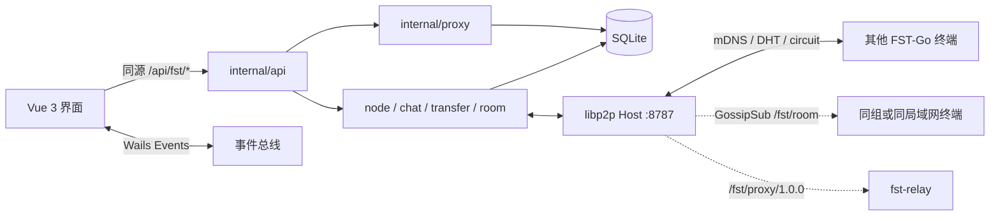

<div align="center">

[English](README.md) | **简体中文** | [日本語](README_ja.md)

# FST-Go

**File Safe Transfer** — 文件安全传输。

用 Go 实现的局域网 / 跨网络 P2P 桌面程序：点对点传文件、聊天，以及可选的自建出网代理。无账号、无中心业务服务器。每台电脑既是客户端也是完整节点；局域网自动发现，跨网段只需要你自己的一台中继。

</div>

### 本程序仅供学习参考之用，请勿用于非法用途，希望对你有帮助，但作者本人不提供任何担保。

| 名称 | 含义 |
|---|---|
| **FST** | **F**ile **S**afe **T**ransfer，文件安全传输 |
| **Go** | 后端与节点用 Go 编写，也表示把文件「送出去」 |

仓库与命令行里仍使用短名 `fst`（例如 `fst.exe`、`fst-relay`、协议 ID `/fst/...`），与产品名 FST-Go 是同一项目。

[](LICENSE)
[](https://go.dev/)
[](https://vuejs.org/)
[](https://libp2p.io/)

当前发布形态：**Windows 桌面端**（`fst.exe`）+ **Linux 无头中继**（`fst-relay`）。本仓库以 [MIT License](LICENSE) 发布。

---

## 目录

- [它解决什么问题](#它解决什么问题)
- [功能](#功能)
- [特点](#特点)
- [架构](#架构)
- [模块](#模块)
- [协议](#协议)
- [开源组件](#开源组件)
- [运行环境](#运行环境)
- [编译桌面端](#编译桌面端)
- [打包与分发](#打包与分发)
- [中继：编译、部署与设置](#中继编译部署与设置)
- [中继分组与出口鉴权](#中继分组与出口鉴权)
- [终端如何连上中继](#终端如何连上中继)
- [网络代理（可选）](#网络代理可选)
- [配置与数据目录](#配置与数据目录)
- [开发与测试](#开发与测试)
- [现状与限制](#现状与限制)
- [许可证](#许可证)

---

## 它解决什么问题

常见网盘、即时通讯和商业 VPN 都把流量、文件和通讯录放在别人的服务器上。办公室、家庭局域网、或两台都在 NAT 后面的电脑，往往只想：

1. **同一网段互相看见、发消息、传文件**，不要注册、不要公网账号。
2. **不在同一网段时**，用自己的一台 VPS 当“介绍人 / 转发人”，而不是把文件存到云盘。
3. 需要时，让本机部分或全部上网流量 **经自己的中继出网**（类似自建出口），而不是再装一套无关的代理栈。

FST-Go 把这三件事放进同一个进程、同一个业务端口：设备身份是 libp2p PeerID，发现、聊天、文件和代理都在加密连接上多路复用。文件走端到端加密信道、整文件 SHA-256 校验、断点续传，不经过第三方网盘。

---

## 功能

| 能力 | 说明 |
|---|---|
| 设备发现 | 局域网 mDNS 自动上线；跨网靠中继目录 + 私有 DHT，可用完整 multiaddr、PeerID+中继或仅 PeerID 添加 |
| 点对点聊天 | 加密信道、本地存档、送达 ACK、未读、富文本（单条 ≤32000 字符）；文本 / 图片 / 文件卡片三种气泡；2 分钟内可撤回；头像随 HELLO 同步 |
| 离线消息 | 对端离线/超时先转「待发送」，每 15 秒扫描并按指数退避自动重投（上限 10 分钟、20 次），上线立即冲刷；气泡可手动重试 |
| 群聊 | 基于 GossipSub 自动房间：同一局域网一个房间，配置中继分组密钥后再加同组房间；仅文本、本机历史、按消息 ID 去重；复用 8787，不新开端口 |
| 文件传输 | 多选 / 拖到设备卡片、确认弹窗、信任或自动接收、并发 1–8、`.fstpart` 断点续传、整文件 SHA-256、全局限速、发送前预哈希跳过、失败后继续整批 |
| 文件夹传输 | 递归发送目录、保留相对结构与空目录；单批 ≤1000 文件，超过自动拆批；符号链接/特殊文件发送前提示 |
| 跨网络 | AutoNAT、DCUtR 打洞、Circuit Relay；打洞成功后丢掉中继冗余连接，升级直连 |
| 自建中继 | `fst-relay`：电路中继 + 在线目录 + DHT Server；支持分组隔离、组表过期、每组软上限 |
| 出口鉴权 | `-exit-allow` PeerID 白名单、`-exit-token` 多令牌+过期、`-exit-group` 分组限制，三者取交集；全部未配置时保持旧行为 |
| 出网代理 | TUN 分流（CIDR / 域名）或全局；IPv4 TCP+UDP，可选实验性 IPv6；本机 SOCKS5 入站（默认 `127.0.0.1:20300`） |
| SOCKS5 加固 | 可选 RFC1929 账号、来源 CIDR 白名单、单 IP/全局并发上限；未配置账号时仍是仅回环免认证 |
| 桌面集成 | 托盘、关闭行为（询问 / 托盘 / 退出）、系统通知、开机自启、单实例或多实例 |
| 工程地基 | `user_version` 版本化迁移、离线图标、四个业务页 zh/en 词条 |

---

## 特点

- **身份是 PeerID，不是 IP / MAC。** 私钥在 `%APPDATA%\FST\identity.key`，昵称和地址可变，设备主键不变。
- **业务单端口 8787**（TCP + QUIC/UDP 同号）。聊天、文件、代理都走 libp2p stream，不为业务再开公网端口；唯一例外是本机 SOCKS5 入站（默认 `127.0.0.1:20300`，仅回环）。
- **文件字节不进前端。** Vue 只拿到本地路径；读写、哈希、进度都在 Go 里，进度事件节流推送；聊天图片/文件卡片只传 transfer ID。
- **无中心业务库。** 聊天和传输历史只存在本机 SQLite，节点之间不同步消息；schema 升级由 `user_version` 迁移完成。
- **加密不自研。** 应用层消息走 libp2p 安全通道（TCP 上 Noise/TLS，QUIC 自带）。
- **出口 fail-closed。** 中继开 `-exit` 但白名单为空时，谁也不能拿这台机器当代理；令牌只比较摘要，日志不打印明文。
- **中继可完全自建。** 项目不内置公共中继；你填谁的地址，流量才经过谁。
- **高风险能力默认关闭。** 代理 IPv6、SOCKS5 局域网来源、出口令牌未配置时，行为与旧版一致。

---

## 架构



桌面端启动后：打开数据目录 → 迁移 SQLite → 加载或生成身份 → 建 libp2p Host → 挂聊天、传输与群聊房间 → 按配置可选启动 SOCKS5/TUN → Wails 窗口把 `front/dist` 嵌进去，`/api/*` 由 Go 处理。

---

## 模块

| 路径 | 职责 |
|---|---|
| `main.go` / `instance.go` / `config.go` | 窗口、托盘、实例目录、`config.yaml`、代理装配 |
| `internal/api` | `/api/fst/*`，`{code,message,data}` 信封，只读媒体端点 |
| `internal/node` | Host、mDNS、DHT、中继预约、HELLO/目录、在线状态、分组表、头像 |
| `internal/chat` | 聊天收发、kind/attach、撤回、离线队列与指数退避、落库、ACK |
| `internal/room` | GossipSub 群聊：自动房间、topic 派生、LAN 直连校验、本机历史 |
| `internal/transfer` | 文件/文件夹 offer、自动分批、流式拷贝、续传、校验、限速、预哈希、进度 |
| `internal/store` | SQLite（WAL，纯 Go 驱动）、`user_version` 版本化迁移 |
| `internal/proto` | 协议 ID、JSON 分帧、消息结构 |
| `internal/proxy` | 出口 Client、TUN、路由绕行、fake-IP DNS、SOCKS5、出口令牌、IPv6 |
| `internal/e2e` | 进程内多节点集成测试 |
| `cmd/fst-relay` | 无头中继/出口入口 |
| `front/src/views/fst` | 设备 / 聊天 / 传输 / 设置 |
| `front/src/api/fst` + `types/api/fst.d.ts` | 唯一业务 HTTP 封装与类型契约 |
| `front/src/store/modules/fst.ts` | 唯一的 Wails 事件订阅点 |

---

## 协议

应用层协议定义在 `internal/proto`。底层连接由 libp2p 负责（多地址、加密、多路复用）。

| 协议 ID | 用途 | 帧格式 |
|---|---|---|
| `/fst/msg/1.0.0` | 控制与聊天：HELLO、CHAT、CHAT_ACK、CHAT_RECALL、FILE_OFFER/ACCEPT/REJECT/CANCEL、ERROR | uvarint 长度 + JSON，单帧 ≤ 1 MiB |
| `/fst/file/1.0.0` | 单文件内容 | JSON `FileHeader` → 裸字节 `[offset,size)` → 32 字节 SHA-256 → JSON `FileResult` |
| `/fst/proxy/1.0.0` | 经中继出网 | JSON `ProxyReq/Resp`；TCP 之后双向拷贝；UDP 之后为 2 字节大端长度前缀数据报 |
| GossipSub `fst/room/1.0.0/<room>` | 群聊广播 | 签名 JSON `RoomMsg`；`lan` 为局域网房间，`g-<hash>` 为分组房间（哈希不泄露密钥） |
| mDNS 服务名 `fst` | 局域网发现 | UDP 5353 多播 |
| 私有 Kademlia `/fst` | 按 PeerID 查地址 | 仅 peer routing，不上公共 DHT |

HELLO 里：普通节点带已连对端的局域网 multiaddr（peer exchange）；**只有中继**填写 `Directory`（在线终端 PeerID），终端只采信自己配置的中继发来的目录；`group` 只发给配置的中继，中继回包带 `group_name` / `group_expires` / `group_error`。头像只带 base64 小图（≤16KB base64），不传文件字节。

私聊状态新增 `queued`（待发送）：离线或超时先入本机队列，自动退避重投；`chat:ack` 会推送状态变化，`POST /messages/{id}/retry` 可手动重试。群聊消息只通过 GossipSub 发送，不进入 `/fst/msg`；局域网房间只接受原始发送方为直连非 circuit 的邻居。

`FileInfo` 为 `{id,name,size,rel_path?,sha256?}`；`rel_path` 用于文件夹传输，接收端必须按不可信输入清洗。`ProxyReq` 为 `{net,addr,port,family?,token?}`，`family` 显式声明 `ip4`/`ip6`，出口不做双栈猜测。

UI 与 Go 之间 **不是** libp2p：同源 HTTP `/api/fst/*`（业务错误 HTTP 200 + `code: 400`）+ Wails 事件（`peer:*`、`chat:*`、`transfer:*`、`proxy:status` 等）。

---

## 开源组件

直接依赖（版本以 `go.mod` / `front/package.json` 为准）：

| 组件 | 用途 |
|---|---|
| [go-libp2p](https://github.com/libp2p/go-libp2p) v0.50 | PeerID、mDNS、Noise/TLS、yamux、TCP+QUIC、AutoNATv2、DCUtR、Circuit Relay |
| [go-libp2p-kad-dht](https://github.com/libp2p/go-libp2p-kad-dht) v0.42 | 私有 DHT |
| [go-libp2p-pubsub](https://github.com/libp2p/go-libp2p-pubsub) v0.18 | GossipSub 群聊广播 |
| [Wails v3](https://wails.io/) `v3.0.0-beta.29` | 桌面壳、托盘、原生对话框、拖放、嵌入前端 |
| [tun2socks](https://github.com/xjasonlyu/tun2socks) v2.6 + [gVisor](https://gvisor.dev/) | TUN 用户态协议栈 |
| [golang.zx2c4.com/wireguard](https://git.zx2c4.com/wireguard-go) / [Wintun](https://www.wintun.net/) | Windows TUN 网卡（需官方签名 `wintun.dll`） |
| [modernc.org/sqlite](https://gitlab.com/cznic/sqlite) v1.60 | 纯 Go SQLite，运行时无 CGO |
| [yaml.v3](https://github.com/go.yaml/yaml) v3.0.5 | `config.yaml` |
| Vue 3.5、Vite 8、Element Plus 2.13、Tailwind CSS v4、Pinia、vue-router、axios、wangEditor、DOMPurify、Iconify | 界面、构建与离线图标 |

第三方库保留各自许可证。本仓库源码以 MIT 覆盖。

---

## 运行环境

**桌面端**

- Windows 10/11 x64
- [WebView2](https://developer.microsoft.com/microsoft-edge/webview2/)（Win11 通常已带）
- 局域网：防火墙放行 **TCP/UDP 8787**、**UDP 5353**（mDNS）；关闭路由器 AP/客户端隔离
- 跨网络：再放行到中继的 8787，并在设置里打开「允许跨网络」
- TUN 代理：管理员权限 + exe 旁的 `wintun.dll`
- SOCKS5 入站：不需要管理员、不需要 `wintun.dll`；默认只监听回环

**中继**

- 公网 IPv4 的 Linux（当前 deb 为 amd64）
- 安全组 / `ufw` 放行 **TCP 8787 与 UDP 8787**
- 出口模式还需允许中继向目标地址发起 TCP/UDP

---

## 编译桌面端

需要：Go 1.26+、Node 22+、[pnpm](https://pnpm.io/)、[Wails v3 CLI](https://v3.wails.io/)（与 `go.mod` 中 Wails 版本一致）。

```powershell
go install github.com/wailsapp/wails/v3/cmd/wails3@v3.0.0-beta.29
$env:Path += ";$(go env GOPATH)\bin"

cd front
pnpm install
cd ..

# 覆盖 bin\fst.exe 前先结束正在运行的进程
Stop-Process -Name fst -ErrorAction SilentlyContinue
wails3 build
```

产物：`bin/fst.exe`，以及从 `build/windows/wintun/` 复制过去的 `bin/wintun.dll`。前端已经嵌进 exe，分发不必带 `front/`。

开发热重载（不写 `bin/`）：

```powershell
wails3 dev
```

同机开第二个实例（独立身份与端口）：

```powershell
$env:FST_DATA_DIR = "D:\fst-dev-2"
$env:FST_PORT = "8788"
```

---

## 打包与分发

把 FST-Go 拷到另一台 Windows，**只需要 `bin/fst.exe`**（若要用 TUN 代理，再带上同目录的 `wintun.dll`）。不要拷 `%APPDATA%\FST\`：那里的 `identity.key` 是设备身份，两台机器共用会 PeerID 冲突。

可选安装包（需本机安装 [NSIS](https://nsis.sourceforge.io/)）：

```powershell
wails3 package
```

会把 WebView2 引导程序打进安装包。没有 NSIS 时，直接分发 exe 即可。

---

## 中继：编译、部署与设置

中继 **没有界面、不做 mDNS**。它做三件事：Circuit Relay（NAT 后的两台终端互相转发）、私有 DHT、把连上它的 FST-Go 终端 PeerID 写进 HELLO 目录。加上 `-exit` 后，还可以当出网出口。

### 在 Windows 上交叉编译并打 deb

```powershell
$env:GOOS = "linux"
$env:GOARCH = "amd64"
$env:CGO_ENABLED = "0"
go build -trimpath -ldflags "-s -w" -o bin/fst-relay-linux-amd64 ./cmd/fst-relay
Remove-Item Env:GOOS, Env:GOARCH, Env:CGO_ENABLED

$env:Path += ";$(go env GOPATH)\bin"
wails3 tool package -name fst-relay -format deb -config ./build/relay/nfpm.yaml -out ./bin
```

得到例如 `bin/fst-relay_0.1.3_amd64.deb`。

### 在 Linux 上安装

```bash
sudo ufw allow 8787/tcp
sudo ufw allow 8787/udp
sudo dpkg -i fst-relay_0.1.3_amd64.deb
sudo systemctl status fst-relay
journalctl -u fst-relay -e
```

deb 会把二进制装到 `/usr/bin/fst-relay`，单元文件到 `/lib/systemd/system/fst-relay.service`，postinstall 会 `enable --now`。数据目录默认 `/var/lib/fst-relay`（`identity.key` 决定 PeerID，换目录等于换身份）。

启动日志会打印应填进客户端的地址：

```text
/ip4/<服务器公网IP>/tcp/8787/p2p/<PeerID>
```

### 命令行参数

| 参数 | 默认 | 含义 |
|---|---|---|
| `-data` | `/var/lib/fst-relay` | 数据目录（身份与库） |
| `-port` | `8787` | TCP + UDP(QUIC) 监听端口 |
| `-name` | `fst-relay` | 终端设备列表里显示的名字 |
| `-group` | 空 | 单组密钥：只把出示同一密钥的终端互相介绍 |
| `-group-file` | 空 | 组表文件，每行 `name:key[:expiry]`；与 `-group` 互斥；修改后 10 秒内热加载，无需重启中继 |
| `-group-max-terminals` | `0` | 每组在线终端软上限；超限只停发目录/到达通知，不踢连接 |
| `-exit` | 关 | 开启出网出口（还需 `-exit-allow` 列出终端，否则没人能用） |
| `-exit-allow` | 空 | 文件：每行一个终端 PeerID；空文件或省略 = 拒绝所有人（fail-closed） |
| `-exit-token` | 空 | 出口令牌文件，每行 `token[:expiry]`；expiry 支持 RFC3339 或 Unix 秒 |
| `-exit-group` | 空 | 只允许该组终端使用出口；同组可免令牌 |
| `-exit-group-slots` | `0` | 每组并发出口会话上限；0 表示只受全局 1024 限制 |

日志只打印生效组数/令牌数与 PeerID，不打印密钥或令牌明文。

改端口等参数用 systemd drop-in（重装 deb 不会冲掉）：

```bash
sudo systemctl edit fst-relay
```

只在编辑区写入：

```ini
[Service]
ExecStart=
ExecStart=/usr/bin/fst-relay -data /var/lib/fst-relay -port 8787 -group-file /etc/fst-relay/groups.txt -exit -exit-allow /etc/fst-relay/allow.txt -exit-token /etc/fst-relay/tokens.txt
```

```bash
sudo mkdir -p /etc/fst-relay
sudo chmod 700 /etc/fst-relay
# allow.txt：每行一个终端 PeerID（设置页可复制）
# groups.txt：每行 name:key[:expiry]，例如 office:change-me:2027-01-01T00:00:00Z
# tokens.txt：每行 token[:expiry]，客户端在设置页「出口令牌」填写同一个值
sudo systemctl restart fst-relay
```

没有出口需求时，保持默认 `ExecStart=/usr/bin/fst-relay -data /var/lib/fst-relay -port 8787` 即可，聊天和传文件仍然走电路中继。

---

## 中继分组与出口鉴权

**分组隔离**用于同一台中继上的多批终端：

- 终端在设置页或 `config.yaml: group` 填一个字符串密钥，只发给配置的中继。
- 中继用 `-group`（单组）或 `-group-file`（多组表）校验；只把同组终端互相介绍，异组零可见。
- 组表行 `name:key[:expiry]`，过期后中继不再下发目录与到达通知，并在 HELLO 回包带 `group_error`；设置页显示「分组已过期 / 密钥无效」。
- **组表热加载**：修改 `-group-file` 后中继在 10 秒内自动换表，无需重启；删除组、换钥或过期会立即撤销该组终端的目录/出口资格，并主动重发 HELLO。终端保存新的 `group` 后也会立即重连中继。
- `-group-max-terminals` 是软上限：超限只停发目录与到达通知，不断开连接。
- 未配置分组时行为与旧版完全一致。

**出口鉴权**三层取交集（校验顺序：白名单 → 分组 → 令牌）：

1. `-exit-allow`：PeerID 白名单；`fst-relay` 始终启用，空白名单即 fail-closed。
2. `-exit-group`：只允许指定组；同组免令牌。
3. `-exit-token`：终端在 `proxy.token` 携带；中继常量时间比较，支持多令牌与过期。

`-exit-group-slots` 限制每组并发；全局并发 1024。`-exit` 必须同时提供非空 `-exit-allow`，否则谁也用不了出口。

边界：分组是共享密钥模型，没有在线轮换/吊销接口，改表后需重启中继，终端改配置后需重启客户端。中继仍能看到加密流，端到端安全由 libp2p 保证。

---

## 终端如何连上中继

1. 设置 → **允许跨网络**，中继地址填一行 `/ip4/<公网IP>/tcp/8787/p2p/<PeerID>`，保存后 **重启 FST-Go**。
2. 两台终端都连上同一中继后，设备页会出现中继卡片；目录下发成功则对方也会出现在「在线设备」。
3. 若列表里暂时只有中继：用「添加设备」→ 仅 PeerID（DHT）或 PeerID+中继。
4. 聊天点卡片「聊天」；文件点「发送文件」或把文件拖到卡片上。卡片显示「中继」表示正在走服务器转发，「直连」表示已经打洞或本来就能直连。

`config.yaml` 与 exe 放在同一目录（开发时也可放在项目根）。设置页保存会改写该文件：**分组密钥保存后立即重连中继并生效**，其余跨网络与代理相关项仍需重启。

```yaml
enable_relay: true
relays:
  - /ip4/<PUBLIC_IP>/tcp/8787/p2p/<RELAY_PEER_ID>
group: ""                # 中继分组密钥；留空 = 不分组
proxy:
  enable: false
  mode: split            # split | global
  exit: /ip4/<PUBLIC_IP>/tcp/8787/p2p/<RELAY_PEER_ID>
  routes:
    - 93.184.216.0/24
  domains:
    - example.com
  token: ""              # 中继 -exit-token 的出口令牌
  ipv6: false            # 实验：TUN IPv6 栈 + fake AAAA
  socks_enable: true     # 本机 SOCKS5 入站（缺省开启）
  socks_user: ""
  socks_pass: ""
  socks_allow: []        # 来源 CIDR；非空时强制要求账号
  socks_max_conn: 0
  socks_max_per_ip: 0
```

---

## 网络代理（可选）

经 **同一条** `/fst/proxy/1.0.0` 流到 `fst-relay` 出网，不另开公网端口。代理需要先开启跨网络并配置中继作为出口。

- **分流 `split`**：只把列出的 CIDR 和/或域名（fake-IP `198.18.0.0/15`，DNS `198.18.0.2`）送进隧道；有域名规则时系统/公共 DNS 的 `/32` 也进 TUN，未命中域名经出口解析。
- **全局 `global`**：默认路由进 TUN；局域网、系统 DNS、常用公共 DNS、出口中继 IP 走原网关，避免把内网和解析一起送进隧道。
- **传输**：IPv4 TCP + UDP；`proxy.ipv6=true` 时增加 IPv6 出口（AAAA、IPv6 字面量、`tcp6`/`udp6`）与 TUN v6 栈，失败自动降级 IPv4。
- **出口安全**：拒绝环回、私网、链路本地、ULA、组播目标；白名单 + 令牌 + 分组任一配置即参与鉴权。
- **SOCKS5 入站**：`127.0.0.1:20300`（占用时回退随机端口），CONNECT + UDP ASSOCIATE，供浏览器 `socks5h://` 使用，不强制走 TUN。可选 RFC1929 账号、来源 CIDR、并发上限；配置了来源白名单但未设密码时拒绝启动加固版（回退回环免认证并记 Warn）。
- **TUN**：需要管理员 + `wintun.dll`；`proxy.ipv6=true` 时接口增加 `fdfe:1::1/64`，fake AAAA 使用 `fdfe:2::/64`。

Windows 上以管理员启动 `fst.exe`（只用 SOCKS5 时不需要）。中继必须 `-exit` 且通过白名单/令牌/分组校验，否则拨不出去。失败原因见设置页代理状态，以及 `%APPDATA%\FST\fst.log` / `journalctl -u fst-relay`。

验证：

```powershell
nslookup www.google.com 8.8.8.8          # 全局模式应返回 198.18.x.x（被劫持）
curl.exe -x socks5h://127.0.0.1:20300 -I --ssl-no-revoke https://www.google.com
curl.exe -s -o NUL -w "%{http_code}" --ssl-no-revoke https://www.qq.com   # 走 TUN
```

---

## 配置与数据目录

| 位置 | 内容 |
|---|---|
| `%APPDATA%\FST\identity.key` | 设备身份，不要在同时在线的两台机器间共用 |
| `%APPDATA%\FST\fst.db` | 设备、聊天、传输、部分设置（WAL） |
| `%APPDATA%\FST\fst.log` | 日志 |
| `config.yaml`（exe 旁或项目根） | 跨网络开关、中继列表、分组、代理与 SOCKS5 |
| 默认下载目录 | `%USERPROFILE%\Downloads\FST` |

SQLite 使用 `PRAGMA user_version` 做版本化迁移（当前 v6：`transfers.rel_path`、消息 `kind/recalled/attach/attempts/next_retry`、`peers.avatar`、`room_messages`/`rooms`），升级不需要手工改表。

整体搬家：退出 FST-Go 后拷贝整个 `%APPDATA%\FST\`。只是多装一台：只拷 exe，让它自己生成新身份。

环境变量：`FST_DATA_DIR`、`FST_PORT`。

---

## 开发与测试

```powershell
go test . ./internal/...
cd front
npx vue-tsc --noEmit
```

代理测试全部 mock 拨号，不碰真实网卡；真实双栈 IPv6、NAT 打洞、Windows TUN 需真机手工回归。

协作约定见根目录 [AGENTS.md](AGENTS.md)。模块、协议与缺口的详细说明见 [docs/开发文档.md](docs/开发文档.md)，架构与文档核对结论见 [docs/项目架构分析报告.md](docs/项目架构分析报告.md)，演进过程见 [docs/开发计划.md](docs/开发计划.md)，代理故障复盘见 [docs/代理故障分析与改进报告.md](docs/代理故障分析与改进报告.md)，真实网络下的手工回归步骤见 [docs/回归清单.md](docs/回归清单.md)，中继排障见 [部署.md](部署.md)。

---

## 现状与限制

- **由于个人开发条件限制**，桌面端目前按 Windows 构建；macOS / Linux 桌面未作为发布目标（Linux 走无头中继）。Windows 安装包需自行安装 NSIS，当前主要分发裸 exe。
- 代理 IPv6 仍是实验能力，需真实双栈环境手工回归；IPv6 全局模式依赖系统默认 v6 路由做绕行；不支持代理链。
- SOCKS5 加固默认关闭：未配置账号时仍是仅回环免认证，任何本机进程可用；来源白名单与并发上限需手动开启。
- 中继分组是共享密钥，支持多组/过期/软上限，但没有在线轮换或吊销接口；改表后需重启。
- 传输限速是全进程总量，不能按对端/方向单独设置；预哈希会多读一遍源文件。
- 哈希跳过仅在 `prehash` 开启时生效；被跳过的符号链接/特殊文件只在发送时提示，不落库。
- 群聊只支持文本，不支持图片/文件；历史只存本机，新成员看不到入群前消息，也没有群消息离线补投或成员管理。
- 离线消息最多自动重试 20 次（退避封顶 10 分钟），之后转失败，需手动重试；消息只在对方上线后投递，不做服务端暂存。
- 群聊房间按“同一局域网 / 同一中继分组”自动划分，不能手动建房间或邀请；局域网房间依赖直连，跨网经中继只适合文本小消息。
- 聊天撤回窗口固定 2 分钟，只能撤回自己发出的消息；头像仅支持 PNG/JPEG 且原图 ≤12KB（base64 ≤16KB），无裁剪/压缩。
- 单文件日志无轮转、无崩溃上报、无 RTT/流量统计。

---

## ⚠️ 免责声明
本软件仅供学习与研究使用。请遵守当地法律法规。使用本软件所产生的任何后果由使用者自行承担。

---

## 许可证

Copyright (c) 2026 FST-Go contributors

本程序以 [MIT License](LICENSE) 发布：可自由使用、修改、分发与商业使用，只需保留版权声明与许可声明。本程序仅供学习参考之用，请勿用于非法用途，希望对你有帮助，但不提供任何担保。

依赖库仍按其原许可证使用。
