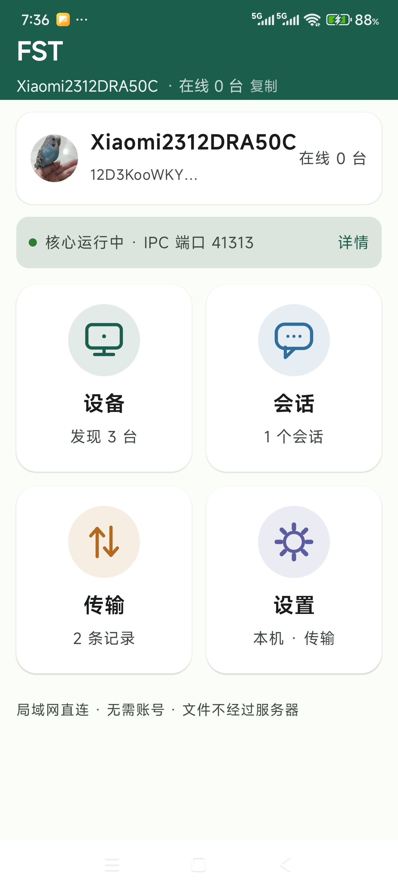
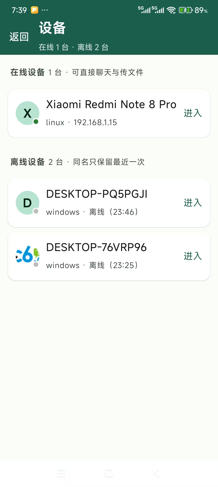
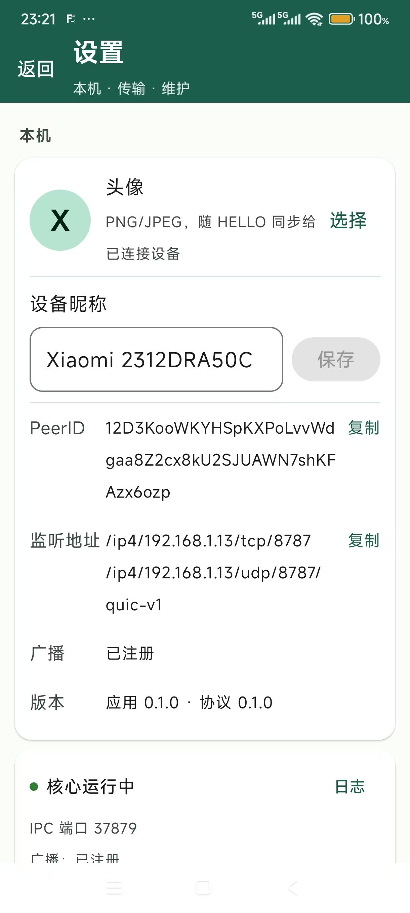
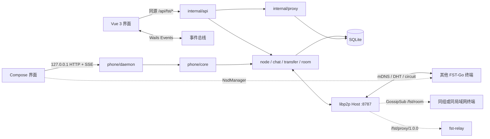

[English](README.md) | **简体中文** | [日本語](README_ja.md)

# FST-Go

**File Safe Transfer** — 文件安全传输。

用 Go 实现的局域网 / 跨网络 P2P 应用：点对点传文件、聊天，以及可选的自建出网代理。无账号、无中心业务服务器。每台设备既是客户端也是完整节点；局域网自动发现，跨网段只需要你自己的一台中继。

当前发布形态（v1.2.0）：**Windows 桌面端**（`fst.exe`）+ **Android 客户端**（APK）+ **Linux 无头中继**（`fst-relay`）+ **Linux 服务模式包**（`fst` deb，浏览器界面）。本仓库以 [MIT License](LICENSE) 发布。


### 本程序仅供学习参考之用，请勿用于非法用途，希望对你有帮助，但作者本人不提供任何担保。

| 名称 | 含义 |
|---|---|
| **FST** | **F**ile **S**afe **T**ransfer，文件安全传输 |
| **Go** | 后端与节点用 Go 编写，也表示把文件「送出去」 |

仓库与命令行里仍使用短名 `fst`（例如 `fst.exe`、`fst-relay`、协议 ID `/fst/...`），与产品名 FST-Go 是同一项目。

[](LICENSE)
[](https://go.dev/)
[](https://vuejs.org/)
[](https://kotlinlang.org/)
[](https://libp2p.io/)

---

## 界面预览

| 桌面端（Windows） | 移动端（Android） |
| :---: | :---: |
|  |  |
| **设备页** —— 在线 / 中继 / 离线三段，每台设备一张卡片，带「信任」开关；文件可直接拖到卡片上发送 | **首页** —— 四个入口大图标带实时摘要，本机身份与核心状态一目了然 |

<details>
<summary><b>更多截图</b> —— 桌面端 4 张（聊天 / 传输 / 设置 / 浅色主题）、移动端 2 张（设备 / 设置）</summary>

<br>

| 桌面端 | 桌面端 |
| :---: | :---: |
|  |  |
| **聊天** —— 私聊 / 群聊分栏，图片与文件，富文本，已送达回执 | **传输** —— 按文件名 / 方向 / 状态筛选，断点续传与批量重试 |
|  |  |
| **设置** —— 昵称、头像、PeerID、监听地址、并发数、限速 | **浅色主题** —— 同一套界面，浅色配色 |

| 移动端 | 移动端 |
| :---: | :---: |
|  |  |
| **设备** —— 在线 / 离线分段，离线同名设备只保留最近一次 | **设置** —— 头像、昵称、PeerID、监听地址、核心日志 |

</details>

---

## 目录

- [它解决什么问题](#它解决什么问题)
- [功能](#功能)
- [特点](#特点)
- [架构](#架构)
- [模块](#模块)
- [协议](#协议)
- [开源组件](#开源组件)
- [运行环境](#运行环境)
- [安装与快速开始](#安装与快速开始)
- [编译桌面端](#编译桌面端)
- [编译移动端（Android）](#编译移动端android)
- [打包与分发](#打包与分发)
- [中继：编译、部署与设置](#中继编译部署与设置)
- [中继分组与出口鉴权](#中继分组与出口鉴权)
- [终端如何连上中继](#终端如何连上中继)
- [网络代理（可选）](#网络代理可选)
- [配置与数据目录](#配置与数据目录)
- [无界面服务模式（fst serve）](#无界面服务模式fst-serve)
- [局域网发现与排障](#局域网发现与排障)
- [本地开发与调试](#本地开发与调试)
- [现状与限制](#现状与限制)
- [许可证](#许可证)

---

## 它解决什么问题

常见网盘、即时通讯和商业 VPN 都把流量、文件和通讯录放在别人的服务器上。办公室、家庭局域网、或两台都在 NAT 后面的设备，往往只想：

1. **同一网段互相看见、发消息、传文件**，不要注册、不要公网账号。
2. **不在同一网段时**，用自己的一台 VPS 当「介绍人 / 转发人」，而不是把文件存到云盘。
3. 需要时，让本机部分或全部上网流量 **经自己的中继出网**（类似自建出口），而不是再装一套无关的代理栈。

FST-Go 把这三件事放进同一个进程、同一个业务端口：设备身份是 libp2p PeerID，发现、聊天、文件和代理都在加密连接上多路复用。文件走端到端加密信道、整文件 SHA-256 校验、断点续传，不经过第三方网盘。

桌面端、Android 端共用同一份 Go 核心（`internal/*`），因此协议不分叉：手机和电脑之间传文件、发消息、断点续传、离线队列的行为完全一致。

---

## 功能

| 能力 | 说明 |
|---|---|
| 设备发现 | 局域网 mDNS 自动上线（标准 `_fst._tcp` + 历史 `fst` 双注册）；跨网靠中继目录 + 私有 DHT，可用完整 multiaddr、PeerID+中继或仅 PeerID 添加 |
| 跨端互通 | Windows / Linux / Android 三端同一套协议与数据模型；手机与电脑、手机与手机都能直接互连（局域网内不需要任何中转） |
| 点对点聊天 | 加密信道、本地存档、送达 ACK、未读、富文本（单条 ≤32000 字符）；文本 / 图片 / 文件卡片三种气泡；2 分钟内可撤回；头像随 HELLO 同步 |
| 离线消息 | 对端离线/超时先转「待发送」，每 15 秒扫描并按指数退避自动重投（上限 10 分钟、20 次），上线立即冲刷；气泡可手动重试 |
| 群聊 | 基于 GossipSub 自动房间：同一局域网一个房间，配置中继分组密钥后再加同组房间；仅文本、本机历史、按消息 ID 去重；复用 8787，不新开端口 |
| 文件传输 | 多选 / 拖到设备卡片、确认弹窗、信任或自动接收、并发 1–8、`.fstpart` 断点续传、整文件 SHA-256、全局限速、发送前预哈希跳过、失败后继续整批 |
| 文件夹传输 | 递归发送目录、保留相对结构与空目录；单批 ≤1000 文件，超过自动拆批；符号链接/特殊文件发送前提示 |
| 跨网络 | AutoNAT、DCUtR 打洞、Circuit Relay；打洞成功后丢掉中继冗余连接，升级直连 |
| 自建中继 | `fst-relay`：电路中继 + 在线目录 + DHT Server；支持分组隔离、组表过期、每组软上限 |
| 出口鉴权 | `-exit-allow` PeerID 白名单、`-exit-token` 多令牌+过期、`-exit-group` 分组限制，三者取交集；全部未配置时保持旧行为 |
| 出网代理 | TUN 分流（CIDR / 域名）或全局；IPv4 TCP+UDP，可选实验性 IPv6；本机 SOCKS5 入站（默认 `127.0.0.1:20300`） |
| SOCKS5 加固 | 可选 RFC1929 账号、来源 CIDR 白名单、单 IP/全局并发上限；未配置账号时仍是仅回环免认证 |
| 移动端 | 首页四宫格（设备 / 会话 / 传输 / 设置）、前台服务常驻、系统 DNS-SD 发现、SAF 选文件、MediaStore 导出、与桌面端共享设置项 |
| 桌面集成 | 托盘、关闭行为（询问 / 托盘 / 退出）、系统通知、开机自启、单实例或多实例 |
| 工程地基 | `user_version` 版本化迁移（当前 v7）、离线图标、桌面四个业务页 zh/en 词条、可复现的打包脚本 |

---

## 特点

- **身份是 PeerID，不是 IP / MAC。** 私钥在 `%APPDATA%\FST\identity.key`，昵称和地址可变，设备主键不变。
- **业务单端口 8787**（TCP + QUIC/UDP 同号）。聊天、文件、代理都走 libp2p stream，不为业务再开公网端口；唯一例外是本机 SOCKS5 入站（默认 `127.0.0.1:20300`，仅回环）。
- **文件字节不进前端。** Vue 只拿到本地路径；读写、哈希、进度都在 Go 里，进度事件节流推送；聊天图片/文件卡片只传 transfer ID。
- **一份核心，三端复用。** Android 端不是另写一套协议：`phone/core` 直接引用 `internal/node|chat|transfer`，跨语言只传 JSON 与基础类型。
- **无中心业务库。** 聊天和传输历史只存在本机 SQLite，节点之间不同步消息；schema 升级由 `user_version` 迁移完成。
- **加密不自研。** 应用层消息走 libp2p 安全通道（TCP 上 Noise/TLS，QUIC 自带）。
- **出口 fail-closed。** 中继开 `-exit` 但白名单为空时，谁也不能拿这台机器当代理；令牌只比较摘要，日志不打印明文。
- **中继可完全自建。** 项目不内置公共中继；你填谁的地址，流量才经过谁。
- **高风险能力默认关闭。** 代理 IPv6、SOCKS5 局域网来源、出口令牌未配置时，行为与旧版一致。

---

## 架构



桌面端启动后：打开数据目录 → 迁移 SQLite → 加载或生成身份 → 建 libp2p Host → 挂聊天、传输与群聊房间 → 按配置可选启动 SOCKS5/TUN → Wails 窗口把 `front/dist` 嵌进去，`/api/*` 由 Go 处理。

移动端启动后：前台服务拉起 `libfstcored.so` 子进程（本机回环 HTTP + SSE）→ Kotlin 侧注入本机 IPv4 与 DNS-SD 发现结果 → Compose 界面通过 HTTP 调用同一套 API。加密、分帧、传输全部发生在 Go 里。

---

## 模块

| 路径 | 职责 |
|---|---|
| `main.go` | 唯一入口：桌面窗口 / `fst serve` 子命令分发 |
| `internal/bootstrap` | 装配核心运行时（`Assemble`）、数据目录、单实例锁、`config.yaml`、日志轮转 |
| `internal/api` | `/api/fst/*`，`{code,message,data}` 信封，只读媒体端点 |
| `internal/node` | Host、地址播报（`AnnounceIP`）、mDNS 桥接、DHT、中继预约、HELLO/目录、在线状态、分组表、头像 |
| `internal/lanmdns` | mDNS 广播/浏览：`_fst._tcp` + `fst` 双注册，结果去重，`FST-<PeerID>` 实例名兜底解析 |
| `internal/chat` | 聊天收发、kind/attach、撤回、离线队列与指数退避、落库、ACK |
| `internal/room` | GossipSub 群聊：自动房间、topic 派生、LAN 直连校验、本机历史 |
| `internal/transfer` | 文件/文件夹 offer、自动分批、流式拷贝、续传、校验、限速、预哈希、进度 |
| `internal/store` | SQLite（WAL，纯 Go 驱动）、`user_version` 版本化迁移 |
| `internal/proto` | 协议 ID、JSON 分帧、消息结构 |
| `internal/proxy` | 出口 Client、TUN、路由绕行、fake-IP DNS、SOCKS5、出口令牌、IPv6 |
| `internal/serve` | `fst serve`：SSE + 令牌 Cookie 的 Web 外壳 |
| `internal/e2e` | 进程内多节点集成测试 |
| `cmd/fst-relay` | 无头中继/出口入口 |
| `cmd/mdnsview` `cmd/mdnssniff` `cmd/mdnsfake` `cmd/mdns6` | mDNS 抓包与伪造工具（仅 Windows），见「局域网发现与排障」 |
| `cmd/netdiag` `cmd/fstproxy` | 网卡组播诊断、TCP 转发的隔离绕过验证 |
| `phone/core` | 移动端 Go 门面：JSON 边界，暴露启动/停止、状态、会话、传输、设置 |
| `phone/daemon` | 把 core 暴露为本机回环 HTTP + SSE，编译为随 APK 分发的 `libfstcored.so` |
| `phone/android` | 原生 Android 外壳（Kotlin + Compose + 前台服务 + NsdManager + SAF） |
| `front/src/views/fst` | 设备 / 聊天 / 传输 / 设置 |
| `front/src/api/fst` + `types/api/fst.d.ts` | 唯一业务 HTTP 封装与类型契约 |
| `front/src/store/modules/fst.ts` | 唯一的 Wails 事件订阅点 |
| `scripts/build-exe.sh` `scripts/build-deb.sh` | 发布产物的构建入口 |

---

## 协议

应用层协议定义在 `internal/proto`。底层连接由 libp2p 负责（多地址、加密、多路复用）。

| 协议 ID | 用途 | 帧格式 |
|---|---|---|
| `/fst/msg/1.0.0` | 控制与聊天：HELLO、CHAT、CHAT_ACK、CHAT_RECALL、FILE_OFFER/ACCEPT/REJECT/CANCEL、ERROR | uvarint 长度 + JSON，单帧 ≤ 1 MiB |
| `/fst/file/1.0.0` | 单文件内容 | JSON `FileHeader` → 裸字节 `[offset,size)` → 32 字节 SHA-256 → JSON `FileResult` |
| `/fst/proxy/1.0.0` | 经中继出网 | JSON `ProxyReq/Resp`；TCP 之后双向拷贝；UDP 之后为 2 字节大端长度前缀数据报 |
| GossipSub `fst/room/1.0.0/<room>` | 群聊广播 | 签名 JSON `RoomMsg`；`lan` 为局域网房间，`g-<hash>` 为分组房间（哈希不泄露密钥） |
| mDNS `_fst._tcp` / `fst` | 局域网发现 | UDP 5353 多播；TXT 带 `dnsaddr=` 与 PeerID |
| 私有 Kademlia `/fst` | 按 PeerID 查地址 | 仅 peer routing，不上公共 DHT |

协议 ID 自 1.0.0 起未变，**v1.2.0 与旧版本仍可互通**；`internal/proto.Version`（当前 `1.2.0`）只用于展示与排障。

HELLO 里：普通节点带已连对端的局域网 multiaddr（peer exchange）；**只有中继**填写 `Directory`（在线终端 PeerID），终端只采信自己配置的中继发来的目录；`group` 只发给配置的中继，中继回包带 `group_name` / `group_expires` / `group_error`。头像只带 base64 小图（≤16KB base64），不传文件字节。

私聊状态含 `queued`（待发送）：离线或超时先入本机队列，自动退避重投；`chat:ack` 会推送状态变化，`POST /messages/{id}/retry` 可手动重试。群聊消息只通过 GossipSub 发送，不进入 `/fst/msg`；局域网房间只接受原始发送方为直连非 circuit 的邻居。

`FileInfo` 为 `{id,name,size,rel_path?,sha256?}`；`rel_path` 用于文件夹传输，接收端必须按不可信输入清洗。`ProxyReq` 为 `{net,addr,port,family?,token?}`，`family` 显式声明 `ip4`/`ip6`，出口不做双栈猜测。

UI 与 Go 之间 **不是** libp2p：同源 HTTP `/api/fst/*`（业务错误 HTTP 200 + `code: 400`）+ Wails 事件（桌面）/ SSE（`fst serve` 与移动端）。

---

## 开源组件

直接依赖（版本以 `go.mod` / `front/package.json` 为准）：

| 组件 | 用途 |
|---|---|
| [go-libp2p](https://github.com/libp2p/go-libp2p) v0.50 | PeerID、Noise/TLS、yamux、TCP+QUIC、AutoNATv2、DCUtR、Circuit Relay |
| [go-libp2p-kad-dht](https://github.com/libp2p/go-libp2p-kad-dht) v0.42 | 私有 DHT |
| [go-libp2p-pubsub](https://github.com/libp2p/go-libp2p-pubsub) v0.18 | GossipSub 群聊广播 |
| [zeroconf](https://github.com/libp2p/zeroconf) v2 + [miekg/dns](https://github.com/miekg/dns) | mDNS 广播/浏览、服务类型解析 |
| [Wails v3](https://wails.io/) `v3.0.0-beta.29` | 桌面壳、托盘、原生对话框、拖放、嵌入前端 |
| [tun2socks](https://github.com/xjasonlyu/tun2socks) v2.6 + [gVisor](https://gvisor.dev/) | TUN 用户态协议栈 |
| [golang.zx2c4.com/wireguard](https://git.zx2c4.com/wireguard-go) / [Wintun](https://www.wintun.net/) | Windows TUN 网卡（需官方签名 `wintun.dll`） |
| [modernc.org/sqlite](https://gitlab.com/cznic/sqlite) v1.60 | 纯 Go SQLite，运行时无 CGO |
| [yaml.v3](https://github.com/go.yaml/yaml) v3.0.5 | `config.yaml` |
| Kotlin 2.0.21 + Jetpack Compose（Material 3）、AGP 8.7.3 | Android 外壳与界面 |
| Vue 3.5、Vite 8、Element Plus 2.13、Tailwind CSS v4、Pinia、vue-router、axios、wangEditor、DOMPurify、Iconify | 桌面界面、构建与离线图标 |

第三方库保留各自许可证。本仓库源码以 MIT 覆盖。

---

## 运行环境

**桌面端**

- Windows 10/11 x64
- [WebView2](https://developer.microsoft.com/microsoft-edge/webview2/)（Win11 通常已带）
- 局域网：防火墙放行 **TCP/UDP 8787**、**UDP 5353**（mDNS）；关闭路由器 AP/客户端隔离
- 跨网络：再放行到中继的 8787，并在设置里打开「允许跨网络」
- TUN 代理：管理员权限 + exe 旁的 `wintun.dll`
- SOCKS5 入站：不需要管理员、不需要 `wintun.dll`；默认只监听回环
- Linux 桌面（Ubuntu 24.04 实测）：GTK4 + WebKitGTK 6.0 运行库；TUN 代理需 root / `CAP_NET_ADMIN` 与 `/dev/net/tun`

**Android**

- Android 8.0（API 26）及以上，**arm64-v8a**
- 需要「通知」「附近设备（Android 13+）」权限；前台服务常驻以保证后台收消息
- 与电脑互通需同一 Wi-Fi 且路由器未开 AP/客户端隔离

**服务模式（fst serve / deb）**

- 任何现代浏览器（桌面 / Android / iOS）；后端可与桌面端同机部署
- 默认只绑 `127.0.0.1:9797`；对局域网开放时放行所选端口的 **TCP**

**中继**

- 公网 IPv4 的 Linux（当前 deb 为 amd64）
- 安全组 / `ufw` 放行 **TCP 8787 与 UDP 8787**
- 出口模式还需允许中继向目标地址发起 TCP/UDP

---

## 安装与快速开始

从 [Releases](https://github.com/xuey490/Fst-go/releases) 下载对应平台的产物：

| 平台 | 文件 | 说明 |
|---|---|---|
| Windows x64 | `fst-1.2.0-windows-amd64.zip` | **推荐**：`fst.exe` + `wintun.dll`（TUN 代理需要后者） |
| Windows x64 | `fst-1.2.0-windows-amd64.exe` | 单文件，仅局域网功能可用，跨网 TUN 代理会因缺 `wintun.dll` 不可用 |
| Android arm64 | `fst-1.2.0-android-arm64.apk` | debug 签名，可直接安装；上架商店需自备 release keystore |
| Debian / Ubuntu amd64 | `fst_1.2.0-1_amd64.deb` | **服务模式**（`fst serve`，浏览器界面），见下方说明 |

### Windows

1. 解压 zip 到任意目录（不要放在 `%APPDATA%\FST`）。
2. 双击 `fst.exe`，首次启动会在 `%APPDATA%\FST\` 生成身份与数据库。
3. 局域网内另一台设备启动后，设备页会自动出现对方；点卡片即可聊天或发送文件。

### Android

1. 传输 APK 到手机，允许「安装未知应用」后安装。
2. 首次启动授权「通知」与「附近设备」；核心以本地库形式解压执行，App 会申请前台服务常驻。
3. 与电脑连同一 Wi-Fi，两端互相出现在设备页即可互通。手机之间的直连不需要电脑参与。

### Debian / Ubuntu（服务模式）

```bash
sudo dpkg -i fst_1.2.0-1_amd64.deb
fst serve                      # 终端会打印访问地址、访问令牌与数据目录
# 浏览器打开 http://127.0.0.1:9797 ，输入令牌即可使用完整界面
```

安装后也会在应用菜单生成「FST」入口（终端中启动服务模式）。对该版本需要说明的是：**deb 里装的是服务模式，不是 GTK 窗口版**。GTK4 + WebKitGTK 的窗口版必须用 CGO 在 Linux 主机上编译，仓库保留了对应配置（`build/linux/nfpm/nfpm.yaml`），在任意 Linux 主机执行 `nfpm package -f build/linux/nfpm/nfpm.yaml -p deb` 即可产出窗口版包。

### 首次互通自检

1. 两台设备在**同一网段**，路由器关闭「AP 隔离 / 客户端隔离」。
2. 双方防火墙放行 TCP/UDP 8787 与 UDP 5353。
3. 设备页互相可见 → 点卡片发一条消息验证；不可见时按「[局域网发现与排障](#局域网发现与排障)」逐层排查。

---

## 编译桌面端

需要：Go 1.26+、Node 22+、[pnpm](https://pnpm.io/)、[Wails v3 CLI](https://v3.wails.io/)（与 `go.mod` 中 Wails 版本一致）。

```powershell
go install github.com/wailsapp/wails/v3/cmd/wails3@v3.0.0-beta.29
$env:Path += ";$(go env GOPATH)\bin"

cd front
pnpm install
cd ..

# 覆盖 bin\fst.exe 前先结束正在运行的进程
Stop-Process -Name fst -ErrorAction SilentlyContinue
wails3 build
```

产物：`bin/fst.exe`，以及从 `build/windows/wintun/` 复制过去的 `bin/wintun.dll`。前端已经嵌进 exe，分发不必带 `front/`。

仓库另提供一条可复现的脚本（生成带图标与 manifest 的 `.syso`，并落到 `dist/`）：

```bash
scripts/build-exe.sh          # → bin/fst.exe、dist/fst-<版本>-windows-amd64.exe
```

服务模式再编译一个**控制台子系统**版本（从命令行运行时日志直出终端，推荐）：

```powershell
go build -o bin\fst-serve.exe .
```

### 运行

**桌面版 `fst.exe`**（GUI 子系统）：

1. 双击 `bin\fst.exe`，或在终端执行 `.\fst.exe`（不带参数即启动图形界面）。
2. 退出：托盘图标右键退出，或点窗口关闭按钮按提示选择。

**服务模式 `fst-serve.exe`**（控制台子系统）：

```powershell
cd bin
.\fst-serve.exe serve                      # 默认 http://127.0.0.1:9797，仅本机
.\fst-serve.exe serve -addr 0.0.0.0:9797   # 对局域网开放（需放行 TCP）
```

1. 启动后终端直接打印横幅：**访问地址 / 访问令牌（64 位 hex）/ 数据目录**，并实时滚动运行日志。
2. 浏览器打开访问地址，输入一次令牌即可使用与桌面版一致的完整界面（会话 Cookie 保存 30 天）。
3. 停止：在终端按 **Ctrl+C**（优雅退出）；后台进程可用 `Stop-Process -Name fst-serve`。
4. 令牌忘了：查数据目录 `fst.log` 搜 `token=`，或删掉 SQLite `settings` 表的 `web_token` 重启重新生成。
5. 注意：serve 与桌面版共用同一份数据目录与 8787 端口，**同一时间只能运行一个**；要并行请用 `FST_DATA_DIR` / `FST_PORT` 隔离（见下）。

> 用 `fst.exe serve` 也能启动服务（GUI 子系统，日志经控制台挂接显示），但命令行场景推荐 `fst-serve.exe`，行为最可控。

开发热重载（不写 `bin/`）：

```powershell
wails3 dev
```

同机开第二个实例（独立身份与端口）：

```powershell
$env:FST_DATA_DIR = "D:\fst-dev-2"
$env:FST_PORT = "8788"
```

### Linux 桌面（Ubuntu 24.04 LTS 实测可用）

桌面端依赖 GTK4 + WebKitGTK（C 库，必须开 CGO），**不能**用 `GOOS=linux` 直接交叉编译，需在 Linux 上构建：

```bash
# 系统依赖
sudo apt update
sudo apt install -y build-essential pkg-config curl git
sudo apt install -y build-essential pkg-config libgtk-4-dev libwebkitgtk-6.0-dev

# 工具链：Go 1.26+、Node 22+、pnpm（按各自官方文档安装）
go install github.com/wailsapp/wails/v3/cmd/wails3@latest
export PATH=$PATH:$(go env GOPATH)/bin

# 前端（也可以在 Windows 构建后把 front/dist 拷贝过来，embed 需要它存在）
cd front
pnpm install
pnpm build
cd ..

# 构建
wails3 build
```

产物：`bin/fst`。

服务模式（无界面、浏览器访问）可用同一份代码额外编译控制台版，或在装好依赖的机器上直接 `./bin/fst serve`：

```bash
go build -o bin/fst-serve .
./bin/fst-serve serve          # 默认 127.0.0.1:9797，浏览器打开即完整界面
```

> 与桌面构建一样需要 GTK 开发库；纯服务器可先在别处编译，再把二进制拷过去（systemd 示例见下方服务模式章节）。若只需要服务模式，用 `scripts/build-deb.sh` 可以完全跳过 GTK：

```bash
scripts/build-deb.sh           # CGO_ENABLED=0 + -tags server,production → dist/fst_<版本>-1_amd64.deb
```

- Ubuntu 22.04 没有 WebKitGTK 6.0，需改用 GTK3 栈：`sudo apt install -y libgtk-3-dev libwebkit2gtk-4.1-dev`，构建时加 `-tags gtk3`；Ubuntu 20.04 及以下不支持。
- glibc 兼容：在哪个版本上编译，产物只能运行在 ≥ 该版本的系统；目标机器含 22.04 时建议直接在 22.04 上构建。
- TUN 代理需要 root / `CAP_NET_ADMIN` 与 `/dev/net/tun`；SOCKS5 入站（`127.0.0.1:20300`）无需特权。
- 建议先在 X11 会话验证；Wayland 下 WebKitGTK 有已知兼容性问题。

---

## 编译移动端（Android）

移动端不需要 NDK / gomobile：Go 核心编译成**静态可执行文件**放进 `jniLibs`，由 App 以子进程方式执行，Kotlin 侧通过 `127.0.0.1` 回环 HTTP + SSE 调用。这样避开了 cgo 与 NDK 的链路问题，也让桌面端的 `internal/*` 可以原样复用。

需要：Go 1.26+、Android SDK 35、JDK 17/21、Gradle 8.9+（仓库验证使用 8.13）。

```bash
# 1) 编译 Go 核心（纯交叉编译，不需要 NDK）
phone/scripts/build-core.sh
# → phone/android/app/src/main/jniLibs/arm64-v8a/libfstcored.so

# 2) 编译 APK
phone/scripts/build-apk.sh            # debug，自动用 debug key 签名
phone/scripts/build-apk.sh release    # release，未配置 keystore 时仍用 debug 签名

# 3) 安装
adb install -r phone/android/app/build/outputs/apk/debug/app-debug.apk
```

产物约 22MB（其中核心 30MB，未压缩进 APK 后约 21MB）。

三个**平台级硬约束**（改动前必须读，`build-core.sh` 已内置自检）：

- **必须静态、非 PIE**：`-buildmode=pie` 会让 Go 写入 `PT_INTERP=/lib/ld-linux-aarch64.so.1`（glibc 路径），Android 上该路径不存在 → `execve` 返回 ENOENT → 进程静默不启动（App 能开、8787 无监听、mDNS 零报文）。
- **不要改用 `GOOS=android`**：它会启用 `wlynxg/anet` 的 Android 分支（`//go:linkname net.zoneCache`），Go 1.27 已移除该符号，链接失败且上游无修复。
- **回环 HTTP 必须配 `network_security_config`**：targetSdk ≥ 28 默认禁明文，API 37 之前回环也不豁免；漏配时 `/health` 恒失败，界面只显示「核心健康检查超时」。只对 `127.0.0.1/localhost/::1` 放行，不要全量开 `usesCleartextTraffic`。

移动端的架构、发现机制与 Android 平台适配细节见 [phone/README.md](phone/README.md)。

---

## 打包与分发

把 FST-Go 拷到另一台 Windows，**只需要 `bin/fst.exe`**（若要用 TUN 代理，再带上同目录的 `wintun.dll`）。不要拷 `%APPDATA%\FST\`：那里的 `identity.key` 是设备身份，两台机器共用会 PeerID 冲突。

可选安装包（需本机安装 [NSIS](https://nsis.sourceforge.io/)）：

```powershell
wails3 package
```

会把 WebView2 引导程序打进安装包。没有 NSIS 时，直接分发 exe 即可。

三端产物一次性生成（输出统一落在 `dist/`，已被 `.gitignore` 忽略）：

```bash
scripts/build-exe.sh      # Windows exe（+ bin/wintun.dll）
scripts/build-deb.sh      # Linux 服务模式 deb（需要 nfpm）
phone/scripts/build-core.sh && phone/scripts/build-apk.sh   # Android APK
```

`scripts/build-deb.sh` 依赖 [nfpm](https://nfpm.goreleaser.com/)：

```bash
go install github.com/goreleaser/nfpm/v2/cmd/nfpm@latest
```

诊断工具按需单独编译（仅 Windows）：

```powershell
go build -o bin\mdnsview.exe .\cmd\mdnsview
go build -o bin\netdiag.exe  .\cmd\netdiag
```

---

## 中继：编译、部署与设置

中继 **没有界面、不做 mDNS**。它做三件事：Circuit Relay（NAT 后的两台终端互相转发）、私有 DHT、把连上它的 FST-Go 终端 PeerID 写进 HELLO 目录。加上 `-exit` 后，还可以当出网出口。

### 在 Windows 上交叉编译并打 deb

```powershell
$env:GOOS = "linux"
$env:GOARCH = "amd64"
$env:CGO_ENABLED = "0"
go build -trimpath -ldflags "-s -w" -o bin/fst-relay-linux-amd64 ./cmd/fst-relay
Remove-Item Env:GOOS, Env:GOARCH, Env:CGO_ENABLED

$env:Path += ";$(go env GOPATH)\bin"
wails3 tool package -name fst-relay -format deb -config ./build/relay/nfpm.yaml -out ./bin
```

得到例如 `bin/fst-relay_0.1.4_amd64.deb`。

### 在 Linux 上安装

```bash
sudo ufw allow 8787/tcp
sudo ufw allow 8787/udp
sudo dpkg -i fst-relay_0.1.4_amd64.deb
sudo systemctl status fst-relay
journalctl -u fst-relay -e
```

deb 会把二进制装到 `/usr/bin/fst-relay`，单元文件到 `/lib/systemd/system/fst-relay.service`，postinstall 会 `enable --now`。数据目录默认 `/var/lib/fst-relay`（`identity.key` 决定 PeerID，换目录等于换身份）。

启动日志会打印应填进客户端的地址：

```text
/ip4/<服务器公网IP>/tcp/8787/p2p/<PeerID>
```

### 命令行参数

| 参数 | 默认 | 含义 |
|---|---|---|
| `-data` | `/var/lib/fst-relay` | 数据目录（身份与库） |
| `-port` | `8787` | TCP + UDP(QUIC) 监听端口 |
| `-name` | `fst-relay` | 终端设备列表里显示的名字 |
| `-group` | 空 | 单组密钥：只把出示同一密钥的终端互相介绍 |
| `-group-file` | 空 | 组表文件，每行 `name:key[:expiry]`；与 `-group` 互斥；修改后 10 秒内热加载，无需重启中继 |
| `-group-max-terminals` | `0` | 每组在线终端软上限；超限只停发目录/到达通知，不踢连接 |
| `-exit` | 关 | 开启出网出口（还需 `-exit-allow` 列出终端，否则没人能用） |
| `-exit-allow` | 空 | 文件：每行一个终端 PeerID；空文件或省略 = 拒绝所有人（fail-closed） |
| `-exit-token` | 空 | 出口令牌文件，每行 `token[:expiry]`；expiry 支持 RFC3339 或 Unix 秒 |
| `-exit-group` | 空 | 只允许该组终端使用出口；同组可免令牌 |
| `-exit-group-slots` | `0` | 每组并发出口会话上限；0 表示只受全局 1024 限制 |

日志只打印生效组数/令牌数与 PeerID，不打印密钥或令牌明文。

改端口等参数用 systemd drop-in（重装 deb 不会冲掉）：

```bash
sudo systemctl edit fst-relay
```

只在编辑区写入：

```ini
[Service]
ExecStart=
ExecStart=/usr/bin/fst-relay -data /var/lib/fst-relay -port 8787 -group-file /etc/fst-relay/groups.txt -exit -exit-allow /etc/fst-relay/allow.txt -exit-token /etc/fst-relay/tokens.txt
```

```bash
sudo mkdir -p /etc/fst-relay
sudo chmod 700 /etc/fst-relay
# allow.txt：每行一个终端 PeerID（设置页可复制）
# groups.txt：每行 name:key[:expiry]，例如 office:change-me:2027-01-01T00:00:00Z
# tokens.txt：每行 token[:expiry]，客户端在设置页「出口令牌」填写同一个值
sudo systemctl restart fst-relay
```

没有出口需求时，保持默认 `ExecStart=/usr/bin/fst-relay -data /var/lib/fst-relay -port 8787` 即可，聊天和传文件仍然走电路中继。

---

## 中继分组与出口鉴权

**分组隔离**用于同一台中继上的多批终端：

- 终端在设置页或 `config.yaml: group` 填一个字符串密钥，只发给配置的中继。
- 中继用 `-group`（单组）或 `-group-file`（多组表）校验；只把同组终端互相介绍，异组零可见。
- 组表行 `name:key[:expiry]`，过期后中继不再下发目录与到达通知，并在 HELLO 回包带 `group_error`；设置页显示「分组已过期 / 密钥无效」。
- **组表热加载**：修改 `-group-file` 后中继在 10 秒内自动换表，无需重启；删除组、换钥或过期会立即撤销该组终端的目录/出口资格，并主动重发 HELLO。终端保存新的 `group` 后也会立即重连中继。
- `-group-max-terminals` 是软上限：超限只停发目录与到达通知，不断开连接。
- 未配置分组时行为与旧版完全一致。

**出口鉴权**三层取交集（校验顺序：白名单 → 分组 → 令牌）：

1. `-exit-allow`：PeerID 白名单；`fst-relay` 始终启用，空白名单即 fail-closed。
2. `-exit-group`：只允许指定组；同组免令牌。
3. `-exit-token`：终端在 `proxy.token` 携带；中继常量时间比较，支持多令牌与过期。

`-exit-group-slots` 限制每组并发；全局并发 1024。`-exit` 必须同时提供非空 `-exit-allow`，否则谁也用不了出口。

边界：分组是共享密钥模型，组表本身支持热加载与过期吊销，但没有在线轮换接口；终端改配置后立即重连中继。中继仍能看到加密流，端到端安全由 libp2p 保证。

---

## 终端如何连上中继

1. 设置 → **允许跨网络**，中继地址填一行 `/ip4/<公网IP>/tcp/8787/p2p/<PeerID>`，保存后 **重启 FST-Go**。
2. 两台终端都连上同一中继后，设备页会出现中继卡片；目录下发成功则对方也会出现在「在线设备」。
3. 若列表里暂时只有中继：用「添加设备」→ 仅 PeerID（DHT）或 PeerID+中继。
4. 聊天点卡片「聊天」；文件点「发送文件」或把文件拖到卡片上。卡片显示「中继」表示正在走服务器转发，「直连」表示已经打洞或本来就能直连。

`config.yaml` 与 exe 放在同一目录（开发时也可放在项目根）。设置页保存会改写该文件：**分组密钥保存后立即重连中继并生效**，其余跨网络与代理相关项仍需重启。

```yaml
enable_relay: true
relays:
  - /ip4/<PUBLIC_IP>/tcp/8787/p2p/<RELAY_PEER_ID>
group: ""                # 中继分组密钥；留空 = 不分组
proxy:
  enable: false
  mode: split            # split | global
  exit: /ip4/<PUBLIC_IP>/tcp/8787/p2p/<RELAY_PEER_ID>
  routes:
    - 93.184.216.0/24
  domains:
    - example.com
  token: ""              # 中继 -exit-token 的出口令牌
  ipv6: false            # 实验：TUN IPv6 栈 + fake AAAA
  socks_enable: true     # 本机 SOCKS5 入站（缺省开启）
  socks_user: ""
  socks_pass: ""
  socks_allow: []        # 来源 CIDR；非空时强制要求账号
  socks_max_conn: 0
  socks_max_per_ip: 0
```

---

## 网络代理（可选）

经 **同一条** `/fst/proxy/1.0.0` 流到 `fst-relay` 出网，不另开公网端口。代理需要先开启跨网络并配置中继作为出口。

- **分流 `split`**：只把列出的 CIDR 和/或域名（fake-IP `198.18.0.0/15`，DNS `198.18.0.2`）送进隧道；有域名规则时系统/公共 DNS 的 `/32` 也进 TUN，未命中域名经出口解析。
- **全局 `global`**：默认路由进 TUN；局域网、系统 DNS、常用公共 DNS、出口中继 IP 走原网关，避免把内网和解析一起送进隧道。
- **传输**：IPv4 TCP + UDP；`proxy.ipv6=true` 时增加 IPv6 出口（AAAA、IPv6 字面量、`tcp6`/`udp6`）与 TUN v6 栈，失败自动降级 IPv4。
- **出口安全**：拒绝环回、私网、链路本地、ULA、组播目标；白名单 + 令牌 + 分组任一配置即参与鉴权。
- **SOCKS5 入站**：`127.0.0.1:20300`（占用时回退随机端口），CONNECT + UDP ASSOCIATE，供浏览器 `socks5h://` 使用，不强制走 TUN。可选 RFC1929 账号、来源 CIDR、并发上限；配置了来源白名单但未设密码时拒绝启动加固版（回退回环免认证并记 Warn）。
- **TUN**：需要管理员 + `wintun.dll`；`proxy.ipv6=true` 时接口增加 `fdfe:1::1/64`，fake AAAA 使用 `fdfe:2::/64`。

Windows 上以管理员启动 `fst.exe`（只用 SOCKS5 时不需要）。中继必须 `-exit` 且通过白名单/令牌/分组校验，否则拨不出去。失败原因见设置页代理状态，以及 `%APPDATA%\FST\fst.log` / `journalctl -u fst-relay`。

验证：

```powershell
nslookup www.google.com 8.8.8.8          # 全局模式应返回 198.18.x.x（被劫持）
curl.exe -x socks5h://127.0.0.1:20300 -I --ssl-no-revoke https://www.google.com
curl.exe -s -o NUL -w "%{http_code}" --ssl-no-revoke https://www.qq.com   # 走 TUN
```

移动端**没有** TUN 与跨网络代理：Android 上不做 VPN 服务，代理相关设置项在手机端不出现。

---

## 配置与数据目录

| 位置 | 内容 |
|---|---|
| `%APPDATA%\FST\identity.key` | 设备身份，不要在同时在线的两台机器间共用 |
| `%APPDATA%\FST\fst.db` | 设备、聊天、传输、部分设置（WAL） |
| `%APPDATA%\FST\fst.log` | 日志（按大小轮转） |
| `config.yaml`（exe 旁或项目根） | 跨网络开关、中继列表、分组、代理与 SOCKS5 |
| 默认下载目录 | `%USERPROFILE%\Downloads\FST` |

Android 端的数据目录是应用私有目录（`/data/data/com.fst.phone/`）：核心库、SQLite、日志都在里面；收到的文件先落私有目录，点「保存到下载」经 MediaStore 导出到系统「下载/FST」。卸载应用会连同身份一起删除。

SQLite 使用 `PRAGMA user_version` 做版本化迁移（当前 **v7**）：v2 `transfers.rel_path`、v3 消息 `kind/recalled/attach`、v4 `peers.avatar`、v5 消息重试字段、v6 `rooms`/`room_messages`、v7 消息 `reply`。升级不需要手工改表。

整体搬家：退出 FST-Go 后拷贝整个 `%APPDATA%\FST\`。只是多装一台：只拷 exe，让它自己生成新身份。

环境变量：`FST_DATA_DIR`、`FST_PORT`（桌面/服务端）；`FST_LAN_IP`（移动端核心，由 Kotlin 注入本机 IPv4）。

---

## 无界面服务模式（fst serve）

同一份代码与数据，不带图形界面后台驻留，在 HTTP 端口提供与桌面版一致的完整界面——任何设备打开浏览器即可使用（Windows / Linux / macOS 桌面、手机、平板）。

```bash
fst serve                 # 默认监听 127.0.0.1:9797，仅本机可访问
fst serve -addr 0.0.0.0:9797   # 对局域网开放（日志会出现安全警告，请确保令牌足够强）
```

> Windows 构建产物有两个：`fst.exe`（GUI 子系统，双击启动桌面版，serve 时输出经控制台挂接显示）；`fst-serve.exe`（控制台子系统，`go build -o bin\fst-serve.exe .` 生成）——**从命令行跑服务推荐用它**：cmd 会一直等待进程，日志与横幅（访问地址、令牌、Ctrl+C 提示）直接显示在终端，按 Ctrl+C 优雅停止。

- **首次启动**会生成随机**访问令牌**并打印在日志里（也存于数据目录 `fst.db` 的 `settings.web_token`），浏览器打开访问地址后输入一次即可（会话 Cookie 保存 30 天）。
- 界面与桌面版完全相同：设备发现、聊天（图片/文件/撤回/离线队列）、群聊、传输历史、设置。
- **Web 端发文件**：点选或把文件拖到设备卡片上，浏览器直接 multipart 上传给后端，后续确认/进度与桌面一致；发文件夹请用桌面端。
- 实时消息与传输进度经 SSE 推送；节点、聊天、传输走同一套 P2P 协议与 8787 端口，serve 的 HTTP 端口只服务浏览器，默认不对外暴露。
- 退出：`Ctrl+C`（或 `kill`），节点会优雅关闭。

Linux 服务器上建议用 systemd 驻留（`/opt/FST/fst` 换成实际路径；用 deb 安装时路径是 `/usr/local/bin/fst`）：

```ini
# /etc/systemd/system/fst.service
[Unit]
Description=FST headless web service
After=network-online.target

[Service]
ExecStart=/opt/FST/fst serve -addr 0.0.0.0:9797
Restart=on-failure
User=fst

[Install]
WantedBy=multi-user.target
```

```bash
systemctl enable --now fst && journalctl -u fst -n 50   # 日志里找访问令牌
```

---

## 局域网发现与排障

发现层是三端互通的唯一门槛，也是历史上问题最集中的地方。当前实现要点：

- **双服务类型注册**：`_fst._tcp`（标准 DNS-SD，Android `NsdManager` 与 iOS `NWBrowser` 只认这种带下划线前缀的合法类型）+ `fst`（历史裸标签，仅兼容旧装机）。新版桌面端两者都播。
- **实例名带完整 PeerID**（`FST-<PeerID>`）：部分 ROM 的 `mdnsd` 在 resolve 时会丢掉 TXT，此时实例名是唯一还能拿到 PeerID 的地方；配合 SRV 端口与 A 记录可兜底拼出可拨号地址（桌面 `lanmdns.fallbackInfo`，手机 `Nsd.fallbackAddr`）。
- **手机主动重播**：部分 ROM 息屏后收不到组播查询，于是永远不应答。手机端每 3 分钟主动组播一次服务（不依赖收包能力）。
- **桌面代播**：新版桌面端发现手机后，代它在 `fst` 标签上补播一条记录（`lanmdns.Bridge`），让只认旧标签的装机也能看见手机。
- **地址改写**：Android 取不到网卡（`NETLINK_ROUTE` 被禁），libp2p 展开后只剩 `127.0.0.1`；手机把真实 IPv4 传给核心，`AddrsFactory` 改写广播地址，换 Wi-Fi 时热更新。桌面端不需要这个。
- **只绑真实局域网网卡**：多网卡机器（WSL / Hyper-V / APIPA）上 zeroconf 逐网卡 `SetMulticastInterface`，失败时报文可能从虚拟网卡出去，局域网里的手机永远收不到。

排障按下面顺序逐层定位（工具在 `cmd/` 下，仅 Windows 编译）：

| 步骤 | 命令 | 判断依据 |
|---|---|---|
| 1. 有没有报文 | `mdnsview` | 看到对方的 `_fst._tcp` 查询/应答；零报文说明组播没出去或被隔离 |
| 2. 报文对不对 | `mdnssniff` | 十六进制转储核对 TXT/SRV 字段（`dnsaddr=`、端口、实例名） |
| 3. 网卡行不行 | `netdiag` | 逐块网卡 setsockopt 探测，区分「无可路由 IPv4」「虚拟网卡」「策略禁组播」 |
| 4. 能不能解析 | `mdnsfake` | 伪造一条记录，验证客户端解析路径与兜底逻辑 |
| 5. 是不是隔离 | `fstproxy` | 用一台可达机器做 TCP 中转，能连上说明是 AP/客户端隔离而非协议问题 |

最常见的三个外部原因：Windows 防火墙拦了 UDP 5353、路由器开了「AP 隔离」、手机在省电模式下被系统冻结（已用前台服务缓解）。详细复盘见 [docs/局域网发现排查报告.md](docs/局域网发现排查报告.md)。

---

## 本地开发与调试

```bash
go build ./...                       # 全量编译
go test ./...                        # 单元测试（含 internal/e2e 多节点集成）
go vet ./...

cd front
npx vue-tsc --noEmit                 # 前端类型检查
```

代理测试全部 mock 拨号，不碰真实网卡；真实双栈 IPv6、NAT 打洞、Windows TUN 需真机手工回归。

**桌面端热重载**：`wails3 dev`（不写 `bin/`，自动重建前端）。

**同机跑多实例**（互不干扰的身份与端口）：

```powershell
$env:FST_DATA_DIR = "D:\fst-dev-1"; $env:FST_PORT = "8787"
.\bin\fst.exe
$env:FST_DATA_DIR = "D:\fst-dev-2"; $env:FST_PORT = "8788"
.\bin\fst.exe
```

两个实例在同一个局域网里会互相发现，可直接验证聊天、离线队列与传输。

**服务模式调试**（浏览器 + 可断点）：

```bash
go build -o bin/fst-serve . && ./bin/fst-serve serve -addr 127.0.0.1:9797
# 前端改动可只重建前端后重启 serve，无需重编 Go：
cd front && pnpm build
```

**移动端核心不装手机也能调**：`phone/daemon` 把同一份 core 包成本机回环 HTTP，脚本会在临时目录里拉起它并跑一轮接口冒烟：

```bash
go build -o /tmp/fstcored ./phone/daemon
phone/scripts/e2e-ipc.sh          # 起守护进程 → /health、/self、/settings 读写、头像与信任分支
```

手工调也可以，`FST_TOKEN` 是必需的鉴权头：

```bash
FST_DATA_DIR=/tmp/fstd FST_TOKEN=t0k FST_PORT=18787 /tmp/fstcored
curl -H "X-FST-Token: t0k" http://127.0.0.1:18787/settings
```

> 注意：本机若开着系统代理，`curl` 访问回环也可能被代理接管，加 `--noproxy '*'`。

**日志**：桌面/服务端在数据目录 `fst.log`（按大小轮转）；Android 在应用私有目录，设置页可展开查看核心日志。

协作约定见根目录 [AGENTS.md](AGENTS.md)；移动端细节见 [phone/README.md](phone/README.md)；移动端技术选型与分期计划见 [docs/移动端技术选型评估.md](docs/移动端技术选型评估.md)；发现层复盘见 [docs/局域网发现排查报告.md](docs/局域网发现排查报告.md)。

---

## 现状与限制

- **三端可用但不完全对等**：桌面端功能最全；Android 端**没有** TUN/跨网络代理、群聊、文件夹发送、多设备消息同步（这些是端口裁剪，不是缺陷）。macOS 未验证。
- **Linux 桌面窗口版需要 CGO**：仓库提供的 `fst_1.2.0-1_amd64.deb` 是**服务模式**（`fst serve` + 浏览器），GTK 窗口版需在 Linux 主机用 `build/linux/nfpm/nfpm.yaml` 自行打包。
- **移动端未做真机回归**：构建环境没有 Android 设备/模拟器，APK 只验证了「能编译、能签名、能被系统解包、核心能静态执行」，界面细节（尤其窄屏下的四宫格高度）需真机确认。
- **APK 为 debug 签名**：可直接安装，上架应用商店需自备 release keystore。
- 代理 IPv6 仍是实验能力，需真实双栈环境手工回归；IPv6 全局模式依赖系统默认 v6 路由做绕行；不支持代理链。
- SOCKS5 加固默认关闭：未配置账号时仍是仅回环免认证，任何本机进程可用；来源白名单与并发上限需手动开启。
- 中继分组是共享密钥，支持多组/过期/软上限与组表热加载，但没有在线轮换接口。
- 传输限速是全进程总量，不能按对端/方向单独设置；预哈希会多读一遍源文件。
- 群聊只支持文本，不支持图片/文件；历史只存本机，新成员看不到入群前消息，也没有群消息离线补投或成员管理。
- 离线消息最多自动重试 20 次（退避封顶 10 分钟），之后转失败，需手动重试；消息只在对方上线后投递，不做服务端暂存。
- 聊天撤回窗口固定 2 分钟，只能撤回自己发出的消息；桌面端头像原图 ≤12KB、移动端会本地压缩到 ≤12KB，均无服务端裁剪。
- 移动端发送文件会多一份临时副本（传输引擎需要可 seek 的本地路径，SAF 的 URI 不是路径）。

---

## ⚠️ 免责声明
本软件仅供学习与研究使用。请遵守当地法律法规。使用本软件所产生的任何后果由使用者自行承担。

---

## 许可证

Copyright (c) 2026 FST-Go contributors

本程序以 [MIT License](LICENSE) 发布：可自由使用、修改、分发与商业使用，只需保留版权声明与许可声明。本程序仅供学习参考之用，请勿用于非法用途，希望对你有帮助，但不提供任何担保。

依赖库仍按其原许可证使用。
